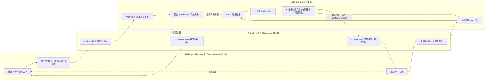
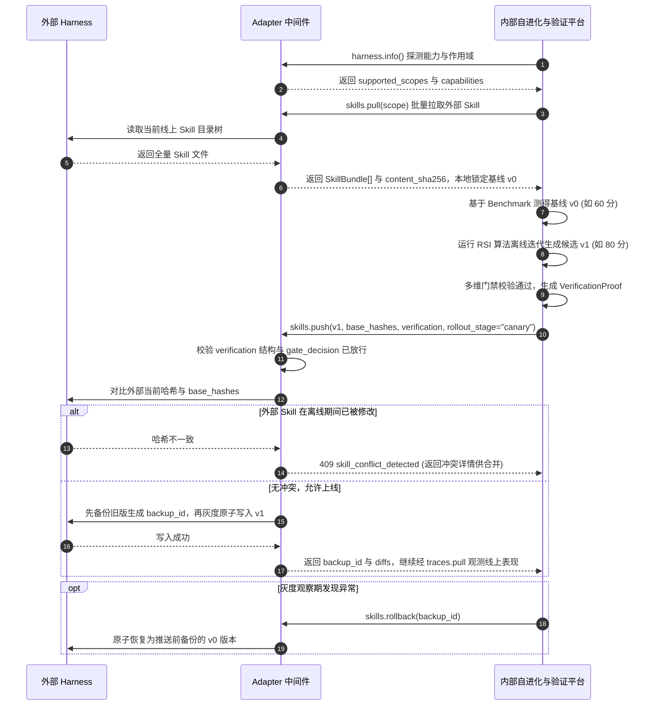
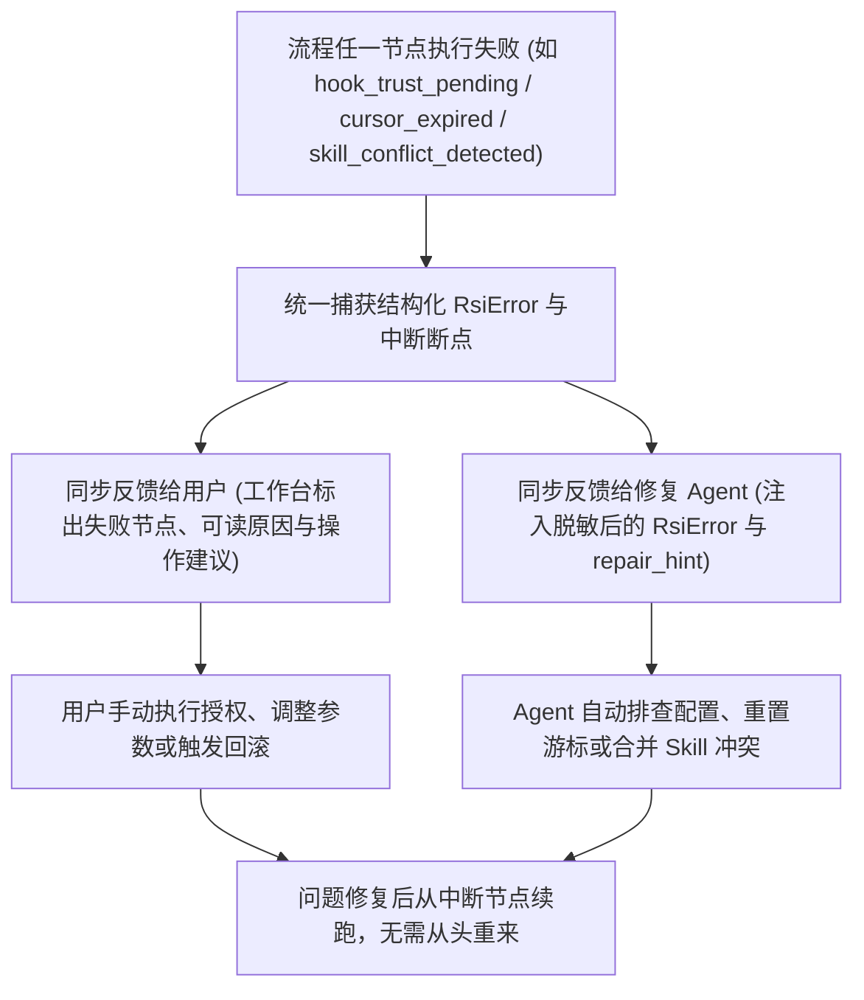

# RSI API 架构设计与统一协议规范

> **核心结论**：让 AI 自己修改自己的 Skill 并不难，难的是**验证它改完之后究竟更好了还是更差了**。RSI API（Recursive Self-Improvement API）将「日志沉淀 → 基准构建 → **离线优化** → 量化验证 → 安全回写」定义为一套跨 Agent Harness 的统一协议：采用**平台单向拉取、薄 Adapter 翻译、复用 AMSP 轨迹格式、将验证凭证写进推送契约**的设计原则，只有在客观指标证明新版本 `v1` 优于基线 `v0` 且无关键回归后，才允许推送回外部系统。

---

## 执行摘要（SCQA）

- **背景（Situation）**：现代 Agent 的表现高度依赖 Skill 等 Harness 层配置，让 AI 直接编辑自身 Skill 已无技术门槛。
- **冲突（Complication）**：**黑盒自改缺乏验证机制**。AI 改完 Skill 后，用户无法确认这次改动是真实变强、对个别样例过拟合，还是在修好一个问题时弄坏了其他高频场景，直改线上存在崩溃风险。
- **核心问题（Question）**：如何设计一套统一的协议规范与工作台架构，使不同外部 Agent Harness 都能低成本接入同一套可验证、可回滚的自进化体系？
- **整体方案（Answer）**：按四根支柱落地 RSI API：
  1. **可验证自进化闭环**：物理隔离外部运行区与内部进化区，先沉淀真实交互生成评估尺子，再离线优化并经多维门禁验收后灰度回写。
  2. **统一 RSI API 协议规范**：确立 `<domain>.<action>` 方法命名规则、REST 路由映射、六大标准数据模型与闭合错误码体系，并把 `verification` 作为推送的强制审计契约。
  3. **薄 Adapter 中间件层**：向上暴露统一 RSI API，向下屏蔽不同外部 Harness 的私有配置、日志格式与目录结构，使同一套 RSI 算法适配所有系统。
  4. **三步式可视化工作台**：收敛交互为递进式三步流程，用帕累托图与榜单呈现前后差异，并打通用户与 Agent 双端异常恢复闭环。

---

## 一、自进化全流程设计：从「黑盒盲改」到「可验证进化」

**本节结论**：要明确回答「改完到底好不好用」，必须先通过非阻塞采集把真实交互沉淀下来生成 Benchmark，再备份线上基线 `v0` 在离线环境中迭代出 `v1`，通过量化门禁后再灰度推回外部系统。

### 1.1 整体架构全景（顺时针 6 步闭环）

整张图按 **「左：外部运行 → 中：标准接口边界 → 右：内部离线加工与验证」** 划分，顺着编号 **1 → 6** 绕一圈即可看懂全流程：

- **视角对应关系**：全景 **6 步**（协议动作）直接映射到下文 **4 个工程阶段**与**工作台 3 步操作**——工作台第一步执行 ① 装 Hook + ② 拉日志；第二步提炼 Benchmark 尺子；第三步串联 ③ 拉 `v0` + ④ 离线优化 + ⑤ 对比验收 + ⑥ 推回 `v1`。
- **离线跑分环境**：`v0`（60 分）与 `v1`（80 分）默认在内部隔离镜像环境用 Benchmark 离线评测（快且可控）；若外部 Harness 声明支持可选 `eval.run` 能力，推送前还可驱动目标真机复核，并在验证凭证的 `eval_environment` 字段中如实留痕。



### 1.2 四阶段闭环职责


| 阶段                | 核心动作                                                                           | 解决的问题                               | 关键产出                       |
| :----------------- | :------------------------------------------------------------------------------ | :----------------------------------- | :-------------------------- |
| **1. 本地数据沉淀**     | 通过 Skill 配合提示词与 Adapter 在外部 Harness 安装 Hook，经 `traces.pull` 增量拉取全量交互日志到本地数据库   | 避免真实交互日志丢失，且外部运行期零阻塞、离线不丢数据         | 归一化本地交互轨迹库                 |
| **2. 生成量化基准集**    | 基于本地沉淀的原始交互数据，由 Agent 配合清洗、提炼并生成量化 Benchmark                                   | 解决「拿什么评判 Skill 好不好用」，确保评测贴合真实业务     | 冻结可复用的量化 Benchmark 基准集     |
| **3. Skill 离线优化** | 先通过 `skills.pull` 完整备份外部全量 Skill 为基线 `v0`，再基于 Benchmark 运行 RSI 算法迭代            | 隔离实验区与线上区，避免边跑边改污染外部可用环境            | 候选版本 Skill（`v1`）与多维实验指标    |
| **4. 灰度上线校验**     | 多维度对比 `v0` 与 `v1` 得分、耗时与分项回归，生成验证凭证 `VerificationProof` 后再经 `skills.push` 灰度回写 | **落地核心验证机制**：证明更好再上线，冲突自动拦截，异常可一键回滚 | 验证凭证、安全回写与回滚句柄 `backup_id` |


---

## 二、RSI API 统一协议规范（v1）

**本节结论**：参考现有消息协议（AMSP）的设计哲学，建立一套**单向调用、闭合词汇表、全量 `snake_case`、路径版本化、瘦 Adapter 校验**的统一协议，完整定义方法命名规则、核心数据模型与错误码体系。

### 2.1 协议设计原则与不变量

1. **单向主动调用模型**：统一由「RSI 平台 → Adapter」单向发起请求。Hook 仅在外部做轻量捕获或本地缓冲，平台通过 `traces.pull(cursor)` 主动增量拉取，避免反向 Webhook 带来的在线强耦合与双向鉴权复杂度。
2. **命名与版本规则**：
   - **抽象方法名**：统一采用 `<domain>.<action>`（全小写，与底层传输解耦，本地直调与远程 HTTP 语义一致）；
   - **HTTP 路由映射**：沿用 AMSP 家族的 REST 资源 + 动作后缀风格，版本固化在路径前缀 `/api/rsi/v1`（载荷内部不重复带版本号），路由区分大小写；
   - **字段与错误码**：所有载荷字段名与错误码统一 `snake_case`；时间统一 UTC ISO 8601 字符串（如 `2026-11-26T07:30:00.000Z`）；
   - **演进规则**：v1 生命周期内只做向后兼容的增量字段扩展，接收方必须忽略未知字段与未识别的能力位。
3. **四条协议不变量**：
   - **非阻塞采集不变量**：无论自进化平台是否在线，外部采集 Hook 绝不能阻塞外部 Harness 主流程或导致会话失败。
   - **先验证后回写不变量**：`skills.push` 必须携带合法的 `verification` 验证凭证与 `base_hashes` 冲突校验摘要；无放行结论或发生哈希冲突时，Adapter 必须拒绝静默覆盖。
   - **评测隔离防泄题不变量**：Benchmark 的私有评分细则严禁经由异常反馈或修复提示回流给优化 Agent 或修复 Agent。
   - **四态显式诊断不变量**：Hook 状态必须显式区分 `not_installed` / `pending_trust` / `active` / `broken`，严禁以单一布尔值掩盖授权待确认或配置损坏。

### 2.2 标准方法名与 HTTP 路由总表

协议由 **8 个核心标准方法**（覆盖能力探测、Hook 管理、轨迹拉取、Skill 拉取/推送/回滚）与 **1 个可选扩展方法**组成：


| 类别           | 标准方法名             | HTTP 映射（`/api/rsi/v1`）              | 幂等性            | 职责说明                                             |
| :------------ | :----------------- | :----------------------------------- | :-------------- | :------------------------------------------------ |
| **能力发现**     | `harness.info`    | `GET /api/rsi/v1/info`              | 幂等             | 返回外部 Harness 类型、支持作用域与能力声明                       |
| **Hook 管理**  | `hooks.install`   | `POST /api/rsi/v1/hooks`            | 按 `hook_id` 幂等 | 在外部 Harness 挂载轻量日志采集 Hook                        |
|              | `hooks.status`    | `GET /api/rsi/v1/hooks/status`      | 幂等             | 探测 Hook 四态健康度及待处理授权提示                            |
|              | `hooks.uninstall` | `DELETE /api/rsi/v1/hooks/:hook_id` | 幂等             | 卸载采集 Hook 并恢复受影响的外部配置                            |
| **数据拉取**     | `traces.pull`     | `POST /api/rsi/v1/traces/pull`      | 幂等             | 按游标增量拉取外部交互轨迹并归一化                                |
| **Skill 拉取** | `skills.pull`     | `POST /api/rsi/v1/skills/pull`      | 幂等             | 批量拉取外部全量或指定 Skill 包作为基线 `v0`                     |
| **Skill 推送** | `skills.push`     | `POST /api/rsi/v1/skills/push`      | 乐观锁受控          | 校验 `verification` 与 `base_hashes` 后备份并灰度写入 `v1`  |
| （可选）         | `skills.rollback` | `POST /api/rsi/v1/skills/rollback`  | 幂等             | 按推前备份句柄 `backup_id` 原子恢复旧版 `v0`                  |
| **外部评测（可选）** | `eval.run`        | `POST /api/rsi/v1/eval/run`         | 非幂等            | 当 `capabilities.eval_runner = true` 时启用，供上线前真机复核 |


> **鉴权约定**：远程 HTTP Adapter 统一通过 `Authorization: Bearer <token>` 鉴权；鉴权凭据由部署方/宿主独立管理，不得存放在 Agent 可写状态目录中。


> 要考虑信息不完全纰漏的情况要如何去；； 白盒、**灰盒**、黑盒

三种情况都可以讲一下，三种情况下的API设计

### 2.3 核心数据模型与字段定义

#### 1. 能力发现：`HarnessInfo`（`harness.info` 响应）


| 字段名                | 类型                            | 必填  | 说明                                                                                                                 |
| :------------------ | :----------------------------- | :--- | :------------------------------------------------------------------------------------------------------------------ |
| `protocol_version` | `"v1"`                        | 是   | 当前 Adapter 支持的 RSI API 协议主版本                                                                                       |
| `harness_type`     | `string`                      | 是   | 目标系统标识，如 `"codex"`、`"claude_code"`、`"cursor"`、`"penguin"`、`"custom"`                                               |
| `harness_version`  | `string`                      | 否   | 目标外部 Harness 的自身版本号                                                                                                |
| `supported_scopes` | `Array<"project" | "global">` | 是   | 支持的作用域集合                                                                                                           |
| `capabilities`     | `object`                      | 是   | 能力声明布尔位：`hook_install`、`incremental_cursor`、`skill_assets`、`instruction_artifacts`、`rollback_backup`、`eval_runner` |


#### 2. Hook 管理：`hooks.install` / `hooks.status` / `hooks.uninstall`

**`hooks.install` 请求字段**：


| 字段名         | 类型                                                                    | 必填   | 说明                                       |
| :----------- | :--------------------------------------------------------------------- | :---- | :---------------------------------------- |
| `hook_id`   | `string`                                                              | 否    | 稳定标识，重复传入同名 ID 时执行幂等更新；省略则由 Adapter 生成   |
| `scope`     | `"project" | "global"`                                                | 是    | 挂载作用域（单项目目录或用户全局配置）                      |
| `workspace` | `string`                                                              | 条件必填 | `scope = "project"` 时必填，标识目标项目路径或 ID     |
| `events`    | `Array<"session_end" | "task_end" | "post_tool_use" | "user_prompt">` | 是    | 标准化生命周期事件，由 Adapter 映射至外部私有 Hook 事件      |
| `delivery`  | `{ mode: "native_log" | "local_buffer", buffer_dir?: string }`        | 是    | 采集落盘模式：复用外部原生日志或写入独立本地缓冲目录               |
| `dry_run`   | `boolean`                                                             | 否    | 为 `true` 时仅返回将要修改的配置路径预览，不落盘（默认 `false`） |


`hooks.install` **/** `hooks.status` **响应字段**：


| 字段名                | 类型                                                        | 必填  | 说明                                               |
| :------------------ | :--------------------------------------------------------- | :--- | :------------------------------------------------ |
| `hook_id`          | `string`                                                  | 是   | Hook 唯一标识                                        |
| `status`           | `"not_installed" | "pending_trust" | "active" | "broken"` | 是   | 显式四态状态；例如外部系统要求人工确认 Hook 哈希信任时返回 `pending_trust` |
| `scope`            | `"project" | "global"`                                    | 是   | 实际生效作用域                                          |
| `installed_paths`  | `string[]`                                                | 是   | 实际写入或挂载的外部配置文件路径清单                               |
| `last_captured_at` | `string`                                                  | 否   | 最近一次捕获到交互日志的 UTC 时间戳                             |
| `pending_count`    | `number`                                                  | 否   | 缓冲中尚未被拉取的记录/会话估算数量                               |
| `action_required`  | `string`                                                  | 否   | 当状态非 `active` 时，给出面向用户与修复 Agent 的明确操作说明          |


`hooks.uninstall` **请求与响应**：

- 请求：路径参数 `hook_id` + 可选查询/请求字段 `purge_buffer?: boolean`（默认 `false`，避免误删尚未同步的缓冲日志）。
- 响应：`{ hook_id, uninstalled: boolean, restored_paths: string[] }`。

#### 3. 轨迹拉取：`traces.pull` 与 `TraceEnvelope`

`traces.pull` **请求字段**：


| 字段名               | 类型                             | 必填  | 说明                                |
| :----------------- | :------------------------------ | :--- | :--------------------------------- |
| `cursor`          | `string`                       | 否   | 上次成功拉取返回的增量游标；省略则从最早或 `since` 处开始 |
| `since`           | `string`                       | 否   | UTC ISO 8601 起始时间过滤               |
| `limit`           | `number`                       | 否   | 单批最大返回会话条数（默认 `50`，上限 `200`）      |
| `scope`           | `"project" | "global" | "all"` | 否   | 按作用域过滤（默认 `"all"`）                |
| `workspace`       | `string`                       | 否   | 按指定项目工作区过滤                        |
| `session_ids`     | `string[]`                     | 否   | 定向补拉指定外部会话 ID                     |
| `include_raw_ref` | `boolean`                      | 否   | 是否在每条轨迹中附带外部原始日志路径引用（默认 `false`）  |


`traces.pull` **响应字段**：

- `items: TraceEnvelope[]`、`next_cursor: string`、`has_more: boolean`、`dropped_lines?: number`（外部损坏行跳过计数，不阻断整批拉取）。

**单条 `TraceEnvelope` 核心字段**（外层轻信封 + 内层直接复用 AMSP `AmspRecord`）：


| 字段名                   | 类型             | 必填  | 说明                                                                                                                                 |
| :--------------------- | :-------------- | :--- | :---------------------------------------------------------------------------------------------------------------------------------- |
| `external_session_id` | `string`       | 是   | 外部系统原始会话 ID，与目标标识组合为全局幂等去重键                                                                                                        |
| `harness_type`        | `string`       | 是   | 来源 Harness 类型                                                                                                                      |
| `workspace`           | `string`       | 否   | 会话执行时的工作区路径或项目标识                                                                                                                   |
| `started_at`          | `string`       | 是   | 会话开始时间（UTC ISO 8601）                                                                                                               |
| `ended_at`            | `string`       | 否   | 会话结束时间（进行中或异常中断时可缺省）                                                                                                               |
| `active_skills`       | `string[]`     | 否   | 本次会话实际加载或触发的 Skill 名称列表，用于精准归因                                                                                                     |
| `records`             | `AmspRecord[]` | 是   | 归一化后的标准记录序列，直接复用 AMSP 闭合词汇表（`session_meta`、`model_msg`、`event_msg`）                                                                |
| `summary`             | `object`       | 否   | 供本地数据库快速建索引的轻量统计：`{ turns, tool_calls, tool_errors, duration_ms?, tokens?: { cache_read, cache_write, output, total }, aborted? }` |
| `raw_ref`             | `string`       | 否   | 外部原始日志文件引用路径，仅在 `include_raw_ref = true` 时返回                                                                                       |


#### 4. Skill 传输包：`SkillBundle`（`skills.pull` / `skills.push` / `skills.rollback`）

**`SkillBundle` 通用对象字段**（以完整目录包为单位传输，兼容多文件 Skill 与附属资源）：


| 字段名              | 类型                                                                          | 必填   | 说明                                                     |
| :---------------- | :--------------------------------------------------------------------------- | :---- | :------------------------------------------------------ |
| `name`           | `string`                                                                    | 是    | Skill 唯一名称（对应目录名）                                      |
| `kind`           | `"skill" | "instruction"`                                                   | 否    | 资产类型，默认 `"skill"`；预留 `"instruction"` 以便未来平滑纳管全局规则/指令文件 |
| `scope`          | `"project" | "global"`                                                      | 是    | 所在作用域                                                  |
| `workspace`      | `string`                                                                    | 条件必填 | `scope = "project"` 时必填                                |
| `description`    | `string`                                                                    | 否    | 摘要描述                                                   |
| `version`        | `string`                                                                    | 否    | 版本号标识                                                  |
| `content_sha256` | `string`                                                                    | 是    | 整包规范化内容摘要（按 `rel_path` 排序计算），用于基线锁定与冲突检测               |
| `files`          | `Array<{ rel_path: string, encoding: "utf8" | "base64", content: string }>` | 是    | 完整文件清单（含主定义文件与脚本、参考资料等附属文件），严禁出现越界相对路径                 |


**`skills.pull` 请求与响应**：

- 请求：`{ scope: "project" | "global" | "all", workspace?, names?: string[], include_kinds?: Array<"skill" | "instruction">, include_assets?: boolean }`（默认只拉 `"skill"` 且包含附属资源）。
- 响应：`{ pulled_at: string, snapshot_id: string, skills: SkillBundle[] }`。

**`skills.push` 请求字段**：


| 字段名                   | 类型                       | 必填   | 说明                                                |
| :--------------------- | :------------------------ | :---- | :------------------------------------------------- |
| `scope`               | `"project" | "global"`   | 是    | 目标回写作用域（灰度试点阶段优先写 `"project"`）                    |
| `workspace`           | `string`                 | 条件必填 | `scope = "project"` 时必填                           |
| `skills`              | `SkillBundle[]`          | 是    | 待推送的新版本 Skill 包列表                                 |
| `mode`                | `"merge" | "replace"`    | 否    | 默认 `"merge"`（仅更新请求中包含的 Skill，不误删外部其他 Skill）       |
| `base_hashes`         | `Record<string, string>` | 是    | 按 Skill 名称映射的拉取 `v0` 时 `content_sha256`，用于乐观锁冲突检测 |
| `verification`        | `VerificationProof`      | 是    | **强制审计凭证块**：证明新版本已通过量化验证（见下表）                     |
| `rollout_stage`       | `"canary" | "full"`      | 是    | 上线阶段标记（试点灰度或全量晋级）                                 |
| `backup_before_write` | `boolean`                | 否    | 写入前是否在外部侧生成备份句柄（默认 `true`）                        |
| `dry_run`             | `boolean`                | 否    | 为 `true` 时仅执行冲突检测与差异计算，不落盘（默认 `false`）            |


**`skills.push` 响应字段**：

- `backup_id?: string`（用于回滚）、`applied: string[]`、`skipped: string[]`、`conflicts: Array<{ name, expected_sha256, actual_sha256 }>`、`diffs: Array<{ name, added_files, modified_files, deleted_files }>`。

**`skills.rollback` 请求与响应**：

- 请求：`{ backup_id: string, names?: string[] }`（省略 `names` 时整批恢复至该备份）。
- 响应：`{ backup_id: string, restored: string[], restored_at: string }`。

#### 5. 验证证明块：`VerificationProof`（强契约 + 瘦 Adapter 校验）

Adapter 不负责重跑评测或计算帕累托前沿，但**必须在写入前校验该对象结构完整且 `gate_decision` 为放行态**，并记入本地/远端变更审计日志：


| 字段名                 | 类型                                                                            | 必填   | 说明                                                  |
| :------------------- | :----------------------------------------------------------------------------- | :---- | :--------------------------------------------------- |
| `benchmark_id`      | `string`                                                                      | 是    | 参与验收的量化 Benchmark 标识                                |
| `baseline_version`  | `string`                                                                      | 是    | 基线版本标识（如 `"v0"`）                                    |
| `candidate_version` | `string`                                                                      | 是    | 候选新版本标识（如 `"v1"`）                                   |
| `eval_environment`  | `"platform_mirror" | "target_harness"`                                        | 是    | 显式声明验证是在平台镜像环境还是目标 Harness 真机完成                     |
| `baseline_metrics`  | `{ score: number, duration_ms?: number, cost_usd?: number, tokens?: number }` | 是    | 基线版本量化指标                                            |
| `candidate_metrics` | `{ score: number, duration_ms?: number, cost_usd?: number, tokens?: number }` | 是    | 候选版本量化指标                                            |
| `delta`             | `{ score: number, duration_ms?: number, cost_usd?: number }`                  | 是    | 候选相对基线的指标变化量                                        |
| `pareto_improved`   | `boolean`                                                                     | 是    | 是否在帕累托前沿上优于基线                                       |
| `regressions_count` | `number`                                                                      | 是    | 关键分项出现退化的题目数量                                       |
| `gate_decision`     | `"approved" | "override_by_user"`                                             | 是    | 门禁结论；Adapter 仅在取这两个放行值之一时允许写入                       |
| `override_reason`   | `string`                                                                      | 条件必填 | 当 `gate_decision = "override_by_user"` 时必填，记录人工放行原因 |


#### 6. 统一错误信封与闭合错误码表：`RsiError`

所有接口失败统一返回与 AMSP 同源的错误信封，并附带面向工作台用户与修复 Agent 的结构化恢复线索：

```json
{
  "error": {
    "code": "skill_conflict_detected",
    "message": "Skill 'code-review' was modified externally after baseline v0 was pulled.",
    "phase": "push",
    "retryable": true,
    "repair_hint": "Pull the latest external skill, merge changes with v1, and push with updated base_hashes.",
    "details": {
      "skill_name": "code-review",
      "expected_sha256": "a1b2c3...",
      "actual_sha256": "d4e5f6..."
    }
  }
}
```


| 阶段（`phase`）   | 标准错误码（`code`）              | HTTP 状态 | `retryable` | 典型触发场景与恢复方向                                         |
| :------------- | :-------------------------- | :------- | :----------- | :--------------------------------------------------- |
| 通用            | `invalid_request`          | `400`   | `false`     | 缺少必填字段、路径越界或字段类型不合法                                 |
| 通用            | `unauthorized`             | `401`   | `false`     | 缺少或无效的 Bearer 凭据                                    |
| 通用            | `unsupported_capability`   | `501`   | `false`     | 调用了该 Adapter 未在 `capabilities` 中声明的能力（如 `eval.run`） |
| `hook`        | `hook_trust_pending`       | `409`   | `true`      | Hook 已写入配置但外部 Harness 要求人工信任确认（如执行 `/hooks`）        |
| `hook`        | `hook_config_corrupted`    | `500`   | `true`      | 外部配置文件语法损坏，无法安全解析挂载                                 |
| `hook`        | `hook_write_denied`        | `403`   | `false`     | 无权写入外部配置或受企业托管策略限制                                  |
| `hook`        | `hook_not_found`           | `404`   | `false`     | 卸载或查询不存在的 `hook_id`                                 |
| `pull_traces` | `cursor_expired`           | `410`   | `true`      | 同步游标已失效，应重置游标并按 `since` 重新增量拉取                      |
| `pull_traces` | `source_unreadable`        | `503`   | `true`      | 外部日志目录不可读或文件被临时占用                                   |
| `pull_traces` | `normalization_failed`     | `422`   | `true`      | 外部私有日志格式变更，无法映射为标准 `AmspRecord`                     |
| `pull_skills` | `skill_invalid_format`     | `422`   | `true`      | 外部 Skill 缺少必要元数据或包含非法路径/符号链接越界                      |
| `push`        | `verification_gate_failed` | `422`   | `false`     | 缺少合法 `verification` 凭证或 `gate_decision` 未放行         |
| `push`        | `skill_conflict_detected`  | `409`   | `true`      | 外部 Skill 在离线优化期间被手工修改，与 `base_hashes` 不一致           |
| `push`        | `target_write_denied`      | `403`   | `false`     | 目标 Skill 目录无写入权限                                    |
| `rollback`    | `backup_not_found`         | `404`   | `false`     | 指定的 `backup_id` 不存在或已过期清理                           |
| `rollback`    | `rollback_failed`          | `500`   | `true`      | 恢复旧版过程发生 I/O 异常，需人工核查目录状态                           |


#### 可选扩展接口：`eval.run`（高保真真机复核预留）

当外部 Harness 的 `capabilities.eval_runner = true` 时，平台可在离线搜索完成后、最终推送前调用该可选接口，直接驱动目标 Harness 无头运行高保真复核：

- **请求**：`{ case_id: string, prompt: string, workspace_files?: Array<{ rel_path, encoding, content }>, candidate_skills: SkillBundle[], timeout_s?: number }`
- **响应**：`{ status: "completed" | "failed" | "timeout", trace: TraceEnvelope, duration_ms: number, cost_usd?: number }`

### 2.4 多系统 Adapter 中间件与跨 Harness 适配要点

通过 **Adapter 中间件层** 将异构外部系统的私有实现翻译为上述统一协议：

- **向上统一**：对自进化引擎、Benchmark 构建与工作台只暴露标准 RSI API 语义；
- **向下适配**：内置主流本地外部 Harness 适配器（如 Codex、Claude Code、Cursor、OpenCode 等），同时提供通用远程 HTTP Adapter，任何第三方系统按规范实现 `/api/rsi/v1` 即可直接接入。

#### 多 Harness Hook 适配机制（轻采集核 + 双模式分流）

外部 Harness 的 Hook 分为「**Command 进程派**（JSON 配置调用任意外部命令，stdin 传 JSON）」与「**进程内 Plugin 派**（直接加载 JS/TS 模块）」两类，适配层统一遵循 **“薄挂载 + 唯一零依赖采集核 + 重解析移回平台”** 的策略：


| 典型 Harness      | 承载流派                         | 采集策略                                                    | 适配处理要点                                                                                |
| :--------------- | :---------------------------- | :------------------------------------------------------- | :------------------------------------------------------------------------------------- |
| **Codex CLI**   | Command 进程派（`hooks.json`）    | **指针模式**：低频挂 `Stop`，仅记录 `transcript_path`               | `stdout` 严格校验 Schema 必须静默；新装后需经 `hooks.status` 识别 `pending_trust` 引导 `/hooks` 授权      |
| **Claude Code** | Command 进程派（`settings.json`） | **指针模式**：低频挂 `Stop` / `SessionEnd` 记录 `transcript_path` | 禁止返回 `exit 2`（否则会强行阻断停止）；遇企业 `allowManagedHooksOnly` 时返回 `hook_write_denied`          |
| **Cursor**      | Command 进程派（`hooks.json`）    | **事件流模式**：无现成完整日志文件，逐事件追加本地缓冲                           | 兼容 Windows `stdin` UTF-8 BOM；由 `traces.pull` 按 `conversation_id` 离线拼装为 `AmspRecord[]` |
| **OpenCode**    | 进程内 JS/TS Plugin 派           | **事件流模式**：生成轻量 `.mjs` 插件监听事件直接写缓冲                       | 无子进程启动开销，与 Command 派共享同一本地缓冲格式                                                        |


三项落地约束：

1. **轻 Hook、重拉取**：Command 派统一指向同一个跨平台零依赖单文件 Node `.mjs` 采集核，仅做 `<10ms` 追加写缓冲，异常全部静默吞掉、空 `stdout`、固定 `exit 0`；格式转换与 Skill 归因全放在平台侧 `traces.pull` 完成，升级解析逻辑无需重装外部 Hook。
2. **双策略分流**：自带完整原生日志文件的 Harness 优先用低频指针模式（不挂高频工具钩子避免卡顿，且支持目录扫描补录）；其余系统走事件流缓冲离线拼装。
3. **非破坏性配置合并**：安装前自动备份原配置文件，按专属 `hook_id` 标记增量追加、卸载时精准摘除，绝不覆盖用户原有 Hook。

#### Skill 跨系统传输与校验流转



---

## 三、自进化工作台迭代计划：三步完成进化，效果可见、异常可修

**本节结论**：将复杂的数据沉淀、评测和协议调用收敛为递进式三步操作体验，用多维图表直观呈现 `v0` 与 `v1` 差异，并打通面向用户与 Agent 的双端异常恢复。

### 3.1 递进式三步式交互流程


| 步骤                | 用户操作                           | 背后调用的标准协议与闭环动作                                                                                                 |
| :----------------- | :------------------------------ | :-------------------------------------------------------------------------------------------------------------- |
| **第一步：接入与沉淀数据**   | 选择目标外部 Harness，点击安装 Hook 并同步日志 | 依次调用 `harness.info` → `hooks.install` / `hooks.status` → `traces.pull(cursor)`，将全量交互归一化入库                      |
| **第二步：生成量化基准集**   | 筛选高价值或失败轨迹样本，点击生成并确认 Benchmark | 由 Agent 配合脱敏、聚类并产出评测题与私有评分标准，冻结为后续验收尺子                                                                         |
| **第三步：离线优化与校验上线** | 点击运行优化，审阅榜单/帕累托图与 Diff 后确认推送   | `skills.pull` 备份 `v0` → 运行 RSI 迭代产出 `v1` → 生成 `VerificationProof` → `skills.push` 灰度上线（异常随时 `skills.rollback`） |


### 3.2 结果可视化展示

工作台通过三种互补视图把「改完究竟更好还是更差」直观呈现出来，避免单一平均分误导决策：

1. **性能榜单**：对比 `v0`、`v1` 与不同 RSI 算法的综合得分、波动范围、平均耗时与成本，明确展示相对基线的增量。
2. **帕累托图**：将「任务得分」与「耗时 / 成本 / Token」置于同一坐标系中，一眼识别处于前沿的最优候选，淘汰高成本低收益方案。
3. **分项对比与变更 Diff 视图**：逐题核对得分升降（迅速发现局部回归），并在触发 `skills.push` 前展示文件级 Skill 变更内容。

### 3.3 全流程双向异常反馈与恢复机制

依托协议层的统一 `RsiError`（`code`、`phase`、`retryable`、`repair_hint`、`details`），任何节点失败均不再沉没在日志中：



---

## 四、后续落地路线

**本节结论**：本规范已确立协议命名规则、核心模型与错误契约，后续按「规范评审冻结 → 协议底座与首批 Adapter 落地 → 工作台三步式升级」有序推进，过程中随时同步中间结果评审微调。

1. **阶段 0 · 协议规范评审定稿（当前）**：基于本文档的 8+1 标准方法、六大核心数据模型与错误码表完成最终确认，冻结 RSI API v1 契约。
2. **阶段 1 · 协议契约层与本地存储底座**：落地独立协议类型定义与客户端抽象，接通本地轨迹增量索引、基线版本快照与验证凭证持久化。
3. **阶段 2 · 首批外部 Harness Adapter 与三步 Skill 闭环**：优先打通首批标杆外部系统（如 Codex、Claude Code 及通用远程 HTTP Adapter），验证从 `hooks.install` → `traces.pull` → `skills.pull` → 离线 RSI → `skills.push` / `rollback` 的端到端链路。
4. **阶段 3 · 自进化工作台全面迭代**：上线递进式三步交互、帕累托图/榜单/逐题对比可视化，以及基于 `RsiError` 的用户与 Agent 双端断点恢复体验。


首轮选择一个具体任务，在开源的 Codex CLI 上跑通 Skill 优化闭环，并用同一套 Benchmark 对比优化前后的表现。