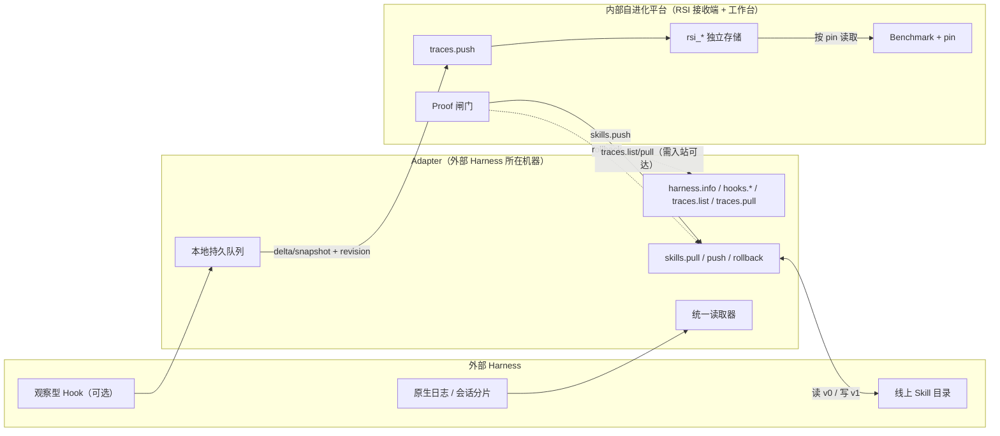
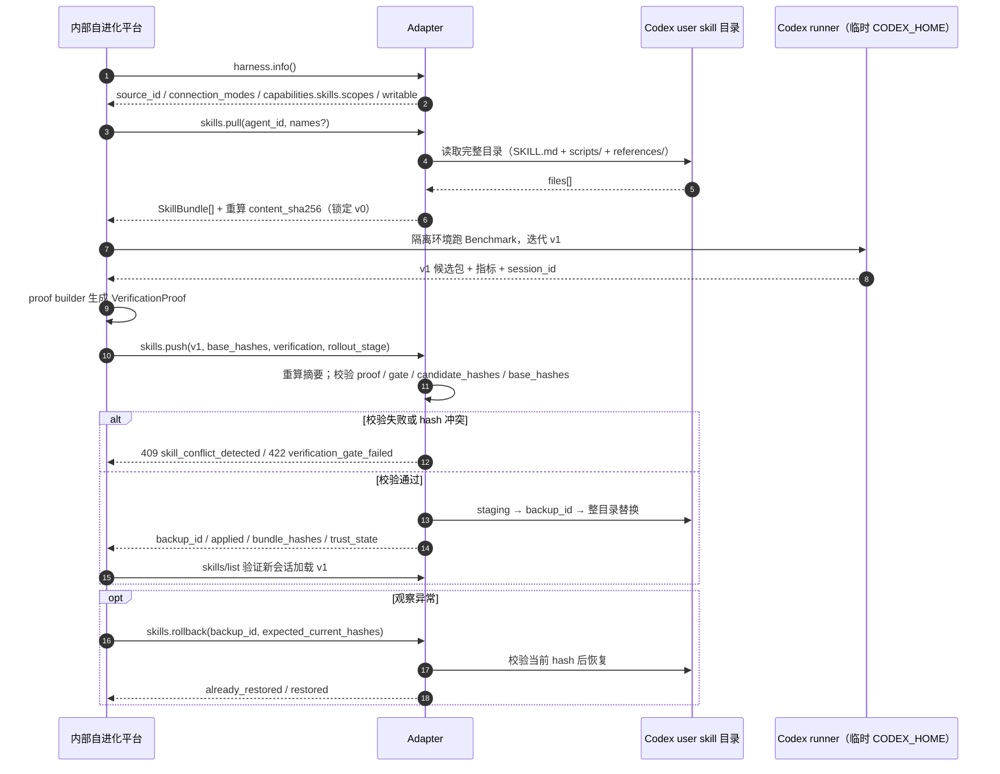
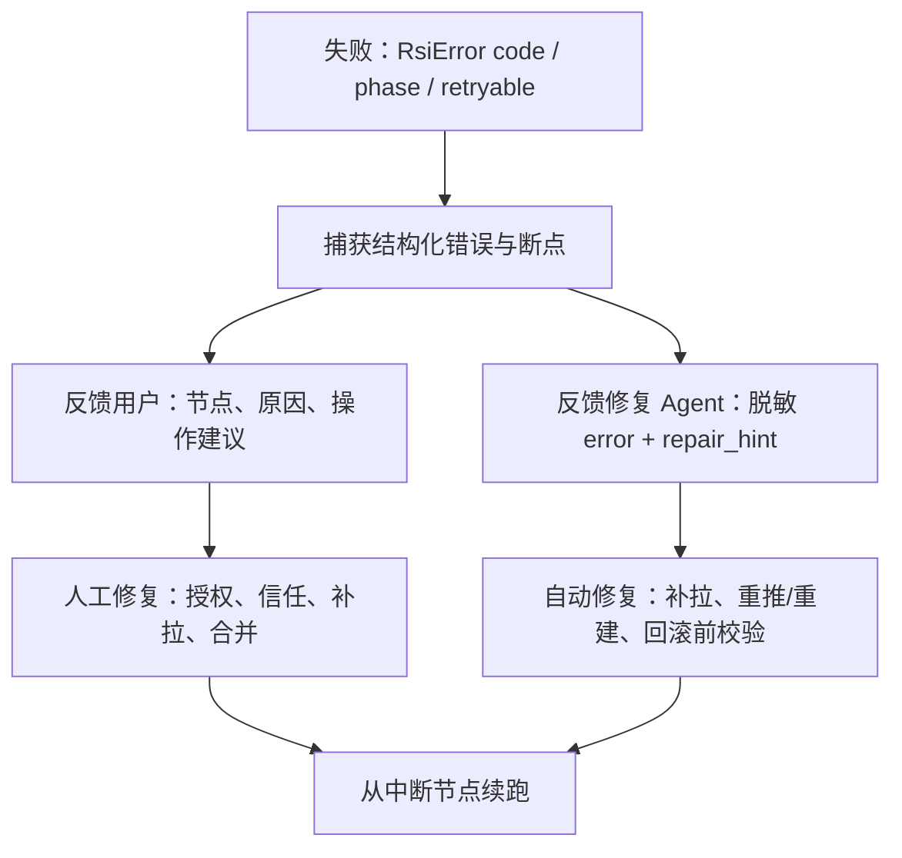

# RSI API 架构设计与统一协议规范（V2）

> **核心结论**：让 AI 修改自己的 Skill 并不难，难的是证明改完更好，并且在信息不完整时仍能诚实地说清「看到了什么、缺了什么」。RSI API V2 把「日志沉淀 → 基准构建 → 离线优化 → 量化验证 → 安全回写」定义为一套跨 Harness 协议：一个外部 session 对应一条逻辑 trace；历史按 ID 拉取、运行中增量推送，两条路径以 revision 仲裁重复、乱序与旧快照；每次读取都带可见性与缺口；Skill 以完整目录包传输，验证凭证绑定候选包摘要；只有验证凭证处于放行态且无 `base_hashes` / 摘要冲突时，才允许写回。

---

## 执行摘要（SCQA）

- **背景（Situation）**：Agent 表现依赖 Skill、Hook、指令文件等 Harness 配置；真实交互是构建评测尺子的原料。
- **冲突（Complication）**：黑盒自改缺少验证；来源又常常只能提供部分信息，权限、策略、能力与离线状态都会造成缺口。把「没看到」当「没有」，后续结论全部失真。
- **核心问题（Question）**：如何用统一协议，让不同 Harness 接入同一套可验证、可回滚、可解释缺口的自进化体系？
- **整体方案（Answer）**：按四根支柱落地；协议版本 v1，文档版本 V2。
  1. **可验证闭环**：外部运行区与内部进化区物理隔离；先沉淀真实交互生成尺子，再离线优化，经多维闸门灰度回写。
  2. **双路径采集**：`traces.pull(session_id)` 拉历史；运行中 Adapter 经 Hook 感知变化后 `traces.push`。两条路径共用同一读取器、记录格式与 revision 规则。
  3. **薄 Adapter**：向上统一 RSI API，向下翻译异构 Harness 的 Hook、日志与 Skill 目录；逐项声明能力与可见性，`unknown` 不得伪装成空。
  4. **三步工作台**：接入与采集 → 生成 Benchmark → 优化与上线；用可见性徽标、缺口面板、帕累托图、榜单与逐题 Diff 呈现证据。

---

## 一、自进化全流程设计：从「黑盒盲改」到「可验证进化」

**本节结论**：要回答「改完到底好不好用」，必须先通过双路径采集把真实交互沉淀成可复现的 Benchmark，再在离线环境迭代出 v1，经 Proof 闸门后灰度回写。

### 1.1 整体架构全景（顺时针 6 步闭环）
**结论**：采集是双路径——历史按 ID pull、运行中 push——两路汇入同一独立存储；平台只在 Adapter 入站可达时主动读取，写回必须经过 Proof 闸门。图分三层：外部 Harness → Adapter（来源机器上的薄翻译层）→ 内部自进化平台（含 RSI 接收端、存储、Benchmark、优化与 Proof 闸门）；RSI 接收端不是单独一层。

| # | 动作 | 协议 | 闭环阶段 | 工作台 |
|---|---|---|---|---|
| ① | 探测来源 | `harness.info` | 阶段 1 前置 | 接入与采集 |
| ② | 读历史 | `traces.list` + `traces.pull` | 阶段 1 | 接入与采集 |
| ③ | 运行中更新 | `hooks.*` + `traces.push` | 阶段 1 | 接入与采集 |
| ④ | 冻结 Benchmark | 平台内部，pin `(revision, content_sha256)` | 阶段 2 | 出题 |
| ⑤ | 离线优化 | `skills.pull` 拉 v0，平台内迭代 v1 | 阶段 3 | 评估 / 优化 |
| ⑥ | 验证与回写 | `VerificationProof` + `skills.push`/`skills.rollback` | 阶段 4 | 上线 |
“双路径”不是两条数据格式：两条路都产出 `SessionSnapshot`，区别只在哪一方发起、何时发生。`traces.pull` 是纯读，不写 RSI 存储；`traces.push` 才产生新 revision。
### 1.2 四阶段闭环职责
**结论**：四个阶段各自回答一个问题——看到了什么、用什么尺子、候选是否更好、能否安全上线。

| 阶段 | 核心动作 | 解决的问题 | 关键产出 |
|---|---|---|---|
| **1. 本地数据沉淀** | 已知 `session_id` 时 `traces.pull`；运行中 Hook 触发 `traces.push`；共用读取器与 revision 规则 | 在可重读或已落盘范围内沉淀真实交互；未采集/未送达/不可见显式记缺口 | 归一化会话库 + `visibility`/`gaps` |
| **2. 生成量化基准集** | 清洗、聚类、提炼 Benchmark；冻结 `(source_id, session_id, revision, content_sha256)` 与各域可见性并 pin | 评测尺子可复现；会话后续变化不影响已冻结版本 | Benchmark + 选题快照 |
| **3. Skill 离线优化** | `skills.pull` 拉完整目录包作为 v0；隔离环境基于 Benchmark 迭代 v1 | 隔离实验区与线上区，避免边跑边改污染外部环境 | 候选包 v1 + 多维指标 |
| **4. 灰度上线校验** | 对比 v0/v1、生成 `VerificationProof`；`skills.push` 校验后备份写入；异常 `skills.rollback` | 证明更好再上线；外部改动自动拦截；可回滚 | 验证凭证 + `backup_id` |
**trace 的用途**：解释任务是什么、Skill 如何进入上下文、哪一步产生什么可观察结果。单条 trace 不证明效果；效果必须靠同一 Benchmark 的 v0/v1 对照。Skill 归因只到来源能证明的层级（2.3.8.2）。
## 二、RSI API 统一协议规范（v1）

**本节结论**：协议以 `SessionSnapshot` 为唯一会话单位，用 revision + 两个摘要仲裁新旧，用 `visibility`/`gaps`/`sync` 描述证据边界，用 `VerificationProof` 约束写回。

### 2.1 协议设计原则与不变量
**结论**：协议只有一条主线——用版本化快照统一采集，用可见性/缺口描述证据边界，用 Proof 约束写回；其余规则都是这条主线的派生。

| ID | 不变量 | 内容 |
|---|---|---|
| I1 | 一个外部 session = 一条 trace | 协议单位是 `SessionSnapshot`；Adapter 按分片索引 + 行序拼接，保留每个分片的 `session_meta`。 |
| I2 | 两条采集路径汇入同一 session | pull 与 push 共用读取器、记录格式与 revision 规则，不能各拼一套历史。 |
| I3 | 非阻塞采集 | Hook 不阻塞 Harness 主流程、不改变 Agent 行为、不因 RSI 离线导致会话失败。 |
| I4 | Adapter 产生版本，RSI 按 revision 仲裁 | revision 对 `(source_id, session_id)` 单调分配并跨重启持久化；旧版本不覆盖新版本。 |
| I5 | 可见性与缺口显式 | `available` 的空结果是“检查过没有”；`partial` 必带 gap；`unavailable`/`unknown` 省略字段；`unknown` 不派生为 0。 |
| I6 | 先验证后回写 | `skills.push` 必须带 `verification` + `base_hashes`；无放行或冲突时拒绝静默覆盖。 |
| I7 | ack 只在事务提交后 | `accepted:"stored"` 只在 RSI 事务提交后返回；外围收到 ack 才清缓冲，重发按幂等键去重。 |
| I8 | 评测隔离防泄题 | 私有评分细则不得经异常反馈或修复提示回流给优化/修复 Agent。 |
| I9 | Hook 四态显式 | `not_installed`/`pending_trust`/`active`/`broken`；不得用布尔值掩盖待授权或配置损坏。 |
| I10 | 命名、版本、时间、演进 | 方法名 `<domain>.<action>`；前缀 `/api/rsi/v1`；字段与错误码 `snake_case`；UTC ISO 8601；v1 内只做向后兼容增量。 |
| I11 | 连接级凭据分权 | ingest token 只写本连接 trace；control token 按 scope 读 trace/skill，写操作需 `skills:write`/`hooks:manage`/`eval:run`。 |
| I12 | 每个 session 单一写者 | 同一 `(source_id, session_id)` 同时只允许一个 Adapter 分配 revision；`source_id` 必须固定。 |
- **非对称双向**：读历史由平台按 ID 发起，运行中更新由来源主动推送；两种方向各有凭据与失败恢复。
- **能力位是事实，盒级是摘要**：`capabilities` 逐项决定能否调用；`access_level` 只用于工作台预设与降级提示。
- **只描述可验证事实**：来源没提供的字段省略并记 gap；未持久化的流式片段不进快照；运行状态只有来源能证明时才写。

| 规则 | 硬约束（） | 落点 |
|---|---|---|
| P0-1 | 可见性按 revision 级处理：任何升级或降级都必须发完整 snapshot，按新可见集合过滤 `records` 并重算 `content_sha256`；只允许同可见性下的 gaps/status 元数据修正 | 2.3.3.7、2.3.8.1 |
| P0-2 | 拆 `SyncState`（RSI 侧）与 `DeliveryStatus`（Adapter 侧）；`pending_unit` 枚举 `revision`/`push_batch`/`turn`，默认 `push_batch` | 2.3.2、2.3.8.1、2.3.8.3 |
| P0-3 | 幂等键是 `(revision, content_sha256, metadata_sha256)`；`metadata_sha256` 覆盖固定字段集；派生字段不参与；重发按字节原样 | 2.3.3.1、2.3.3.3、2.3.3.6 |
| P0-4 | `traces.pull` 是纯读；pin 的旧 revision 只能经内部只读 `GET .../revisions/{revision}`（control token，不经 Adapter）或 Benchmark 直读 `rsi_revisions` | 2.3.3.4、2.3.3.8 |
| P0-5 | `payload` 级允许表：always-retained 与 domain-gated 分开；`content_sha256` 只覆盖有效集合（effective set） | 2.3.3.2、2.3.3.3 |
### 2.2 标准方法名与 HTTP 路由总表
**结论**：11 个方法（9 核心 + 2 可选）；`traces.push` 由 RSI 接收端提供，其余标准方法由 Adapter 提供。

| 类别 | 方法 | 提供方 | 发起方 | HTTP（`/api/rsi/v1`） | 幂等性 | 职责 |
|---|---|---|---|---|---|---|
| 能力发现 | `harness.info` | Adapter | RSI/工作台 | `GET /info` | 幂等 | 来源类型、`source_id`、版本、方向、`access_level`、能力、默认可见性 |
| Hook 管理 | `hooks.install` | Adapter | RSI/工作台 | `POST /hooks` | 按 `hook_id` | 安装运行中采集；只在需要推送时调用 |
| Hook 管理 | `hooks.status` | Adapter | RSI/工作台 | `GET /hooks/status` | 幂等 | 四态 + 信任状态 + 待发数量 + 最近捕获/送达 + `action_required` |
| Hook 管理 | `hooks.uninstall` | Adapter | RSI/工作台 | `DELETE /hooks/:hook_id` | 幂等 | 卸载；默认保留未送达缓冲 |
| 轨迹发现 | `traces.list` | Adapter | RSI/工作台 | `POST /traces/list` | 幂等 | 按来源活跃时间与页码发现会话摘要；默认含子会话 |
| 轨迹读取 | `traces.pull` | Adapter | RSI/工作台 | `POST /traces/pull` | 幂等 | `{session_id}` → 一个完整 `SessionSnapshot`，纯读 |
| 轨迹写入 | `traces.push` | **RSI 接收端** | Adapter | `POST /traces/push` | 按 revision + 两个摘要 | 推送 delta 或 snapshot；事务提交后 ack |
| Skill 拉取 | `skills.pull` | Adapter | RSI/工作台 | `POST /skills/pull` | 幂等 | 拉完整 Skill 目录包 |
| Skill 推送 | `skills.push` | Adapter | RSI/工作台 | `POST /skills/push` | 按 `request_id`（必填） | 校验 proof、基线 hash、候选摘要后备份写入 |
| 可选 | `skills.rollback` | Adapter | RSI/工作台 | `POST /skills/rollback` | 按 `backup_id`；已恢复返回 `already_restored` | 按推前备份恢复 |
| 可选 | `eval.run` | Adapter | RSI/工作台 | `POST /eval/run` | 非幂等 | 真机跑一个评测用例；返回 status/session_id/duration_ms/cost_usd，trace 走 pull |
| 方法组 | 凭据 |
|---|---|
| `harness.info`、`traces.list`、`traces.pull`、`skills.pull`、`hooks.status` | control token 读权限；`hooks.status` 另需 `hooks:read` |
| `traces.push` | ingest token，且请求体 `source_id` 必须与 token 绑定一致 |
| `skills.push`、`skills.rollback` | control token + `skills:write` |
| `eval.run` | control token + `eval:run` |
| `hooks.install`、`hooks.uninstall` | control token + `hooks:manage` |
缺少 scope 一律 `403 permission_denied`，且在写入前拒绝。服务器到服务器只用 Bearer + JSON，不接受 cookie，不开通配 CORS。未声明能力返回 `501 unsupported_capability`，同样在写入前拒绝。协议版本不是 `v1` 时返回 `400 protocol_version_unsupported`，不建立连接、不执行任何写入。工作台列出“RSI 已入库会话”直接查 RSI 存储，不走 `traces.list`。
### 2.3 核心数据模型与字段定义
**结论**：`SessionSnapshot` 是唯一的会话传输单位；身份是 `(source_id, session_id)`，版本是 `revision`，内容是可见 `records`，证据边界是 `visibility` + `gaps`，幂等身份是 `content_sha256` + `metadata_sha256`。

**术语**：session = 来源侧一个原生会话；trace = 该 session 在 RSI 中的逻辑轨迹（跨多个 revision）；`SessionSnapshot` = 某个 revision 的传输快照；`traces.*` 是方法域，不是数据结构。一个外部 session 始终只有一条逻辑 trace。
#### 2.3.1 能力发现：`HarnessInfo`
**结论**：`HarnessInfo` 是连接的事实来源；`capabilities` 逐项决定方法可用性，`access_level` 只是摘要。

| 字段 | 类型 | 必填 | 说明 |
|---|---|---|---|
| `protocol_version` | `"v1"` | 是 | 与路径 `/api/rsi/v1` 一致；不匹配返回 `protocol_version_unsupported` |
| `source_id` | `string` | 是 | Adapter 稳定标识：机器 + Harness home + profile；不得用 cwd，跨重启不变 |
| `harness_type` | `"codex" \| "claude_code" \| "opencode" \| "penguin" \| "custom"` | 是 | 闭合枚举；快照与 `traces.list` 复用 |
| `harness_version` | `string` | 否 | 外部 Harness 版本；与 Adapter 版本分开 |
| `connection_modes` | `Array<"push" \| "pull">` | 是 | 两项独立，可同时声明；仅出站时只有 `push` |
| `access_level` | `"white_box" \| "gray_box" \| "black_box"` | 是 | 接入层级摘要；事实以 `capabilities` 为准 |
| `capabilities` | `object` | 是 | 逐项能力位，见下 |
| `default_visibility` | `object` | 是 | 五域默认可见性；每次快照可更弱，不能更强 |
- `capabilities.traces`：`list`/`pull`/`push`/`source_replay`，以及五域默认可见性；`source_replay=false` 表示来源不可重读历史，强制 `delivery.mode="local_buffer"`。
- `capabilities.skills`（A3）：`pull`/`push`/`rollback`/`needs_manual_approval`，以及 `scopes`（`["user","repo"]` 等可读作用域）与 `writable`（首轮只含 `"user"`）；system/admin/plugin 作用域只读。
- `capabilities.hooks`：`install` 与标准化事件列表；`capabilities.eval`：`run`。
- push-only 的 `connection` 摘要（仅首次 push 或能力变化时给）至少含 `connection_modes`、`capabilities`、`default_visibility`；RSI 只存储与展示，不用它推断未声明的能力。
- 不设 `supported_scopes`：连接绑定 Project（可选 Workspace/Agent），scope 不逐次传；`traces.list` 的 `workspace` 仅作发现过滤。
#### 2.3.2 Hook 管理：`hooks.install` / `hooks.status` / `hooks.uninstall`
**结论**：Hook 只负责“会话变了”的触发与本地落盘，不承载协议版本；四态与信任状态必须同时可见。

`hooks.install` 请求：`hook_id`（可重试调用方必须提供，省略时按 `(connection, agent_id, events)` 生成确定性 id）、`agent_id`（连接未绑定 Agent 时必填）、`events[]`（`session_start`/`user_prompt`/`pre_tool_use`/`post_tool_use`/`stop`/`interrupt`/`pre_compact`/`post_compact`/`session_end`/`subagent_start`/`subagent_stop`）、`delivery {mode:"native_log"|"local_buffer", buffer_dir?}`、`dry_run`。install 前备份每个被修改配置并在响应返回备份路径；按 `hook_id` 增量追加，不覆盖用户原 Hook。

| `HookStatus` 字段 | 类型 | 说明 |
|---|---|---|
| `hook_id` | `string` | 省略 `hook_id` 调 status 时返回全部 `{hooks:[...]}` |
| `status` | `"not_installed" \| "pending_trust" \| "active" \| "broken"` | RSI 协议状态 |
| `trust_status` | `"managed" \| "untrusted" \| "trusted" \| "modified" \| "unknown"` | 映射来源 `hooks/list` 的 `trustStatus`；hash 变化回到 `pending_trust` |
| `current_hash` | `string` | 当前 Hook 定义摘要 |
| `trusted_hash` | `string?` | 最近一次被信任的摘要；与 `current_hash` 不同即未信任 |
| `is_managed` | `boolean` | 是否由企业策略托管 |
| `source_path` | `string` | Hook 定义文件路径，仅工作台展示 |
| `installed_paths` / `config_backup_paths` | `string[]` | 被修改的配置及备份 |
| `last_captured_at` / `last_delivered_at` | `string?` | 最近捕获/送达时间 |
| `delivery` | `DeliveryStatus` | Adapter 侧待发状态，见 2.3.8.1 |
| `action_required` | `string?` | 例如 `trust_hook`；工作台据此提示人工步骤 |
- `DeliveryStatus` 由 Adapter 填写（`source_revision`、`pending_count`、`pending_unit`、`oldest_pending_at?`、`last_delivered_at?`），不是 `SyncState`；二者不得混用。
- 观察型 Hook 必须空 stdout、`exit 0`，禁止 `decision:"block"`、`continue:false`、权限决定或注入上下文。
- `hooks.uninstall` 默认保留缓冲；`purge_buffer:true` 需 `hooks:manage` 且显式确认；卸载只精准摘除本 `hook_id`，不整文件覆盖。
- push-only 下 Hook 安装是来源机器的本地操作，不经协议；平台只展示其状态。
#### 2.3.3 会话快照：`SessionSnapshot` 与 `traces.*`
##### 2.3.3.1 `SessionSnapshot` / `SnapshotHeader` 字段
**结论**：`SessionSnapshot` 必有 `records` 与 `content_sha256`；`SnapshotHeader` 是同一元数据头去掉 `records`，只用于 delta 与同可见性元数据更新。

| 字段 | 类型 | 必填 | 说明 |
|---|---|---|---|
| `session_id` | `string` | 是 | 来源原生 opaque ID；同一 `source_id` 内唯一 |
| `source_id` | `string` | 是 | RSI 内部键为 `(source_id, session_id)` |
| `harness_type` | `HarnessType` | 是 | 闭合枚举 |
| `harness_version` | `string` | 否 | 来源版本 |
| `normalization` | `"native" \| "normalized" \| "unknown"` | 否 | 外部默认 `normalized`，Penguin `native` |
| `workspace` | `string` | 否 | 展示与发现过滤，不参与身份 |
| `parent_session_id` / `forked_from_id` / `child_sessions` | `string \| null` / `string` / `ChildRef[]` | 否 | 只列直接子；fork 独立成 trace；子会话不内联 |
| `started_at` / `started_at_source` | `string` / 枚举 | 是 | UTC；来源时间未知时不得把 `session_id` 解析值当权威 |
| `updated_at` | `string` | 是 | Adapter 最后一次持久写入时间 |
| `ended_at` | `string \| null` | 否 | 只在来源能证明结束时给 |
| `status` | `"running" \| "idle" \| "completed" \| "interrupted" \| "unknown"` | 是 | 未闭合 task 不能判 failed |
| `revision` | `integer >= 1` | 是 | 单调分配、跨重启持久化 |
| `content_sha256` | `string` | 是 | 有效可见记录摘要（2.3.3.3） |
| `metadata_sha256` | `string` | 是 | 固定元数据字段集摘要（2.3.3.3），幂等键的一半 |
| `records` | `AmspRecord[]` | 是 | 按来源顺序的可见记录；至少含结构记录 |
| `contexts` / `tasks` / `summary` | `ContextInfo[]` / `TaskSummary[]` / `object` | 否 | 派生字段，不参与 `metadata_sha256` |
| `active_skills` / `skill_evidence` | `string[]` / `SkillEvidence[]` | 否 | 三层证据投影，见 2.3.8.2 |
| `visibility` / `gaps` | `object` / `Gap[]` | 是 / 否 | 五域四态；`partial` 必带 gap |
| `sync` | `SyncState` | 否 | 只由 RSI 接收端填写 |
| `integrity` | `{dropped_lines,torn_tail}` | 否 | 非零/true 时记 `truncated` gap |
| `raw_path` | `string[]` | 否 | 仅 `include_raw_path` 且 `raw_log` 可见时给；RSI 永不打开 |
- **`SnapshotHeader`**：字段与 `SessionSnapshot` 相同，但**没有 `records`**；`content_sha256` 可省略，或等于合并后的完整摘要（delta）／已存摘要（同可见性元数据更新）。`SessionSnapshot` 的 `content_sha256` 不可省略。
- **初始态**：首次 push 时 `stored_revision=0`，`base_revision` 必须为 0 且必须是 snapshot；delta 必须有 `base_revision` 与已存版本。
- **delta 缺 `content_sha256`**：返回 `400 invalid_request`；不得让接收端猜测。
- **`ChildRef`**：`session_id`、`source_id?`、`relation`（`subagent`/`fork`/`unknown`）、`readable`、`reason?`、`spawned_at?`、`forked_from?`；不可读子保留引用，不生成占位 trace。
- **`ContextInfo`**：`shard_index`、`first_record`、`record_count`、`provider`/`model_id`、`model_context_window`、`opened_at`、`closed_by`（`compaction`/`model_switch`/`null`）。**`TaskSummary`**：`index`、`started_at`/`ended_at`、`status`（`completed`/`unfinished`/`unknown`）、`request_count`、`first_record`/`last_record`、`derived_from`。

| `NormalizedSessionMeta` 字段 | native（严格 AMSP） | normalized（外部来源） |
|---|---|---|
| `session_id` | 必填 | 必填 |
| `provider` / `model_id` | 必填 | 必填；未知时省略并记 gap |
| `model_context_window` | 必填，允许 `"unknown"` | 同左 |
| `system_prompt` | 必填字符串 | 可省略；省略记 `messages` gap，不明文补空串 |
| `agent_state` / `workspace` | 必填字符串 | 可省略；省略记 `raw_log` gap |
| `source` | 必填 `SessionSource` 枚举 | 必须映射到枚举；不得把未知值归成 `"user"` 冒充真人会话，无法映射时省略并记 gap |
- **派生校验**（接收端可机械验证的部分）：`active_skills == set(skill_evidence.name)`；`tasks`/`contexts` 的下标在 `records` 范围内；`child_sessions` 只含直接子；依赖域 `available` 时 `summary` 计数与 `records` 一致。不可从 records 推导的字段标 `derived`，不参与 `metadata_sha256`。
##### 2.3.3.2 身份、顺序与 payload 过滤
**结论**：记录没有稳定 ID，版本单位只能是 `(source_id, session_id, revision)`；不可见域的数据必须从 records 中过滤，而不是靠“字段存在但内容为空”表达。

- **身份**：`(source_id, session_id)`；`session_id` opaque，不能解析出时间/机器/类型；`source_id` 跨重启稳定。
- **分片拼接**：按分片索引升序 + 文件内行序，不以 `timestamp` 排序；每个分片 `session_meta` 保留，`contexts[]` 只做索引。
- **不进快照**：流式 `partial_*`、`origin` 展开的子会话记录、carry-over 占位、内存 live 输入、索引字段。
- **无记录 ID**：`AmspRecord` 只有 `timestamp`/`type`/`payload`/`origin`，不能逐条去重；禁止用 item ID、时间戳或文本做跨重连去重。
- **delta 前置**（A8）：只有能证明“已存记录是当前记录集前缀且 turn 身份可映射”才发 delta；任何 turn ID 变化、插入、revert、compact 一律发更高 revision 的 snapshot。

| 记录类别 | `records` | 过滤规则（P0-5） |
|---|---|---|
| always-retained | `session_meta`（脱敏）、`event_msg` 的 task/request/compaction/session_update/abort | 始终保留；`session_meta` 只保留 `session_id`/`provider`/`model_id`/`model_context_window`/`source` |
| messages | `model_msg`（text/thinking/inline_data）、`token_usage`、hook 事件 | 仅 `messages: available/partial` 时保留；否则删除并记 `messages` gap |
| tool_calls | `tool_call`、`tool_call_output`、`tool_list_ready`、`mcp_connect_*`、`approval_decision` | 仅 `tool_calls` 可见时保留；否则删除并记 `tool_calls` gap |
| subagents | `event_msg {type:"subagent"}` 指针 | 仅 `subagents` 可见时保留；否则删除并记 `subagents` gap |
| skill_usage | `system_prompt` 中的 Skill roster、`skill_evidence` | roster 仅 `skill_usage` 可见时保留，否则删除并记 `skill_usage` gap |
| raw_log | `raw_path`、`agent_state`/`workspace` 的绝对路径 | 仅 `raw_log` 可见时保留；否则省略路径或只留 basename，并记 `raw_log` gap |
- `system_prompt` 整体归 `messages`；只抽取 Skill roster 归 `skill_usage`。`approval_decision` 由审批事件合成；`tool_list_ready`/`mcp_connect_*` 由工具/MCP 事件合成，二者归 `tool_calls`。
- **脱敏**：`session_meta` 的 `agent_state`/`workspace` 在 `raw_log` 不可见时不得暴露绝对路径；`system_prompt` 在 `messages` 不可见时整段删除，不保留角色说明。`gaps` 只写域与原因，不写被删内容。
- **status**：`running`/`idle`/`completed`/`interrupted`/`unknown`；未闭合 task/request 只能推出“没到终点”，不能推 failed；会话级不设 `failed`。
- **父子**：父 trace 只写 `event_msg {type:"subagent", session_id}` 指针；子内容在子 trace；fork 子指针早于父起点的属于来源会话，需过滤。
##### 2.3.3.3 摘要算法
**结论**：两个摘要分工明确——`content_sha256` 覆盖有效可见记录，`metadata_sha256` 覆盖固定元数据；两者与 revision 共同构成幂等键。
```text
content_sha256  = hex(SHA-256("rsi-session-v1\0" || JCS(effective_records)))
metadata_sha256 = hex(SHA-256("rsi-metadata-v1\0" || JCS(metadata_subset)))
幂等键           = (revision, content_sha256, metadata_sha256)
```
- `metadata_subset` 固定为：`session_id`、`source_id`、`harness_type`、`harness_version`、`normalization`、`workspace`、`parent_session_id`、`forked_from_id`、`child_sessions`（按 `session_id` 排序）、`started_at`、`started_at_source`、`ended_at`、`status`、`visibility`、`gaps`（按 `domain`/`reason` 排序）、`raw_path`（保序）。缺省字段不补 null；`parent_session_id:null` 与缺省不同。
- **排除**：`revision`、`content_sha256`、`metadata_sha256`、`records`、`contexts`、`tasks`、`summary`、`integrity`、`active_skills`、`skill_evidence`、`sync`、`updated_at`。派生字段重算不会破坏 at-least-once 重发。
- `records` 按快照顺序，不排序、不去重；`JCS` 为 RFC 8785，UTF-8。`effective_records` 是被 visibility 过滤后的集合。
- **性能与上限**默认：每次 push 对有效集合 O(n) 重算，接受该成本；单会话 ≤50,000 条可见记录 / ≤64 MB，单次 push ≤16 MB；超限 `413 payload_too_large`；pull 支持 gzip；M1 前按真实会话校准。
- **冲突判定**：同 revision 且两个摘要都相同为 `duplicate`；任一不同为 `revision_conflict`。摘要不同也可能是合法的更高 revision，由 revision 先行裁决。
##### 2.3.3.4 `traces.pull`
**结论**：pull 是纯读：只按 `session_id` 读来源当前状态，不写 RSI 存储、不传分页/时间/workspace，也不改变任何 revision。

请求只有 `session_id` 与可选 `include_raw_path`（仅 `raw_log` 可见时返回路径）。响应是一个完整 `SessionSnapshot`。错误：`404 session_not_found`（不存在或不在授权范围，不泄露存在性）、`403 session_unreadable`（部署显式开启时）、`503 source_unavailable`、`422 normalization_failed`、`422 unsupported_data`、`409 not_synced_yet`。
```json
{
  "session_id": "01a2188a-62e8-73c0-9a58-5f5aaf4528c8", "source_id": "codex-dev-laptop", "harness_type": "codex", "harness_version": "0.172.0",
  "normalization": "normalized", "workspace": "D:/work/rsi-api", "parent_session_id": null,
  "started_at": "2026-11-26T15:47:00.000Z", "started_at_source": "source_meta", "updated_at": "2026-11-26T15:47:09.500Z", "ended_at": null, "status": "idle", "revision": 2,
  "content_sha256": "2247bc82d95cfac4cafb80e2dda9c1370cfb2fb4f0a5500b3160efe2014a8330", "metadata_sha256": "1cc9faf7f7c65bd73af7d268385d9fb6127a1288fa7954ce10cf3b2b884c67d5",
  "contexts": [{"shard_index": 1, "first_record": 0, "record_count": 7, "provider": "openai", "model_id": "gpt-5.1-codex", "model_context_window": 272000, "opened_at": "2026-11-26T15:47:00.000Z", "closed_by": null}],
  "tasks": [{"index": 1, "started_at": "2026-11-26T15:47:01.000Z", "ended_at": "2026-11-26T15:47:09.500Z", "status": "completed", "request_count": 1, "first_record": 1, "last_record": 6, "derived_from": "task_records"}],
  "visibility": {"messages": "available", "tool_calls": "available", "skill_usage": "unknown", "subagents": "unknown", "raw_log": "available"}, "gaps": [{"domain": "skill_usage", "reason": "unreported", "retryable": true, "recovery": "upgrade_adapter"}, {"domain": "subagents", "reason": "unreported", "retryable": true, "recovery": "upgrade_adapter"}],
  "integrity": {"dropped_lines": 0, "torn_tail": false}, "raw_path": ["C:/Users/dev/.codex/sessions/2026/11/26/rollout-2026-11-26T15-47-00-01a2188a-62e8-73c0-9a58-5f5aaf4528c8.jsonl"],
  "summary": {"turns": 1, "tasks": 1, "tool_calls": 0, "tool_errors": 0, "duration_ms": 9500, "tokens": {"cache_read": 900, "cache_write": 300, "output": 180, "total": 1380}},
  "records": [
    {"timestamp": "2026-11-26T15:47:00.000Z", "type": "session_meta", "payload": {"session_id": "01a2188a-62e8-73c0-9a58-5f5aaf4528c8", "provider": "openai", "model_id": "gpt-5.1-codex", "model_context_window": 272000, "system_prompt": "You are Codex, a coding agent. Follow the repository instructions.", "agent_state": "C:/Users/dev/.codex", "workspace": "D:/work/rsi-api", "source": "cli"}},
    {"timestamp": "2026-11-26T15:47:01.000Z", "type": "event_msg", "payload": {"type": "task_begin"}},
    {"timestamp": "2026-11-26T15:47:02.000Z", "type": "model_msg", "payload": {"type": "text", "role": "user", "text": "请检查 rsi-api 分支的类型错误。"}},
    {"timestamp": "2026-11-26T15:47:03.000Z", "type": "event_msg", "payload": {"type": "request_begin"}},
    {"timestamp": "2026-11-26T15:47:08.000Z", "type": "model_msg", "payload": {"type": "text", "role": "assistant", "text": "我会先运行类型检查，再报告问题。"}},
    {"timestamp": "2026-11-26T15:47:09.000Z", "type": "event_msg", "payload": {"type": "request_end", "status": "completed"}},
    {"timestamp": "2026-11-26T15:47:09.500Z", "type": "event_msg", "payload": {"type": "task_end"}}
  ]
}
```
`sync` 由接收端在入库后补，Adapter 的 pull 响应省略。`active_skills`/`child_sessions`/`subagent_tokens` 因 `skill_usage`/`subagents` 为 `unknown` 而省略，不是 `[]` 或 0。`raw_path` 的命名随 Codex 版本变化；读取优先 App Server，transcript 只作回退。
##### 2.3.3.5 `traces.list`
**结论**：`traces.list` 只做发现，回答“有哪些 session”，不代替 pull，也不承诺精确总量或完整摘要。

| 请求字段 | 类型 | 默认 | 说明 |
|---|---|---|---|
| `from` / `to` | `string` | 无 | 按 `source_updated_at` 过滤；不是 Adapter 导入时间 |
| `workspace` | `string` | 无 | 仅发现过滤，不参与身份 |
| `page` / `page_size` | `integer` | 1 / 50 | `page_size` 1..200；只按页码翻页，无其他分页令牌 |
| `include_subagents` | `boolean` | `true` | 必须包含子 Agent 会话；仅显式 `false` 时排除 |
| `sourceKinds` | `string[]` | Adapter 默认 | 显式包含 subAgent 变体、attached、archived；Codex 默认只列 cli/vscode |
| `status[]` | `string[]` | 无 | 仅 best-effort 过滤；无法下推时忽略并返回 `unknown` |
响应 `{items, page, page_size, total?}`；`total` 是当前快照估计值，可为空。每项含：`session_id`、`source_id`、`harness_type`、`parent_session_id?`、`source_updated_at`（来源活跃时间，Codex 为 `Thread.updatedAt`）、`updated_at`（Adapter 导入/持久写入时间）、`status`（best-effort，允许 `unknown`）、`revision`、`content_sha256?`（可选，完整摘要只在 pull 返回）、`visibility`、`child_count?`（仅 `subagents` 为 available/partial 时出现）。

- **稳定排序**：`(source_updated_at DESC, source_id ASC, session_id ASC)`；翻页按三元组去重，客户端仍以 `(source_id, session_id)` 去重。
- **不返回 `sync`**：交付状态由工作台按 `(source_id, session_id)` 查 RSI 存储合并。
- `workspace` 不参与身份；同一 session 不因过滤改变 revision。
##### 2.3.3.6 `traces.push`
**结论**：push 只有 `snapshot` 与 `delta` 两形态；版本单位始终是 `(source_id, session_id, revision)`，不要求 revision 连续，判断依据是 `base_revision == stored_revision`。

`delta` 只追加已存记录之后的精确后缀，自然边界是 turn（通常一个或多个完成的 turn）；`snapshot` 携带完整有效记录集合，用于首次导入、历史回退/压缩/清空、可见性变化与任何插入/重排。接收端按 2.3.3.7 的唯一表执行，本节只定义请求/响应。

| 请求字段 | 类型 | 必填 | 说明 |
|---|---|---|---|
| `mode` | `"delta" \| "snapshot"` | 是 | 只有两个值 |
| `base_revision` | `integer` | delta 必填 | 必须等于发送方所见 `stored_revision`；首次为 0；同 revision 重发不校验 |
| `strict` | `boolean` | 否 | 默认 `false`；`true` 时旧 revision 返回 409 `snapshot_stale` |
| `snapshot` | `SessionSnapshot`（snapshot）或 `SnapshotHeader`（delta） | 是 | snapshot 必带 `records`；delta 用 header |
| `added_records` | `AmspRecord[]` | delta 必填 | 精确后缀；不得修改/插入/重排已存记录 |
| `delivery` | `DeliveryStatus` | 否 | Adapter 队列的待发状态；接收端只展示，不据此判完整性 |
| `connection` | `object` | 否 | push-only 首次或能力变化时的能力摘要 |
响应：`{accepted:"stored"|"duplicate"|"stale_ignored", stored_revision, content_sha256}`；冲突/缺口返回 `409` 错误信封。成功只在事务提交后返回。
```json
{
  "mode": "delta", "base_revision": 2,
  "snapshot": {
    "session_id": "01a2188a-62e8-73c0-9a58-5f5aaf4528c8", "source_id": "codex-dev-laptop", "harness_type": "codex", "harness_version": "0.172.0",
    "normalization": "normalized", "workspace": "D:/work/rsi-api", "parent_session_id": null,
    "started_at": "2026-11-26T15:47:00.000Z", "started_at_source": "source_meta", "updated_at": "2026-11-26T15:52:12.500Z",
    "ended_at": null, "status": "idle", "revision": 3,
    "content_sha256": "77826f6f2783d7689f09b9ef3a37ae8ce8d55129b46c6576814ea65489de0fc9", "metadata_sha256": "1cc9faf7f7c65bd73af7d268385d9fb6127a1288fa7954ce10cf3b2b884c67d5",
    "contexts": [{"shard_index": 1, "first_record": 0, "record_count": 13, "provider": "openai", "model_id": "gpt-5.1-codex", "model_context_window": 272000, "opened_at": "2026-11-26T15:47:00.000Z", "closed_by": null}],
    "tasks": [{"index": 1, "started_at": "2026-11-26T15:47:01.000Z", "ended_at": "2026-11-26T15:47:09.500Z", "status": "completed", "request_count": 1, "first_record": 1, "last_record": 6, "derived_from": "task_records"}, {"index": 2, "started_at": "2026-11-26T15:52:00.000Z", "ended_at": "2026-11-26T15:52:12.500Z", "status": "completed", "request_count": 1, "first_record": 7, "last_record": 12, "derived_from": "task_records"}],
    "visibility": {"messages": "available", "tool_calls": "available", "skill_usage": "unknown", "subagents": "unknown", "raw_log": "available"}, "gaps": [{"domain": "skill_usage", "reason": "unreported", "retryable": true, "recovery": "upgrade_adapter"}, {"domain": "subagents", "reason": "unreported", "retryable": true, "recovery": "upgrade_adapter"}],
    "integrity": {"dropped_lines": 0, "torn_tail": false}, "raw_path": ["C:/Users/dev/.codex/sessions/2026/11/26/rollout-2026-11-26T15-47-00-01a2188a-62e8-73c0-9a58-5f5aaf4528c8.jsonl"],
    "summary": {"turns": 2, "tasks": 2, "tool_calls": 0, "tool_errors": 0, "duration_ms": 312500, "tokens": {"cache_read": 2200, "cache_write": 400, "output": 420, "total": 3020}}
  },
  "added_records": [
    {"timestamp": "2026-11-26T15:52:00.000Z", "type": "event_msg", "payload": {"type": "task_begin"}},
    {"timestamp": "2026-11-26T15:52:01.000Z", "type": "model_msg", "payload": {"type": "text", "role": "user", "text": "把修复写入 src/api.ts。"}},
    {"timestamp": "2026-11-26T15:52:02.000Z", "type": "event_msg", "payload": {"type": "request_begin"}},
    {"timestamp": "2026-11-26T15:52:11.000Z", "type": "model_msg", "payload": {"type": "text", "role": "assistant", "text": "已更新 src/api.ts，并补充了回归测试。"}},
    {"timestamp": "2026-11-26T15:52:12.000Z", "type": "event_msg", "payload": {"type": "request_end", "status": "completed"}},
    {"timestamp": "2026-11-26T15:52:12.500Z", "type": "event_msg", "payload": {"type": "task_end"}}
  ],
  "delivery": {"source_revision": 3, "pending_count": 1, "pending_unit": "push_batch", "last_delivered_at": "2026-11-26T15:47:10.000Z"}
}
```
成功响应：`{"accepted":"stored","stored_revision":3,"content_sha256":"77826f6f…"}`。`metadata_sha256` 与 revision 2 相同，因为固定元数据字段没有变化；`updated_at`、`tasks`、`summary` 是派生或时钟字段，不参与幂等键。丢 ack 后原样重发同一请求体返回 `duplicate`，不会判冲突。
##### 2.3.3.7 合并规则
**结论**：revision 先裁决新旧，摘要再裁决同一 revision 是否等价；本表是合并语义的唯一 normative 来源。

| # | 情形 | 处理 |
|---|---|---|
| 1 | `revision < stored_revision` | 不写入，返回当前版本；`strict` 时 `409 snapshot_stale`，否则 `accepted:"stale_ignored"` |
| 2 | 同 revision，`content_sha256` 与 `metadata_sha256` 都相同 | `200 duplicate`，不重写、不追加 |
| 3 | 同 revision，`content_sha256` 相同但 `metadata_sha256` 不同 | `409 revision_conflict`；元数据/可见性变更必须用新 revision |
| 4 | 同 revision，`content_sha256` 不同 | `409 revision_conflict`；不拼接 `added_records`，不校验 `base_revision` |
| 5 | 新 revision，delta，`base_revision != stored_revision` | `409 revision_gap`；按 ID 补拉或改推 snapshot |
| 6 | 新 revision，delta，base 匹配，拼接后摘要一致 | `200 stored`，更新 `stored_revision` |
| 7 | 新 revision，delta，base 匹配，拼接后摘要不一致 | `409 revision_conflict`，要求重拉重建 |
| 8 | 新 revision，snapshot 带 `records` | 用完整有效记录集合替换；`base_revision` 忽略；任何可见性升级/降级都必须走这一行 |
| 9 | 新 revision，`SnapshotHeader`（无 records） | 只允许同可见性下的 gaps/status 元数据更新；`content_sha256` 省略或等于已存摘要；可见性变化返回 `400 invalid_request` |
| 10 | delta 且 `added_records=[]` | 允许，只修正同可见性元数据，仍增加 revision；不能借此改变可见性 |
| 11 | 同 revision 先成功后重发 | 两个摘要都相同 `duplicate`；任一不同 `revision_conflict` |
| 12 | pull 响应晚于 push | 旧 revision 不写；同 revision 两摘要相同 no-op；任一不同不覆盖并记录冲突 |
- 不要求 revision 连续：跳号不是缺口；判断依据是 `base_revision == stored_revision`。
- `added_records` 必须是精确后缀；插入、替换、重排（补分片、工具结果晚到插入、去重修复）一律用更高 revision 的 snapshot。
- 历史回退/压缩/清空用更高 revision 的 snapshot 表达，不发负增量；旧 revision 是否保留见附录 A 的 Q2。
- **P0-1**：visibility 是 revision 级属性；历史 revision 保留其原 visibility 与原 records，不被新 revision 的过滤影响；新 revision 的 `content_sha256` 只覆盖新的有效集合。
- 父子边幂等：父快照持久化 parent→child 边，与子快照声明的父边合并；已知父不被 `null` 覆盖，先子后父合法。
- 交付延迟只更新 `sync`，不追加 `not_synced` gap，不降级 `available`。
##### 2.3.3.8 接收端存储、ack 与 pin
**结论**：接收端使用独立存储与单一写者 + CAS；`traces.pull` 永不入库；pin 是 RSI 内部状态，提供独立的 revision 读取路径。

- **存储**：`rsi_sources`、`rsi_sessions(source_id, session_id)`、`rsi_revisions`；不得写现有 `sessions`/`traces` 表（会撞全局 `session_id`，导入会话还会以 `client=web` 出现在侧栏）。
- **ack**：`stored` 只在事务提交后返回；外围收到 ack 才清缓冲；重发是 at-least-once，按两个摘要去重。单一写者 + revision CAS 防并发；ingest token 的 `source_id` 必须与请求体一致。
- **pull 纯读**：`traces.pull` 不写 RSI 存储，也不产生 revision；规则 12 的“晚到 pull”只描述重复读取，不是入库路径。
- **内部 revision 读取（P0-4）**：`GET /api/rsi/v1/sessions/{source_id}/{session_id}/revisions/{revision}`，control token，不经 Adapter；返回该 revision 的 `SessionSnapshot`（原 visibility、原 `content_sha256`/`metadata_sha256`、pin 信息）。Benchmark 也可直读 `rsi_revisions`，但必须走同一权限。
- **pin**：记录 `(source_id, session_id, revision, content_sha256, owner_type, owner_id)`；多 pin 幂等；清理跳过被 pin 的 revision；显式 purge 命中 pin 返回 `409 revision_pinned`；revision 不存在返回 `404 revision_not_found`。
- **保留**：当前 revision 长期可读；非 pin 历史默认保留 30 天（默认，可配置，Q2）；来源删除后 RSI 保留已采集快照并标注截至 revision N。
#### 2.3.4 Skill 传输包：`SkillBundle` 与 `skills.*`
**结论**：`SkillBundle` 是完整目录快照，不是逐文件补丁；`content_sha256` 是唯一包身份；协议 v1 只开放单包 `merge`，同名更新整包替换。
##### 2.3.4.1 `SkillBundle` 字段
| 字段 | 类型 | 必填 | 说明 |
|---|---|---|---|
| `name` | `string` | 是 | 目录名与身份；`^[A-Za-z0-9_-]+$`；frontmatter 的 `name` 只用于显示 |
| `kind` | `"skill"` | 是 | 协议 v1 只支持 `"skill"`；`instruction` 不支持（A4，v1.1 单独定义 InstructionBundle） |
| `description` | `string` | 否 | 摘要 |
| `version` | `string` | 否 | 自报版本，不是内容身份 |
| `content_sha256` | `string` | 是 | 完整目录摘要；Adapter 必须从 `files[]` 重算 |
| `files` | `Array<{rel_path, encoding:"utf8"\|"base64", content}>` | 是 | 全部普通文件；必须含根 `SKILL.md`；保留子目录 |
`agent_id`、`mode`、`base_hashes`、`verification`、`rollout_stage` 是请求字段，不放进 bundle。
```json
{
  "name": "review-helper", "kind": "skill", "description": "Review a diff and report correctness and test gaps.", "version": "2026.11.1",
  "content_sha256": "dc13b8f4e01a12f4c8704891efce9465b2cddd89dbdd3853a192a71ffb822047",
  "files": [
    {"rel_path": "SKILL.md", "encoding": "utf8", "content": "---\nname: review-helper\ndescription: Review a diff and report correctness and test gaps.\nversion: \"2026.11.1\"\n---\n\n# Review Helper\n\nRead the diff, run the tests, and list issues by severity.\nUse scripts/check.sh for the quick local checks.\nSee references/checklist.md for the review checklist.\n"},
    {"rel_path": "scripts/check.sh", "encoding": "utf8", "content": "#!/usr/bin/env bash\nset -euo pipefail\ngit diff --check\n"},
    {"rel_path": "references/checklist.md", "encoding": "utf8", "content": "# Checklist\n\n- correctness\n- test coverage\n"}
  ]
}
```
v1 只改 `SKILL.md`：新增“先复现失败、只改任务文件、报告测试结果、不改无关代码”，`content_sha256` 变为 `9bc35cd58a69564b3c124abda141f2504606a247e33b5a7ab88d306f3f04aae4`（397 B）；另外两个文件字节不变（55 B、43 B）。同名更新是整包替换，旧版不再携带的文件会消失。
##### 2.3.4.2 Skill 摘要算法
```text
content_sha256 = hex(SHA-256("rsi-skill-v1\0" ||
  concat over files sorted by UTF-8 bytes of rel_path:
    UTF8(rel_path) || "\0" || ASCII(decimal byte_length) || "\0" || bytes || "\0"))
```
- `rel_path` 用 POSIX 分隔符、NFC；按 UTF-8 字节序排序，不按 locale 或 zip 顺序；base64 先解码。
- 覆盖全部普通文件，不含目录项、staging、符号链接、mode、zip mtime；摘要与传输编码、操作系统无关。
- 摘要同时是 `base_hashes`、`candidate_hashes`、`bundle_hashes` 的包身份；v0 的 `SKILL.md` 294 B，v1 的 397 B，size 变化必须重算。
##### 2.3.4.3 校验、大小与字节保真
| 规则 | 要求 | 错误 |
|---|---|---|
| 非空/可解析 | 至少一个文件，含根 `SKILL.md`；frontmatter 能解析出 `name` | `422 skill_invalid_format` |
| 名称/路径 | `^[A-Za-z0-9_-]+$`；拒绝绝对路径、反斜杠、`.`/`..`、控制字符、NFC/大小写冲突、规范化重复 | `422 skill_invalid_format` |
| 文件类型 | 只允许普通文件；拒绝符号链接、设备、目录条目 | `422 skill_invalid_format` |
| 摘要一致 | 声明值必须等于从 `files[]` 重算值；与 proof 不符则 gate 拒绝 | `422 skill_invalid_format` / `422 verification_gate_failed` |
| 大小 | 解码总量 ≤14 MB；≤200 文件；单文件 ≤5 MB；请求体（JSON，含 base64 开销）≤20 MB | `413 skill_too_large` |
这些是**协议上限**，不是仓库 archive 导入上限；协议没有 zip 信封，按解码后的 `files[]` 计算。所有文件落盘为 0644，脚本通过解释器调用（如 `bash scripts/check.sh`），mode 不进入 hash；Adapter 必须按字节精确写入，禁止补尾换行、改编码或做换行规范化。
##### 2.3.4.4 `skills.pull`
请求：`agent_id`（连接未绑定 Agent 时必填）、`names?`（省略拉全部）。响应：`{pulled_at, skills: SkillBundle[]}`；每个 bundle 的 `content_sha256` 由 Adapter 重算。协议 v1 强制完整目录包，不提供只返回 `SKILL.md`/图标的子集。Codex 读取 user/repo 可读作用域；system/admin/plugin 只读。
##### 2.3.4.5 `skills.push`
| 字段 | 类型 | 必填 | 说明 |
|---|---|---|---|
| `agent_id` | `string` | 条件 | 连接未绑定 Agent 时必填 |
| `mode` | `"merge"` | 否 | 默认且只接受 `merge`；其他值（含 `replace`/prune）返回 `400 invalid_request` |
| `skills` | `SkillBundle[]` | 是 | 协议 v1 必须恰好 1 个；批量留待后续版本 |
| `base_hashes` | `Record<string, string \| "absent">` | 是 | 覆盖每个 `name`；`"absent"` 表示拉取时不存在 |
| `request_id` | `string` | 是 | 幂等键；Adapter 以 `(connection, agent_id, request_id)` 去重；同 id 不同 payload 返回 `409 request_id_conflict` |
| `verification` | `VerificationProof` | 是 | 强制审计凭证，按 2.3.5 校验 |
| `rollout_stage` | `"canary" \| "full"` | 是 | v1 的 canary = 写入 + 观察 + 可回滚审计标记，不是流量切分 |
| `backup_before_write` | `boolean` | 否 | 默认 `true`；为 `false` 时禁用 rollback，响应省略 `backup_id` |
| `dry_run` | `boolean` | 否 | 只检测冲突与 diff，不落盘 |
响应：`{backup_id?, applied, skipped, conflicts, diffs, bundle_hashes, trust_state, already_applied?}`。`applied` 表示“写入”，`trust_state`（`active`/`pending_trust`/`rejected`）表示“生效”；写入成功但来源要求本地信任时返回 `pending_trust`，由来源侧确认后生效。
```json
{"backup_id": "bkp-20261126-162500-01", "applied": ["review-helper"], "skipped": [], "conflicts": [], "diffs": [{"name": "review-helper", "base_sha256": "dc13b8f4e01a12f4c8704891efce9465b2cddd89dbdd3853a192a71ffb822047", "candidate_sha256": "9bc35cd58a69564b3c124abda141f2504606a247e33b5a7ab88d306f3f04aae4"}], "bundle_hashes": {"review-helper": "9bc35cd58a69564b3c124abda141f2504606a247e33b5a7ab88d306f3f04aae4"}, "trust_state": "active", "already_applied": false}
```
##### 2.3.4.6 merge 与幂等优先级
**判定顺序**：格式/摘要校验 → `request_id` 重放（带 payload digest）→ `already_applied` → absent/base 匹配 → conflict。成功结果至少持久化到备份 TTL 结束并跨重启；rollback 后用 epoch 使旧去重键失效。`dry_run` 走同一套校验但不落盘。

| # | 情形 | 处理 |
|---|---|---|
| 1 | name 不存在，`base_hashes[name]="absent"` | 新建目录 |
| 2 | name 存在，base hash 等于当前摘要 | 重算候选摘要，staging → 备份 → 整目录替换 |
| 3 | name 存在，base hash 不匹配 | `409 skill_conflict_detected`，返回 expected/actual，要求人工合并 |
| 4 | name 不存在，base 是 hash 而非 `"absent"` | `409 skill_conflict_detected`（拉取后被人删除） |
| 5 | 请求中未出现的 name | merge：不动；协议 v1 无 prune/delete |
| 6 | `skills` 为空、同名重复或长度 >1 | `400 invalid_request` |
| 7 | 改名 | 协议 v1 无协议内 rename；只能人工新增并删除旧目录 |
| 8 | 候选摘要与 `verification.candidate_hashes` 不一致 | `422 verification_gate_failed` |
| 9 | `gate_decision` 非放行态 | `422 verification_gate_failed` |
| 10 | 无写权限/企业策略 | `403 target_write_denied` |
| 11 | 同一 `request_id` 已成功处理 | 返回首次结果并标 `already_applied:true`，带首次 `backup_id` |
| 12 | base 不匹配但当前 hash 等于候选且 proof 一致 | 视为已应用，返回 `already_applied:true` |
| 13 | 声明摘要与重算不一致 | `422 skill_invalid_format`；与 proof 不符则 `422 verification_gate_failed` |
- 写回提交协议：按 skill 加锁 → 再校验当前 hash → 原目录 rename 到 backup（原子）→ staging rename 到目标 → 解锁；失败把 backup rename 回目标。备份 manifest 存 pre/post hash 与 TTL。
- `rollout_stage=canary/full` 都执行整目录替换；canary 的差异只在审计标记与观察窗口。`canary`/`full` 强制 `backup_before_write=true`。
- 首轮优化器不得提出删除/改名 Skill；新增 Skill 用 `base_hashes[name]="absent"` 表达；`replace`/prune 见 Q14。
##### 2.3.4.7 `skills.rollback`
请求 `{backup_id, names?, expected_current_hashes}`；`expected_current_hashes` **必填**，覆盖所有将恢复目录，防止覆盖别人后来的修改；不匹配 `409 skill_conflict_detected`。幂等分支：若当前 hash 已等于该 `backup_id` 恢复后的 hash（首次成功但响应丢失后重试），返回 `200 {..., already_restored:true}`，不再比较 `expected_current_hashes`。新建 Skill 的 rollback 是删除目录。响应 `{backup_id, restored, restored_at, already_restored?}`；`backup_id` 不存在/过期 `404 backup_not_found`；I/O 异常 `500 rollback_failed`。
##### 2.3.4.8 作用域与 Codex Skill
- `agent_id` 仅作 RSI 绑定；Skill 作用域由 Adapter 声明：Codex pull 读 user/repo，push 首轮只写 user；system/admin/plugin 只读（A3）。
- 写 user 作用域后必须用 `skills/list` + `skills/config/write` 或文件系统验证新会话能加载 v1；只写文件不证明生效，`trust_state` 必须反映真实状态。
- v1 不支持 instruction bundle：AGENTS.md 不是 `SkillBundle`，不得借用 Skill 目录并集；若 A3 只能改 AGENTS.md，v1.1 定义独立 InstructionBundle 的路径、managed block、hash、备份与 rollback（A4）。
- Q10 的准确表述：Codex 用户级/仓库级作用域由 Adapter 声明，不是 RSI 全局 Skill 作用域。
#### 2.3.5 验证证明块：`VerificationProof`
**结论**：Proof 是写回的审计凭证，不是分数截图；它回答“用哪把尺子、在什么环境、跑了几次、候选是哪一份、凭证属于谁”。Adapter 只校验结构与放行态，不重跑评测。

| 字段 | 类型 | 必填 | 说明 |
|---|---|---|---|
| `proof_version` | `"1"` | 是 | 结构版本 |
| `target` | `{agent_id, source_id, harness_type}` | 是 | 凭证绑定的目标；与连接不一致 `422 verification_gate_failed` |
| `proof_sha256` | `string` | 是 | 完整性摘要；算法见下 |
| `benchmark_id` | `string` | 是 | Benchmark 目录 id |
| `benchmark_content_sha256` | `string` | 是 | 尺子内容摘要；两侧必须各自声明同一值 |
| `benchmark_status` | `"published"` | 是 | 只接受已发布 |
| `comparison_basis` | `"same_model_same_runs"` | 是 | 比较口径；不同口径不能自动放行 |
| `runtime` | `{provider, model_id, thinking}` | 是 | 两侧共用的运行配置 |
| `eval_environment` | `"target_harness" \| "platform_mirror"` | 是 | A1 首轮为 `target_harness`；降级是计划变更 |
| `evaluator` | `{kind, version, isolation}` | 是 | 例如 `codex_exec` + `temporary_codex_home` |
| `baseline` / `candidate` | `ProofSide` | 是 | 基线/候选记录绑定 |
| `delta` | `{score, cost_usd?, duration_ms?}` | 是 | candidate − baseline |
| `gate_policy` | `"score_strict" \| "pareto"` | 是 | 默认 `score_strict` |
| `pareto_improved` | `boolean` | 是 | 帕累托改进判定，见下 |
| `regressions` | `RegressionEntry[]` | 是 | 逐题回归数组，不是计数 |
| `gate_decision` | `"approved" \| "override_by_user"` | 是 | 只有这两个值放行 |
| `override` | `object \| null` | 条件 | `override_by_user` 时必填 `{approved_by, approved_at, reason, acknowledged_regressions, proof_sha256}` |
| `candidate_hashes` | `Record<string,string>` | 是 | 名称→候选包摘要；键集合等于 `skills[].name` |
`ProofSide`：`evaluation_id`（scoreboard 记录的规范化摘要，算法见下）、`time`、`label?`、`agent_state_version`、`benchmark_content_sha256`、`bundle_sha256`（与 `base_hashes[name]="absent"` 配对时为 `null`）、`metrics`（`score` 0..100，可带 `cost_usd`/`duration_ms`/`tokens`）、`runs_per_case`（≥1）、`data_coverage`（`Coverage`，不是顶层字段）。

`Coverage`：`sessions`、`excluded_sessions`、`domains`；五域各自含 `available`/`partial`/`unavailable`/`unknown` 计数，每域四态之和等于 `sessions`。

**帕累托判定**：设 `D = {score↑, cost_usd↓, duration_ms↓}`；只有两侧都非 null 的维度才可比。`pareto_improved=true` 当且仅当每个可比维度候选不差于基线，且至少一个维度严格更好。`null` 维度排除并标“不可比较”，不得用来声称改进。`regressions` 逐题列出候选低于基线的 case；数组长度即回归数。

**自动放行 predicate（`approved` 必须全满足）**：两侧 `messages` 与 `tool_calls` 每域 `available = sessions` 且其余三态为 0；两侧 `excluded_sessions = 0`；两侧 `benchmark_content_sha256` 相同且 case 集合一致；两侧 `runs_per_case` 对称且 ≥2。任一不满足只能 `override_by_user`，并且 override 必须显式承认回归；`1 vs 3` runs 只能 override 或标 experimental。

**三个 ID 的算法与测试向量**：
```text
benchmark_content_sha256 = hex(SHA-256("rsi-benchmark-v1\0" ||
  concat over files sorted by UTF-8 bytes of rel_path:
    UTF8(rel_path) || "\0" || decimal(byte_length) || "\0" || bytes || "\0"))
  输入：benchmark_config.toml + 每个 CASE-*/ 下的普通文件；排除 scoreboard.yaml、.jobs/**、点条目、符号链接
evaluation_id = hex(SHA-256("rsi-eval-v1\0" || benchmark_content_sha256 || "\0" ||
  (bundle_sha256 or "absent") || "\0" || agent_state_version || "\0" ||
  decimal(runs_per_case) || "\0" || JCS(metrics)))
proof_sha256 = hex(SHA-256("rsi-proof-v1\0" || JCS(proof 去掉 proof_sha256)))
```
测试向量（6 个 CASE，共 13 个文件）：`benchmark_content_sha256=69b2080f344fd0952d8e726cd6b9f112fa72c026e7122878c2179a8f6f651e0f`；`baseline.evaluation_id=b4e93e41db7fb9de7a77eafc02c22ae779a224e25ddbd1bfb0a9f788718f787a`；`candidate.evaluation_id=7083dc6bb4a8c256e766382f3125b83f06ec6f3ed480c1f33633ee24d836f34c`；`proof_sha256=85a28ed42a5d44b4bf9e6a267cd0dbde85cad04e5fe235fed844a654213ebbbf`。

**Adapter 校验（任一不符 `422 verification_gate_failed`）**：①结构与 `proof_version` 受支持；②重算 `proof_sha256`；③`benchmark_status="published"`，两侧 `benchmark_content_sha256` 等于顶层；④`gate_policy` 满足（`score_strict` 要求 `delta.score>0`，`pareto` 要求 `pareto_improved=true`），override 对象字段齐全；⑤覆盖 predicate 与 runs 对称；⑥`target` 与连接一致；⑦`candidate_hashes` 与 `skills[]` 名称集合相等、值等于重算摘要、每个 name 在 `base_hashes` 中，`bundle_sha256` 与 base/candidate 配对；⑧重算两侧 `evaluation_id`；scoreboard 中存在该记录且 `benchmark_content_sha256` 一致属于平台侧校验，Adapter 只校验 proof 内自洽。
```json
{
  "proof_version": "1", "target": {"agent_id": "default_agent", "source_id": "codex-dev-laptop", "harness_type": "codex"},
  "benchmark_id": "code-review-basic", "benchmark_content_sha256": "69b2080f344fd0952d8e726cd6b9f112fa72c026e7122878c2179a8f6f651e0f", "benchmark_status": "published",
  "comparison_basis": "same_model_same_runs", "runtime": {"provider": "openai", "model_id": "gpt-5.1-codex", "thinking": "medium"}, "eval_environment": "target_harness",
  "evaluator": {"kind": "codex_exec", "version": "0.172.0", "isolation": "temporary_codex_home"},
  "baseline": {"evaluation_id": "b4e93e41db7fb9de7a77eafc02c22ae779a224e25ddbd1bfb0a9f788718f787a", "time": "2026-11-26T16:02:00.000Z", "agent_state_version": "as-20261126-01", "benchmark_content_sha256": "69b2080f344fd0952d8e726cd6b9f112fa72c026e7122878c2179a8f6f651e0f", "bundle_sha256": "dc13b8f4e01a12f4c8704891efce9465b2cddd89dbdd3853a192a71ffb822047", "metrics": {"score": 62.5, "cost_usd": 0.012, "duration_ms": 8300, "tokens": {"input": 18000, "output": 4200}}, "runs_per_case": 2, "data_coverage": {"sessions": 6, "excluded_sessions": 0, "domains": {"messages": {"available": 6, "partial": 0, "unavailable": 0, "unknown": 0}, "tool_calls": {"available": 6, "partial": 0, "unavailable": 0, "unknown": 0}, "skill_usage": {"available": 6, "partial": 0, "unavailable": 0, "unknown": 0}, "subagents": {"available": 6, "partial": 0, "unavailable": 0, "unknown": 0}, "raw_log": {"available": 6, "partial": 0, "unavailable": 0, "unknown": 0}}}},
  "candidate": {"evaluation_id": "7083dc6bb4a8c256e766382f3125b83f06ec6f3ed480c1f33633ee24d836f34c", "time": "2026-11-26T16:21:00.000Z", "agent_state_version": "as-20261126-02", "benchmark_content_sha256": "69b2080f344fd0952d8e726cd6b9f112fa72c026e7122878c2179a8f6f651e0f", "bundle_sha256": "9bc35cd58a69564b3c124abda141f2504606a247e33b5a7ab88d306f3f04aae4", "metrics": {"score": 81, "cost_usd": 0.01, "duration_ms": 7100, "tokens": {"input": 17200, "output": 3900}}, "runs_per_case": 2, "data_coverage": {"sessions": 6, "excluded_sessions": 0, "domains": {"messages": {"available": 6, "partial": 0, "unavailable": 0, "unknown": 0}, "tool_calls": {"available": 6, "partial": 0, "unavailable": 0, "unknown": 0}, "skill_usage": {"available": 6, "partial": 0, "unavailable": 0, "unknown": 0}, "subagents": {"available": 6, "partial": 0, "unavailable": 0, "unknown": 0}, "raw_log": {"available": 6, "partial": 0, "unavailable": 0, "unknown": 0}}}},
  "delta": {"score": 18.5, "cost_usd": -0.002, "duration_ms": -1200}, "gate_policy": "score_strict", "pareto_improved": true,
  "regressions": [], "gate_decision": "approved", "override": null,
  "candidate_hashes": {"review-helper": "9bc35cd58a69564b3c124abda141f2504606a247e33b5a7ab88d306f3f04aae4"},
  "proof_sha256": "85a28ed42a5d44b4bf9e6a267cd0dbde85cad04e5fe235fed844a654213ebbbf"
}
```
Proof 的必填集、覆盖 predicate 与三个 ID 的算法已定义，但实现未验证，状态为 v1-draft；M2a/M2b 验收后升 v1.0。
#### 2.3.6 统一错误信封：`RsiError`
**结论**：错误码闭合，一码固定一个 HTTP 状态与 `retryable`；`phase` 决定恢复入口，`details` 只放定位字段，不放私有评分细则。

信封：`{error: {code, message, phase, retryable, repair_hint, details}}`。`details` 可含 `session_id`、`revision`、`stored_revision`、`expected_sha256`、`actual_sha256`、`request_id`、`field`。`phase` 闭合枚举：`discovery`/`pull_traces`/`push_traces`/`hook`/`skills`/`push`/`rollback`/`eval`/`internal`。

| 阶段 | 错误码 | HTTP | 重试 | 触发/恢复 |
|---|---|---|---|---|
| 通用/协议 | `invalid_request`、`protocol_version_unsupported` | 400 | 否 | 缺字段/类型/路径；delta 缺摘要；协议不是 v1 |
| 通用 | `unauthorized` | 401 | 否 | 缺少/无效 Bearer |
| 通用/授权/写入 | `permission_denied`、`session_unreadable`、`hook_write_denied`、`target_write_denied` | 403 | 否 | 凭据 scope/会话授权/配置写入/目标目录；`session_unreadable` 仅部署显式开启 |
| 通用 | `unsupported_capability` | 501 | 否 | 未声明能力（含 `eval.run`）；写入前拒绝 |
| 通用 | `payload_too_large`、`skill_too_large` | 413 | 否 | 超过会话/push/Skill 大小上限 |
| 通用 | `not_synced_yet` | 409 | 是 | 数据尚未送达/可读 |
| pull | `source_unavailable` | 503 | 是 | 来源目录不可读/被占用 |
| 通用/内部 | `session_not_found`、`revision_not_found`、`hook_not_found`、`backup_not_found` | 404 | 否 | 不存在、不可见或备份过期；不泄露存在性 |
| pull | `normalization_failed` | 422 | 是 | 格式变化，无法映射 |
| 通用 | `unsupported_data`、`skill_invalid_format`、`verification_gate_failed` | 422 | 否 | 不支持的类型/域；Skill 格式非法；缺合法 proof 或未放行 |
| push | `revision_gap`、`revision_conflict`、`skill_conflict_detected` | 409 | 是 | base 不匹配；同 revision 异内容；外部改动与 `base_hashes` 不一致 |
| push | `snapshot_stale`、`request_id_conflict`、`revision_pinned` | 409 | 否 | strict 旧版本；同 `request_id` 不同 payload；purge 命中 pin |
| hook | `hook_trust_pending` | 409 | 是 | 待人工信任 |
| hook/rollback | `hook_config_corrupted`、`rollback_failed` | 500 | 是 | 配置语法损坏；恢复 I/O 异常 |
恢复分类五类：补拉、重推/重建、重新授权、人工处置、接受降级；具体分派见 3.3。错误码新增走协议版本演进；`source_unreadable` 已并入 `source_unavailable`。
#### 2.3.7 可选扩展：`eval.run`
当 `capabilities.eval.run` 为真时，平台可在最终推送前调用：请求 `{case_id, prompt, workspace_files?, candidate_skills?, timeout_s?}`；响应 `{status:"completed"|"failed"|"timeout", session_id, duration_ms, cost_usd?}`。响应不返回 trace，评测会话仍用 `traces.pull(session_id)` 读取；评测环境必须隔离，不得污染目标 Agent 线上状态；黑盒来源通常不提供，只能外部执行 + 结果回传。状态为 v1-draft。
#### 2.3.8 可见性、Skill 证据与离线保证
**结论**：`visibility.<domain>` 只放覆盖度，`gaps[]` 只放内容/授权缺口，交付新鲜度只放 `sync`；`denied` 与 `not_synced` 不是可见性取值。
##### 2.3.8.1 可见性模型
固定五域：`messages`、`tool_calls`、`skill_usage`、`subagents`、`raw_log`。每域恰好一个值；不设会话级单一 `visibility`，工作台按最弱域降级。**P0-1**：可见性是 revision 级属性；任何可见性变化都用完整 snapshot 重新过滤并重算摘要。

| 状态 | 定义 | API 表达 |
|---|---|---|
| `available` | 来源支持并授权，RSI 已持有本次读取范围的全部内容；依据是能力声明 + 实际读到的内容，不是字段非空 | 该域无内容/授权 gap；内容记录为空不算缺口；`active_skills:[]` 仅当 `skill_usage` 为 available 时合法 |
| `partial` | 读到了一部分，但已知有缺口：截断、部分 turn 未采集、部分子会话不可读、字段脱敏或解析丢弃 | `partial` + 至少一个内容 gap；覆盖类 gap 写 `{returned, total_known?}`；聚合必须标注不完整 |
| `unavailable` | 来源确定不提供（不支持/策略禁止/无原始日志）或鉴权拒绝；字段省略 | `unavailable` + gap：不提供用 `unsupported`/`policy`，鉴权拒绝用 `denied`；整会话不可读返回错误，不返回空快照 |
| `unknown` | Adapter 无法判断是否提供/读到：旧 Adapter 未上报、响应含糊、读取异常无结论 | `unknown`；字段省略；gap 用 `unreported`/`source_error`；`visibility` 键缺失按 unknown 处理（fail-closed） |
`Gap`：`domain`（五域之一）、`reason`（`denied`/`policy`/`unsupported`/`truncated`/`not_captured`/`source_error`/`unreported`）、`retryable`、`recovery?`（`none`/`repull`/`reauthorize`/`upgrade_adapter`/`manual`）、`since?`、`detail?`。`detail` 按 reason 取 union：`truncated`/`not_captured` 用 `{lost_from, lost_to}`；覆盖类用 `{returned, total_known?}`。

- `available` ⇒ 无内容/授权 gap；交付延迟只在 `sync`。
- `partial` ⇒ 至少一个内容 gap；没有 gap 的 partial 是协议错误。
- `unavailable`/`unknown` ⇒ 恰好一个 gap 说明原因；字段省略，不写空数组。
- `denied`/`unsupported` 不是可见性值；`not_synced` 不是可见性值也不是 gap 原因。
- 聚合指标只在 available 域上做；partial 必须标覆盖度；`unknown` 不派生为 0。

| 类型 | 字段 | 填写方 |
|---|---|---|
| `SyncState` | `state`（`synced`/`pending`/`stale`）、`stored_revision`、`last_acked_revision`、`updated_at` | 只由 RSI 接收端填写 |
| `DeliveryStatus` | `source_revision`、`pending_count`、`pending_unit`（`revision`/`push_batch`/`turn`，默认 `push_batch`）、`oldest_pending_at?`、`last_delivered_at?` | 只由 Adapter 填写；经 `hooks.status` 或 push 的可选 `delivery` 块上报 |
- **stale**默认：`source_revision > stored_revision` 持续 5 分钟，或 `last_delivered_at` 超过阈值；阈值按连接配置。`pending_count` 不是完整性证明：Hook 非 active 时天然为 0。
- 示例：RSI 返回 `sync={"state":"pending","stored_revision":3,"last_acked_revision":3,"updated_at":"2026-11-26T15:52:20.000Z"}`；Adapter 的 `hooks.status.delivery={"source_revision":4,"pending_count":1,"pending_unit":"revision","oldest_pending_at":"2026-11-26T15:52:15.000Z"}`。revision 3 内容完整（`gaps:[]`），只是 revision 4 还在缓冲。
##### 2.3.8.2 Skill 三层证据
**结论**：安装清单不是会话证据；`active_skills` 只收“已加载/有使用证据”，并必须由 `skill_evidence` 支撑。

| 层级 | 证明什么 | 提取方法 | 能否进 `active_skills` |
|---|---|---|---|
| **已安装** | 装了什么 | `skills.pull` 资产清单；Agent 的 skill 目录 | 不能；安装清单不是会话证据 |
| **已加载** | Skill 进入本次上下文 | 来源元数据显式声明；`system_prompt` 技能清单；用户消息 `[use_skills]` 块；读取 `SKILL.md`；shell 读取（启发式） | 能，但必须带 `skill_evidence` |
| **有使用证据** | 显式调用或来源可证明的使用痕迹 | 来源专有事件/工具调用；仓库无专用 Skill 工具 | 能；`invoked` 需来源显式记录 |
`skill_evidence[]`：`name`、`level`（`loaded`/`invoked`）、`method`（`source_metadata`/`prompt_roster`/`use_skills_marker`/`tool_read`/`shell_read`/`explicit_invocation`）、`confidence`（`declared`/`observed`/`inferred`）、`record_refs[]`（快照 `records` 的零基下标；AMSP 无持久记录 ID）。

- `active_skills` 是 `skill_evidence` 的兼容投影，集合必须一致（P1-7）。
- `skill_usage=available`：有显式记录，或声明/观察型方法在本来源可见范围内可执行、已检查且无反证；`active_skills` 必须出现，`[]` 表示检查过没有。`shell_read` 不单独构成 available。
- `partial`：只有推断/启发式证据、部分轮次可见或存在不可执行区间；必须带 gap；`active_skills` 只能非空，无证据则省略，不能 `[]`。
- `unavailable`/`unknown`：省略 `active_skills`；unknown 不能是 `[]`。单条 trace 只解释过程，是否变好必须用同一 Benchmark 的 v0/v1 对照。
##### 2.3.8.3 离线保证矩阵
| 数据状态 | 保证 | 恢复方式 | API 表达 |
|---|---|---|---|
| **RSI 已入库** | 持久化，重启可读；`stored` 只在事务提交后返回；`(source_id, session_id, revision)` 唯一 | 无需恢复；视图落后按 ID 重新 pull/list；ack 丢失导致的重发按两个摘要去重 | `accepted: stored/duplicate`；`sync.state="synced"` |
| **外围已采集未送达** | 本地队列持久、重启不丢；采集不阻塞；未 ack 保留；`pending_count`/`oldest_pending_at`/`last_delivered_at` 可观测 | 恢复后从 `last_acked_revision` 起重推（at-least-once）；可拉取连接由 RSI 补拉 | `hooks.status.delivery`；`sync.state="pending"`；完全无内容 `not_synced_yet` |
| **来源从未开放** | 协议内无法恢复；永久记录缺口，不自动重试成“成功”，不用空列表掩盖 | 标 `unsupported`/`policy`/`denied` 并停止自动重试；工作台显示永久缺口 | `unavailable` + gap；字段省略；Benchmark 记录缺口 |
| **一次性事件** | 只有事件发生时已落盘的内容能补送；未落盘区间永久丢失 | `source_replay=false` 强制 `local_buffer`；重连重发已落盘部分；上报丢失范围 | `gaps:[{domain,reason:"not_captured",retryable:false,detail:{lost_from,lost_to}}]` |
| **旧快照晚到** | 新旧由 revision 决定，不由到达顺序/来源时钟决定；旧版本永不覆盖新内容 | 从响应 `stored_revision` 得知落后，重新读取再推/拉；回退用更高 revision 的 snapshot | `accepted:"stale_ignored"` + `stored_revision`；strict 时 `409 snapshot_stale` |
`pending_count` 不是完整性证明；来源删除后补拉返回 `session_not_found`，RSI 保留本地快照并标注截至 revision N。交付延迟只改 `sync`，不追加 `not_synced` gap、不降级 `available`。

### 2.4 多系统 Adapter 中间件与跨 Harness 适配要点
**结论**：Adapter 是协议边界的翻译层；白/灰/黑盒只是连接摘要，事实以 `capabilities` 逐项能力位为准；先确定连接方向，再决定方法可用性。
#### 2.4.1 白盒 / 灰盒 / 黑盒
| 层级 | 能读到 | 能写回 | 可用方法 | 工作台表现 |
|---|---|---|---|---|
| **白盒** `white_box` | 完整会话、工具、Skill 加载/使用证据、子会话、原始日志 | Skill、Hook、回滚 | 全方法（pull 可用时）；`eval.run` 可选 | 完整会话树、工具时间线、Skill 证据徽标；允许装 Hook 与回写 |
| **灰盒** `gray_box` | 部分会话/工具/Skill 证据；子会话可能不全 | 部分 Skill 或需人工放行 | `harness.info`、`traces.list`/`pull` 必须；`hooks.*`、`skills.push`/`rollback` 按能力位 | 按缺口展示；关键域 `partial` 标覆盖度；写前要求 proof；隐藏不可用按钮 |
| **黑盒** `black_box` | 只有输入/输出或调用结果 | 通常不能写回 | pull 可用时至少 `harness.info` + `traces.*`；`hooks.install`/`skills.push` 通常 501；评测走 `eval.run` 或外部执行 | 隐藏 Hook 与回写；只做输入/输出评分；不得声称 Skill 归因 |
表中“可用方法”是摘要；实际可用性 = `connection_modes` × `capabilities`。仅出站连接下所有平台发起的方法（含 `traces.list`/`pull`、`skills.*`、`eval.run`）不可用；未声明能力在写入前返回 501。
#### 2.4.2 连接方向与部署边界
**结论**：默认部署是“RSI 在容器/本机、Adapter 在来源机器”；push 可穿 NAT，pull 需要入站可达，仅出站是采集连接（collection-only）。

默认 Compose 只发布 `127.0.0.1:7364`、只挂 `data`，容器读不到宿主日志；跨机需 TLS 反代或 SSH 隧道，不得把接收端直接暴露公网。

| 形态 | 链路 | 可用方法 | 限制 |
|---|---|---|---|
| **push 可用** | Adapter → RSI `traces.push` | `traces.push`；Hook 由 Adapter 本地执行；首次 push 带 `connection` | 可穿 NAT，运行中更新不依赖入站 |
| **pull 可用** | RSI → Adapter `harness.info`/`traces.*`/`skills.*`/`eval.run` | 读历史、拉 Skill、回写、评测 | 需 Adapter 入站可达：同机 localhost、Docker Desktop `host.docker.internal`、Linux `host-gateway`、跨机隧道 |
| **仅出站** | Adapter → RSI，仅出站 | 只有 `traces.push`；平台发起的方法不可用 | collection-only：工作台隐藏第二三步的自动动作，只允许人工导入/导出 Skill；能力由配置或首次 push 的 `connection` 声明；命令通道列 Q11 |
`connection_modes` 可同时含 push/pull；仅当没有 pull 时落入“仅出站”。凭据与传输规则见 2.2 与 I11；创建连接必须 Project owner + 人类登录，不复用管理员 token 或单个 Agent API key。
#### 2.4.3 Hook 适配表与 Codex 细节
| Harness | 流派 | Hook 集合 | 读取路径 | 触发粒度 | 注意 |
|---|---|---|---|---|---|
| **Codex CLI** 0.172.0 | Command 进程派（`hooks.json`） | `SessionStart`、`UserPromptSubmit`、`PreToolUse`、`PostToolUse`、`Stop`、`Interrupt`、`PreCompact`、`PostCompact`、`SessionEnd`、`SubagentStart`、`SubagentStop` | 优先 App Server：`thread/read`、`thread/turns/list`（`itemsView:"full"`、`sortDirection:"asc"` 或翻页反转、循环到末页）、`thread/list`（显式 `sourceKinds`）；transcript 回退 | turn | `pending_trust`；观察型 Hook 空 stdout/exit 0；`notLoaded`/`interrupted` 不判失败；`SessionEnd` 只在主线程；`Stop` 不是会话结束 |
| **Claude Code** | Command 进程派（`settings.json`） | `Stop`、`SessionEnd`（需要工具证据时加 `PostToolUse`） | 来源 transcript/会话存储；事件只做触发 | turn（会话边界用 session） | 禁止 `exit 2`；企业 `allowManagedHooksOnly` 返回 `hook_write_denied`；不伪造工具域 |
| **OpenCode** | 进程内 JS/TS Plugin 派 | 进程内事件监听 | 插件事件流写本地缓冲，与 Command 派共享格式 | turn/event | 无子进程开销；仍须空 stdout、不改变 Agent 行为 |
| **通用 HTTP Adapter** | 无 Hook 要求 | 由实现声明 | 实现 `/api/rsi/v1` 的 `harness.info` + `traces.*` + `skills.*` | 实现声明 | 必须给出 `source_id`、能力位、可见性 |
| **Penguin**（原生） | 原生 AMSP | 不适用 | 直接读 AMSP 记录 | session/event | `normalization:"native"`、`harness_type:"penguin"`；不伪造 `pending_trust` |
**Codex 细节**（官方文档与 0.172.0 schema；未验证项标待实测）：

- **身份**：`thread.id` 是 session 身份；`thread.sessionId` 是树根，`parentThreadId` 是直接父，`forkedFromId` 是 fork 来源；默认 `sourceKinds` 只有 cli/vscode，发现子会话要显式包含 subAgent 变体；attached 默认隐藏、archived 默认排除。
- **读取**：App Server 是 JSON-RPC 2.0 over stdio JSONL，先 `initialize` 再 `initialized`；`thread/turns/list` 默认 newest-first 且 summary，必须显式 full + asc（或翻完页反转）并循环到末页；`thread/items/list` 可能不支持，需按版本探测。
- **更新单位**：turn 决定何时打包 `added_records`，不改变版本单位；旧格式 item ID 会移动，禁止用 item ID/时间戳/文本做跨重连去重；turn ID 稳定性列 Q13待实测。
- **状态映射**：`ThreadStatus.type=active` 且当前 `TurnStatus=inProgress` → `running`；`notLoaded`/`idle` → `idle`；`systemError` → `unknown` + gap；`TurnStatus failed` 只写记录；非 owner 的 `interrupted` 不是失败终态；`activeFlags` 只表示 `waitingOnApproval`/`waitingOnUserInput`。
- **Hook 语义**：`SessionStart.source` 区分 startup/resume/clear/compact/fork，只有 `resume` 做增量；`Stop` 是 turn 级且可能再触发；`SessionEnd` 只在主线程；新/变更 Hook 需 `/hooks` 人工审查并记录 hash。
- **观察载荷**：只写 `{event, session_id, turn_id?, agent_id?, cwd, received_at}` 到持久队列；`turn_id` 只在事件提供时写，`agent_id` 只在子 Agent 事件提供时写；禁止 `decision:"block"`、`continue:false`、权限决定或注入上下文。
##### 2.4.3.1 Codex ThreadItem → AMSP 与 Adapter 组件
**结论**：19 种 ThreadItem 必须逐项有归宿：映射到 AMSP payload，或明确丢弃并记录 `normalization.omitted_items`；不能静默丢失，也不能伪造 gap。

| ThreadItem | AMSP 目标 | 规则 |
|---|---|---|
| `userMessage` | `model_msg` text，role user | 保留原文；时间取 item 时间 |
| `hookPrompt` | `model_msg` text，role user | `payload.fidelity.sender="harness"`，与真人消息区分 |
| `agentMessage` | `model_msg` text，role assistant | 保留原文；流式片段只在完成后入快照 |
| `functionCallOutput` | `tool_call_output` | 必须按 `tool_call_id` 找到配对 call；找不到则丢弃并记 `tool_calls` gap |
| `plan` | `model_msg` text，role assistant | 带 `fidelity.codex_item_type="plan"`；若按“非回放内容”丢弃，记 `omitted_items` |
| `reasoning` | `model_msg` thinking | 无文本或无可保留 fidelity 时丢弃并记 `messages` gap |
| `commandExecution` | `tool_call` + `tool_call_output` | `tool_calls` 域；status 映射 completed/fatal/aborted |
| `fileChange` | `tool_call` + `tool_call_output` | 保留路径与变更摘要；不内联大 diff 时记 fidelity |
| `mcpToolCall` | `tool_call` + `tool_call_output` | 归 `tool_calls`；服务器名写入 payload |
| `dynamicToolCall` | `tool_call` + `tool_call_output` | 归 `tool_calls`；未知工具名保留原文 |
| `collabAgentToolCall` | `tool_call` + `event_msg subagent` | child id 作 `subagents` 指针；call 本体归 `tool_calls` |
| `subAgentActivity` | `event_msg subagent` | 只写 child session 指针；子内容在子 trace |
| `webSearch` | `tool_call` + `tool_call_output` | 归 `tool_calls`；保留 query 与结果摘要 |
| `imageView` | `tool_call` + `tool_call_output` | 归 `tool_calls`；图片引用不展开 base64 |
| `sleep` | 丢弃 | 控制项；记 `normalization.omitted_items`，不写 gap |
| `imageGeneration` | `model_msg` inline_data，role assistant | 归 `messages`；base64 原样，受大小上限约束 |
| `enteredReviewMode` | 丢弃 | UI 控制项；记 `omitted_items` |
| `exitedReviewMode` | 丢弃 | UI 控制项；记 `omitted_items` |
| `contextCompaction` | `event_msg` compaction_begin/end | 归 always-retained；影响 contexts 的 `closed_by` |
- **合成事件**：`approval_decision` 由审批事件合成；`tool_list_ready`、`mcp_connect_*` 由工具/MCP 事件合成，二者归 `tool_calls`。`token_usage`、hook 事件归 `messages`。
- **丢弃规则**：控制项丢弃写 `normalization.omitted_items`；只有它是该 turn 唯一可见内容时才写 gap。`functionCallOutput` 无配对 call 写 `tool_calls` gap；reasoning 无可保留内容写 `messages` gap。
- **NormalizedSessionMeta**：按 2.3.3.1 的 native/normalized 表；Codex 只稳定给 provider/model/cwd，`system_prompt`/`agent_state` 缺失时省略并记 gap，不补空串。

| Adapter 组件 | 职责 | 副作用 |
|---|---|---|
| `app-server client` | 启动/连接 App Server，`initialize`、`thread/read`、`thread/turns/list` | 读来源；不写会话 |
| `thread→AMSP normalizer` | 19 种 ThreadItem → records；维护 `tool_call_id` 配对 | 只产出记录与 gap |
| `revision store` | 对 `(source_id, session_id)` 单调分配 revision；保存原始请求体 | 本地持久化；跨重启 |
| `local queue` | 未 ack 记录、重发字节原样 | 断线不丢已捕获内容 |
| `skill store` | staging、backup manifest、整目录替换 | 写 Codex user skill 目录 |
| `uploader` | `traces.push`、`skills.push`、`skills.pull` 的 HTTP 客户端 | 读 RSI 响应；不改本地记录 |
| `hook installer` | 写 `hooks.json`、备份配置、读取 trust 状态 | 写来源机器配置 |
**golden 测试**：用真实导出的 Codex thread fixture 跑 normalizer，逐项断言 19 种 ThreadItem 的映射/丢弃、`tool_call_id` 配对、status 映射与 `records` 顺序；fixture 与期望输出入库，Adapter 升级不得静默改变。
##### 2.4.3.2 Hook 信任与实时触发 B1/B2
**结论**：实时触发拆两条路验证——B1 覆盖 Adapter 自己启动/接管的会话，B2 覆盖外部 CLI 会话；两者都不可用时降级 pull-only，不把“没触发”写成“没有会话”。

- **B1（App Server 通知流）**：Adapter 启动或接管 app-server 后消费 `turn/completed`、`item/completed`、`thread/status/changed`、`thread/reverted`、`skills/changed`、`hook/started`/`hook/completed`；能覆盖 Adapter 自启会话的增量推送。独立 app-server 能否收到其他 CLI 进程的通知待实测。
- **B2（command Hook）**：覆盖外部 CLI 会话；新/变更 Hook 在 Codex 是 untrusted，必须人工执行 `/hooks` 审查并记录 hash；验收必须包含 `pending_trust → active`。`HookStatus.trust_status` 映射 `hooks/list` 的 `trustStatus`，`current_hash`/`trusted_hash` 映射 `currentHash`；hash 变化回到 `pending_trust`。
- **降级**：B1/B2 都不可用时，Adapter 用 pull-only 或周期 `traces.list` 发现变化；首轮允许 Codex snapshot-only 跑 B/D。push-only 下 Hook 安装是来源机器本地操作。
- `trust_status` 是 Adapter 上报的来源事实，`pending_trust` 是 RSI 协议状态；两者不得互相替代。
#### 2.4.4 Skill 传输与校验时序
**结论**：Skill 往返是“完整包 + 摘要身份 + 备份/替换 + 生效验证”的闭环；写入成功不等于生效。

- **候选如何进入评测环境**：`skills.push` 是唯一写回方法，却需要 proof，形成循环；平台必须在隔离 `CODEX_HOME` 中 out-of-band 安装候选 Skill（复制目录或调用 `skills/config/write`），runner 只用于评测，不触碰线上目录。
- **生效验证**：`applied` 是文件写入，`trust_state` 是实际生效；写入后以 `skills/list` + 新会话加载验证 v1，失败则回滚或标 `pending_trust`。
- **可复用**：仓库 Skill 导入上限的数值思路、staging + 整目录替换、zip-slip 防护思路（协议无 zip 信封，按 `rel_path` 校验）。**必须新写**：`content_sha256`、`base_hashes`、proof 校验、`backup_id`、rollback 双校验、`trust_state`。
## 三、自进化工作台迭代计划：三步完成进化，效果可见、异常可修

**本节结论**：接入与采集是平台前置，不占工作台标签；当前工作台 `@penguinharness/rsi-workbench` 0.2.0 提供「出题 / 评估 / 优化」三个标签，推送与回滚属于「优化」标签的收尾。Benchmark 属于装有工作台的 Agent，数据在 `<agentDir>/app/data/benchmark/<benchmark_id>/`，Harbor 检出在 `<agentDir>/app/cache/benchmark/harbor/`；移除工作台即删除数据，导出 Agent 时勾选工作台数据即带走。`benchmark_config.toml` 与 `scoreboard.yaml` 的读写引用 `@penguinharness/rsi-workbench/format`。

### 3.1 递进式三步式交互流程

**结论**：工作台把复杂流程收敛为递进式三步；当前实现是 `@penguinharness/rsi-workbench` 0.2.0 的「出题 / 评估 / 优化」三个标签，接入与采集作为平台前置，不占工作台标签。

| 步骤 | 用户操作 | 背后调用 | 必须显示 |
|---|---|---|---|
| **第一步：接入与沉淀数据** | 选择外部 Harness 与连接方向；导入已有会话；需要运行时更新时安装 Hook | `harness.info`；`traces.list` / `traces.pull`；需要推送时 `hooks.install` / `hooks.status`；运行中 `traces.push` | 访问层级；五域可见性；`sync` / `gaps`；Hook 四态与 `trust_status`；`pending_count` / `last_delivered_at` |
| **第二步：生成量化基准集** | 在工作台「出题」中筛选轨迹、生成或导入 Benchmark；在「评估」中取得基线 | 冻结 `(source_id, session_id, revision, content_sha256)` 并 pin；Benchmark 包按 `@penguinharness/rsi-workbench/format` 读写；按工作台的评估流程运行基线 | 冻结 revision/hash；参与会话可见性；被排除会话与原因；各域覆盖 |
| **第三步：离线优化与校验上线** | 在「优化」中选择方法并运行；审阅榜单/帕累托/逐题 Diff；确认推送或回滚 | `skills.pull` v0 → 离线迭代 v1 → 生成 `VerificationProof` → `skills.push` canary → 观察 `traces.*` → 异常 `skills.rollback` | 候选包 hash；`base_hashes` 冲突；proof 覆盖度；`gate_policy` / `regressions`；`backup_id` / `trust_state` |

- **有历史先导入**：`traces.list` 按时间段发现，`traces.pull(session_id)` 逐个拉取；不要要求先装 Hook。
- **需要运行时更新才装 Hook**：只读历史、一次性 Benchmark 的连接可以不装。
- **不把「未同步」显示成「没有」**：`sync.state` 与内容 `gaps` 分开；`pending_count` 见 2.3.2。
- **黑盒来源**：隐藏 Hook 安装与 Skill 回写，只显示输入/输出评测或外部执行评分。


### 3.2 结果可视化展示
1. **可见性与证据徽标**：每个会话/case 显示五域徽标；`partial` 显示缺口数，`unknown` 显示“未检查”，`unavailable` 按 `gaps[].reason` 显示“无权限”“策略禁止”或“来源未提供”，不能统一写成“来源未提供”。
2. **缺口面板**：按 `domain` + `reason` 分组，给出 `retryable`/`recovery`；区分可补拉、需重新授权、永久缺失；待送达/重推放 `sync` 面板。
3. **数据覆盖警告**：proof 两侧关键评分域覆盖不一致，或 `messages`/`tool_calls` 非 available 时，v0/v1 分差不可直接比较；不同覆盖等级不得画成一条趋势线。解释域不阻断但显示缺口。
4. **Pareto 口径**：分数 vs 成本/耗时；`null` 维度排除并标“不可比较”；逐题回归单独列出，不能只看平均分。

黑盒只显示可见消息与外部评分结果；不得声称 Skill 归因。
### 3.3 全流程双向异常反馈与恢复机制
**结论**：以 `RsiError` 的 `phase`/`retryable`/`repair_hint` 分派，恢复动作只有五类：补拉、重推/重建、重新授权、人工处置、接受降级。

| 错误 | 恢复类别 | 用户动作 | 修复 Agent 动作 |
|---|---|---|---|
| `session_not_found` | 补拉 | 核对 ID 或重新发现会话 | 停止重试，记录缺口 |
| `session_unreadable` / `permission_denied` | 重新授权 | 确认授权范围/补 scope | 停止重试，提示缺少的权限 |
| `source_unavailable` | 补拉 | 等待来源恢复后重试 | 重试；继续用已有副本并显示新鲜度 |
| `not_synced_yet` | 补拉/重推 | 等待重试 | 检查 Hook 缓冲与 `sync.state` |
| `revision_gap` | 重推/重建 | 选择补拉或改推 snapshot | 从 `stored_revision` 重建，不发负增量 |
| `revision_conflict` | 人工合并 | 人工核对来源内容 | 重新 pull 后重建，保留审计 |
| `request_id_conflict` | 人工合并 | 核对同 id 的不同 payload | 不复用 request_id |
| `hook_trust_pending` | 人工处置 | 执行信任 | 不自动重试，提示 `action_required` |
| `hook_write_denied` / `unsupported_capability` | 接受降级 | 检查策略或接受不装 Hook/不调用 | 不重试，禁用对应操作 |
| `skill_conflict_detected` | 人工合并 | 人工合并外部改动 | 返回 diff 与 expected/actual |
| `verification_gate_failed` | 人工处置 | 检查 proof 与候选包 | 不重试，提示缺放行或摘要不符 |
| `target_write_denied` / `backup_not_found` | 接受降级 | 检查目标权限或改用完整快照恢复 | 不重试，禁用写回/回滚 |
| `revision_pinned` | 人工处置 | 取消 pin 或改用其他 revision | 不 purge |
未列出的错误按 phase 默认恢复：`pull_traces`→补拉，`push_traces`→重推/重建，`hook`/`skills`/`push`→人工处置，`rollback`→接受降级，鉴权类→重新授权。私有评分细则不得出现在 `repair_hint` 或 `details`。

## 四、后续落地路线

**本节结论**：先冻结语义骨架，再落类型/存储，再跑 M2a/M2b，最后 M3 复核工作台与 HTML。首轮目标：在 Codex 真机上用一个可测任务跑通货真价实的 Skill 优化闭环，而不是只演示协议。

| 里程碑 | 目标 | 验收 |
|---|---|---|
| **M0 · 协议冻结** | 冻结身份、revision、`SessionSnapshot`/`SnapshotHeader`、合并规则、可见性/gaps、错误码、`SkillBundle`/hash、内部 revision 读取、payload allowlist、19 项 ThreadItem 映射、A1–A9 决策 | 待决项有 owner/截止；字段表带状态列；v1-draft 标记齐全 |
| **M1 · 类型、存储与算法** | `(source_id, session_id)` 键、revision CAS、snapshot/delta 合并、gaps、Skill hash、proof builder、`benchmark_content_sha256`/`evaluation_id` | 单测覆盖重复/乱序/缺口/旧快照；哈希向量与 golden fixture 通过 |
| **M2a · 协议验收** | A–H + L1 list/分页、I1 info/能力/501、S1 认证 scope、H1 Hook 四态/信任/卸载、S2 sync pending、P1 push-only 首推、C1 哈希向量 | 合成源与 mock 全过；Codex 读取路径无未解释失败 |
| **M2b · 产品验收** | 真实 v0/v1（I）+ gate 拒绝/回滚（J）：Codex runner、proof、push、分数/覆盖、回滚 | E2、I、J 全过；M2 退出 = M2a + M2b |
| **M3 · 工作台与展示稿** | 出题/评估/优化三个标签 + 上线收尾、徽标、缺口面板、Pareto、异常恢复；HTML 已由本稿生成，M3 复核 | 完成一次端到端闭环；HTML 按字段/方法/错误码清单逐项对照 |
### 4.1 首轮 Codex 验收 A–H
环境：Codex CLI 0.172.0，Adapter 在来源机器；S1 指固定的 `(source_id, session_id)`。每个场景记录 `source_id`、`session_id`、`revision`、两个摘要与各域可见性。协议冻结后执行；本节不声称已完成端到端实测。

| 场景 | 前置 | 步骤 | 通过标准 |
|---|---|---|---|
| **A. 按 ID 拉取与发现** | 来源可读；S1 存在 | `harness.info`；`traces.list` 找 S1；`traces.pull({session_id})` | 返回一个快照，`revision>0` 且带两个摘要；records 按分片+行序、含每个 `session_meta`；`session_id=thread.id`；list 的 `source_updated_at` 与 `updated_at` 分开；pull 请求不含分页/时间/workspace；`messages`/`tool_calls` 为 available；`raw_path` 仅要求时出现；`contexts` 下标对得上 |
| **B. 运行中更新（B1/B2）** | B1 有 App Server 通知；B2 有 command Hook 与人工信任 | B1：Adapter 自启会话，推 revision N（running）后以 delta `base_revision N` 推 N+1；B2：外部 CLI 会话，执行 `/hooks` 信任，测 `pending_trust→active` | B1 能看到 `turn/completed` 等通知并增量推送；B2 信任前不执行、信任后 `active`；重复 install 不产生第二个 Hook；RSI 只有一个 S1、一个 Task 最终闭合；status 从 running 到 idle/completed；来源 `interrupted` 不写成会话失败；允许 snapshot-only 并在证据中注明 |
| **C. 重复与乱序** | 合成源或 mock adapter | 同 revision 同摘要重发；同 revision 改一个字段；先推 N+2 再推 N+1；旧 revision 晚到；丢 ack 后按字节原样重发 | 同摘要 `duplicate`；任一摘要不同 `409 revision_conflict`；N+2 先到接受、N+1 后到 `revision_gap`；旧 revision `stale_ignored`；原样重发 `duplicate`，不再拼接、不误报冲突；最终只有一份顺序正确的 S1；哈希向量复算一致 |
| **D. 断线补拉与 pin** | 离线到 N+2 后重启；S1 的 N 被 Benchmark pin | 用 `thread/read` + `thread/turns/list`（full/asc 或翻页反转、循环到末页）重读；推 N+3 snapshot 或按 ID pull；内部 `GET .../revisions/{revision}`；删除来源后补拉 | N..N+2 无重复、顺序一致；ack 只在事务提交后；pin 的旧 revision 仍可读且 visibility/hash 为原值；来源删除返回 `session_not_found`，本地快照保留；清理不删 pin |
| **E1. 门禁与重试（合成 proof）** | 合成 `review-helper` v0/v1；不跑真实评测 | 候选摘要不符；缺 proof；过期 base；写成功但响应丢失后同 `request_id` 重试；rollback | 摘要不符/缺放行 `422 verification_gate_failed`；过期 base `409 skill_conflict_detected`；重试返回 `already_applied:true` 与首次 `backup_id`；旧文件被移除；rollback 的 `expected_current_hashes` 必填且校验；重复回滚 `already_restored` |
| **E2. 真实 v0/v1（M2b 退出）** | Codex user skill 目录可用；runner 隔离 `CODEX_HOME`；`eval_environment=target_harness` | `skills.pull` 得 v0；离线生成 v1；生成 proof；`skills.push` canary；新会话加载 v1；观察后 rollback | Codex `skills/list` 能看到并启用 v1；proof 的 `target` 与连接一致、`benchmark_content_sha256`/`evaluation_id` 可重算；push 200 且 `trust_state` 真实；分数/覆盖写入 scoreboard；rollback 恢复 v0 |
| **F. 部分可见与可见性变更** | 来源声明 `tool_calls` 不可用 | 拉取并检查；把某域从 available 降级；再升级 | 每个非 available 域有 gap（不得用 `not_synced`）；`active_skills` 省略而非 `[]`；`unknown` 不派生 0；`tool_calls: available` 且零调用时计数 0、空数组合法；`skill_usage: available` 且无 Skill 时 `[]` 合法；升级必须完整 snapshot，按新有效集合重算 `content_sha256`，`SnapshotHeader` 被 `400 invalid_request` 拒绝 |
| **G. 父子关系与 fork** | 来源可产生子 Agent/fork | 父 pull；子 pull；先子后父；不可读子 | 父只返回直接子引用、不内联；子有 `parent_session_id=P` 与独立 revision；fork 用 `forked_from_id`、`relation:"fork"`；父边幂等补全、不被 null 覆盖；不可读子 `readable:false` + reason，`subagents` 为 partial；父 token 不含子，子树用 `subagent_tokens`，不重复计数 |
| **H. 历史重写与 turn 漂移** | 能制造 turn ID 变化/revert/compact | 强制 turn ID 变化后改推 snapshot；执行 revert/compact；检查旧 revision | turn ID 变化 → snapshot 成功；无重复 turn；无 409；顺序一致；旧 revision 不删除，撤回用更高 revision 表达；turn ID 跨重连/fork/revert/compact 的稳定性仍未证明（Q13，待实测） |
### 4.2 首轮实验设计
#### 4.2.1 目标与判据
首轮只回答一个问题：在同一 Benchmark 上，`review-helper` v1 是否显著优于 v0，且没有引入回归。判据不是“看起来更好”，而是 scoreboard 分数、覆盖与 `VerificationProof` 三者一致。
#### 4.2.2 任务与 Skill
- 任务：在隔离工作区修复预置失败的 TypeScript 测试，做最小改动；工作区不联网，测试命令固定。
- Skill：合成 `review-helper`，v1 的 diff 必须针对可测失败模式——先复现失败、只改任务允许的文件、运行测试并报告结果、不改无关代码；不接受只加一句泛化提示。
- v0/v1 都从同一 `skills.pull` 基线出发；v1 的 `candidate_hashes` 与 proof 绑定。
#### 4.2.3 Benchmark 与切分
6–8 个 case：3 个 dev + 3 个 held-out + 2 个 negative。机械 checker 为主（测试通过/文件范围/是否报告），rubric 只解释不可机械判定的部分。held-out 在优化开始前冻结，不用于调 Skill；negative 用于确认候选没有靠破坏性改动骗分。case 集合与 `benchmark_content_sha256` 在跑前写入 proof 素材。
#### 4.2.4 执行器与 A1
平台启动 Codex runner：`codex exec` 或 App Server + 临时 `CODEX_HOME`，登录态与重启策略固定；候选 Skill 由平台 out-of-band 安装到临时目录，runner 只读它。`eval_environment=target_harness`，`evaluator.kind=codex_exec`。runner 无法交付时才整体降级 `platform_mirror` 并同步修改工作台文案与 proof 素材；不得在同一轮混用两种环境。
#### 4.2.5 runs、阈值与统计
v0/v1 使用同一 provider/model/thinking；每个 case 2–3 runs，proof 的 `runs_per_case` 两侧对称。跑前冻结通过阈值：held-out 平均分显著高于 v0、逐题无回归、negative 全过；阈值写进实验记录后才执行。1 次 vs 3 次不可直接比较，只能标 experimental 或人工 override。
#### 4.2.6 证据清单
每个 case 保留：fixture 与初始工作区 hash；runner 请求/响应；Adapter 日志；`rsi_*` 存储行（`revision`/两个摘要/visibility）；scoreboard 记录与 `evaluation_id`；proof 原文与 `proof_sha256`；rollback 的 `backup_id`。证据缺一项，该 case 不计入结论。

## 附录 A：决策、范围与待决

### A.1 A1–A9 已拍板决策

A1–A9 全部已拍板；P0-1–P0-5 已写入正文。

| ID | 决策 | 正文落点 |
|---|---|---|
| A1 | 首轮锁定 Codex 真机评测（`codex exec`/App Server + 临时 `CODEX_HOME`，`eval_environment=target_harness`）；runner 交付不了才降级 `platform_mirror` 并同步改文案，不能逐次混用 | 2.3.5、3.1、四、4.1 E2、4.2 |
| A2 | 拆 M2a（协议：A–H + list/info/hooks/auth/push-only）与 M2b（产品：真实 v0/v1 + proof + push + 分数/覆盖 + 回滚）；M2 退出 = M2a + M2b | 四、4.1、4.2 |
| A3 | Codex Skill：pull 读 user/repo 可读作用域，push 首轮只写 user；`agent_id` 仅作 RSI 绑定；`skills.push` 返回 `trust_state`；`capabilities.skills` 增 `scopes`/`writable`；用 `skills/list` + `skills/config/write` 或文件系统验证生效 | 2.3.1、2.3.4.4、2.3.4.5、2.3.4.8、4.1 E2 |
| A4 | v1 不支持独立 instruction bundle；若只能改 AGENTS.md，新增 v1.1 InstructionBundle（独立路径、merge、hash、rollback），不混入 SkillBundle | 2.3.4.1、2.3.4.8、附录 A |
| A5 | 首轮实验契约：隔离工作区修复预置失败 TS 测试；Skill=review-helper/minimal-fix；6–8 case（3 dev + 3 held-out + 2 negative）；v0/v1 同 provider/model/thinking，每 case 2–3 runs；预冻结阈值与证据清单 | 4.1 E2、4.2、3.1 |
| A6 | Codex 19 种 ThreadItem 逐项映射到 AMSP payload 或丢弃+gap；`tool_call_id` 配对；reasoning/plan/审批/compaction/subagent 单独处理；定义 NormalizedSessionMeta 与 Adapter 组件；真实 fixture 做 golden 测试 | 2.3.3.1、2.3.3.2、2.4.3.1、4.1 A/D |
| A7 | Hook 信任与实时触发：B1 用 App Server 通知流覆盖 Adapter 自启/接管会话；B2 用 command Hook 覆盖外部 CLI 会话，加人工 `/hooks` 信任步骤；HookStatus 增 `trust_status`/`current_hash`；两者不可用时降级 pull-only/周期 list | 2.3.2、2.4.3.2、4.1 B、2.3.8.3 |
| A8 | 只有能证明“已存记录是当前记录集前缀且 turn 身份可映射”才发 delta；任何 turn ID 变化/插入/revert/compact 一律发更高 revision snapshot；H 断言“snapshot 成功、无重复 turn、无 409”；首轮允许 snapshot-only | 2.3.3.2、2.3.3.6、2.3.3.7、4.1 B/D/H |
| A9 | 定义 `benchmark_content_sha256`/`evaluation_id` 算法与测试向量；扩展 scoreboard 字段；实现 proof builder、Codex runner、候选 Skill 的 out-of-band 安装；E 拆 E1（合成 proof 门禁）与 E2（真实 v0/v1） | 2.3.5、2.3.4.5、四 M1/M2b、4.1 E1/E2、4.2 |

### A.2 范围与非目标

**范围内（6）**：Codex 首轮真机闭环；11 个方法的协议语义；`SessionSnapshot` 的合并、revision 与可见性；`SkillBundle` + `VerificationProof` + 回滚；工作台三步与证据可视化；离线五档保证。  

**非目标（8）**：token 级流式采集；一请求多 session 批量推送；RSI 全局 Skill 作用域；v1 的 instruction bundle；v1 的 replace/prune；`eval.run` 回传 trace；canary 流量切分；跨部署签名/issuer（v2）。

### A.3 冻结级别与 v1-draft

**v1-draft 清单**：`VerificationProof` 的必填集与 coverage predicate、Hook 安装/信任流程、`eval.run`、`skills.rollback`、canary/full 的写入+观察+回滚审计、push-only collection-only。它们在 M0 冻结结构，但实现未验证；M2a/M2b 证据齐后升 v1.0。任何契约变更必须重算受影响的 `content_sha256`/`metadata_sha256`/`proof_sha256`/`evaluation_id`。

### A.4 关键待决

| ID | 关键待决 | 建议默认 | owner | 截止 |
|---|---|---|---|---|
| Q2 | 非 pin 历史 revision 保留期与删除 | 默认保留 30 天、可配置；pin 到引用对象删除；旧 revision 不对外默认展示，内部审计可读 | 待指派 | M1 |
| Q5 | 黑盒评分如何进入 scoreboard/proof | 平台侧按 Benchmark 格式录入，不走 wire；首轮不纳入自动 gate；协议化留 v2 | 待指派 | M0 |
| Q6 | HTML 展示稿复核 owner/日期 | HTML 已由本稿生成；M3 按字段/方法/错误码清单复核 | 待指派 | M3 |
| Q7 | AMCP 样例与 AMSP 映射 | v1 以 AMSP 为唯一规范格式；AMCP 映射待样例，列为 M0 阻塞输入 | 待指派 | M0 |
| Q9 | instruction v1.1 的路径/merge/hash/rollback | v1 不做；v1.1 独立 InstructionBundle，不混入 SkillBundle | 待指派 | v1.1 |
| Q11 | push-only 命令通道 | v1 不做；仅出站只推完整快照，命令通道留 v2 | 待指派 | M0 |
| Q13 | turn ID 跨重连/fork/revert/compact 稳定性 | 不写死为跨版本主键；变化即 snapshot；4.1 H 必测 | 待指派 | M2 |
| Q14 | replace/prune | v1 不引入；后续需待删除清单 + 逐目录 base hash + dry-run + 整包回滚 | 待指派 | v2 |

**M0 退出条件**：A 组决策已拍板；Q2–Q14 的 owner/截止已填；2.3.3.7 与 2.3.6 无自相矛盾；v1-draft 标记齐全；示例 JSON 全部可解析且摘要自洽。


## 附录 B：术语、类型与哈希索引

### B.1 术语

| 术语 | 定义 |
|---|---|
| session | 来源侧一段连续对话；协议读取单位。 |
| Adapter | 运行在外部 Harness 所在机器上的薄翻译层：读会话、装 Hook、读写 Skill、分配 revision，向上暴露 RSI API。 |
| 来源机器 | 外部 Harness 及其日志、配置、Skill 目录所在的机器；可以是一台笔记本、开发机或 CI runner，不是 RSI 平台所在机器。 |
| 内部自进化平台 | 消费 trace、构建 Benchmark、运行离线优化与 Proof 闸门、承载工作台的内部系统；不是外部 Harness，也不是 Adapter。 |
| trace | 该 session 在 RSI 中的逻辑轨迹，由 `(source_id, session_id)` 标识，跨多个 revision。 |
| `SessionSnapshot` | 某个 revision 的完整传输快照；必有 `records` 与 `content_sha256`。 |
| `SnapshotHeader` | 无 `records` 的元数据头；只用于 delta 与同可见性元数据更新。 |
| record | AMSP 的 `AmspRecord` 信封：`timestamp`/`type`/`payload`/`origin?`。 |
| shard | 来源磁盘上的单个 Trace 文件；不是协议单位。 |
| revision | Adapter 对 `(source_id, session_id)` 单调分配并持久化的版本。 |
| `source_id` | Adapter 实例的稳定标识；跨重启不变。 |
| `raw_path` | 来源机器上的原始日志路径；RSI 永不打开。 |
| v1-draft | 结构已定、实现未验证的协议部分；M2 验收后升 v1.0。 |

### B.2 类型索引

| 类型 | 定义节 | 使用处 |
|---|---|---|
| `HarnessInfo` | 2.3.1 | `harness.info` 响应；能力/可见性/连接方向 |
| `HookStatus` | 2.3.2 | `hooks.status`；四态 + `trust_status`/`current_hash` |
| `SessionSnapshot` / `SnapshotHeader` | 2.3.3.1 | `traces.pull` 响应、`traces.push` 请求 |
| `TracesPushResponse` | 2.3.3.6 | `accepted`/`stored_revision`/`content_sha256` |
| `DeliveryStatus` / `SyncState` | 2.3.2 / 2.3.8.1 | Adapter 待发状态 / RSI 交付状态 |
| `SkillBundle` | 2.3.4.1 | `skills.pull`/`skills.push` |
| `VerificationProof` / `ProofSide` / `Coverage` | 2.3.5 | `skills.push` 的 `verification` |
| `RsiError` | 2.3.6 | 所有失败响应 |
| `Gap` | 2.3.8.1 | `visibility` 不可用/部分可用时的缺口 |
| `ChildRef` | 2.3.3.1 | `SessionSnapshot.child_sessions` |

### B.3 哈希命名对照

| 名称 | 覆盖对象 | 使用处 |
|---|---|---|
| `content_sha256`（session） | 有效可见 records | `SessionSnapshot`、push 响应、合并规则 |
| `metadata_sha256` | 固定元数据字段集 | 幂等键、同 revision 判重 |
| `content_sha256`（skill） | 完整 Skill 目录包 | `SkillBundle`、`base_hashes`、`candidate_hashes`、`bundle_hashes` |
| `bundle_sha256` | `ProofSide` 中引用的包摘要 | proof 的 baseline/candidate；与 base/candidate hash 配对 |
| `benchmark_content_sha256` | Benchmark 包的 manifest + CASE 文件 | proof、scoreboard、冻结 revision |
| `evaluation_id` | benchmark + bundle + agent state + runs + metrics | `ProofSide`、scoreboard 记录 |
| `proof_sha256` | proof 去掉自身后的 JCS | 完整性校验 |
| `trusted_hash` / `current_hash` | Hook 定义 | `HookStatus` 的信任状态 |

所有示例使用合成 `review-helper` 与合成会话；不引用真实插件 hash，不把插件源目录 hash 当作 `base_hashes`。示例中的 ID、revision、摘要前后一致；任何字段调整都必须重算。

