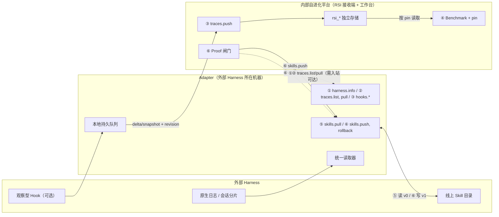
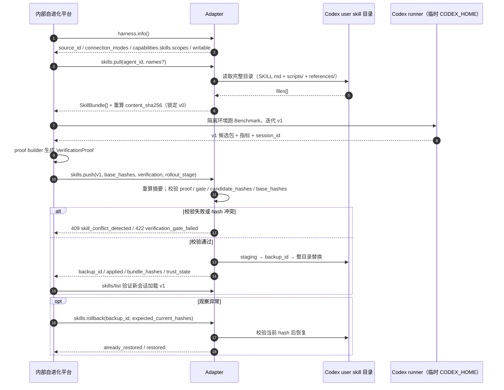
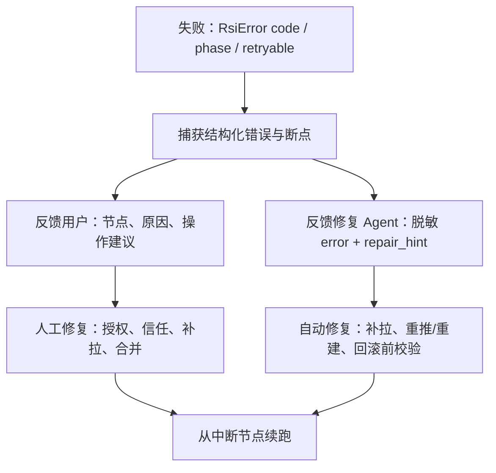

# RSI API 设计文档

> 协议版本：v1（路由前缀 `/api/rsi/v1`） · 日期：2026-11-27 · 阅读版：[rsi-api-architecture.html](./rsi-api-architecture.html)

## 目录

- [1. 背景、全景闭环与协议不变量](#1-背景全景闭环与协议不变量)
  - [1.1 问题背景与设计目标](#11-问题背景与设计目标)
  - [1.2 整体架构与四阶段闭环](#12-整体架构与四阶段闭环)
  - [1.3 核心设计取舍与协议不变量（I1–I12）](#13-核心设计取舍与协议不变量i1i12)
  - [1.4 范围与非目标](#14-范围与非目标)
- [2. 核心横切模型：可见性、同步、证据与离线保证](#2-核心横切模型可见性同步证据与离线保证)
  - [2.1 五域四态可见性与缺口模型（Visibility & Gaps）](#21-五域四态可见性与缺口模型visibility--gaps)
  - [2.2 交付状态拆分（SyncState vs DeliveryStatus）与本地缓冲](#22-交付状态拆分syncstate-vs-deliverystatus与本地缓冲)
  - [2.3 Skill 三层证据模型（SkillEvidence）](#23-skill-三层证据模型skillevidence)
  - [2.4 离线五档保证矩阵](#24-离线五档保证矩阵)
- [3. RSI API 统一协议规范（v1）](#3-rsi-api-统一协议规范v1)
  - [3.1 标准方法与 HTTP 路由总表](#31-标准方法与-http-路由总表)
  - [3.2 能力发现与 Hook 管理（`harness.info` / `hooks.*`）](#32-能力发现与-hook-管理harnessinfo--hooks)
  - [3.3 会话快照模型（`SessionSnapshot` / `SnapshotHeader`）](#33-会话快照模型sessionsnapshot--snapshotheader)
  - [3.4 轨迹发现、拉取与推送合并（`traces.*`）](#34-轨迹发现拉取与推送合并traces)
  - [3.5 Skill 传输包与安全回写（`SkillBundle` / `skills.*`）](#35-skill-传输包与安全回写skillbundle--skills)
  - [3.6 验证证明块（`VerificationProof`）](#36-验证证明块verificationproof)
  - [3.7 真机评测扩展（`eval.run`）与统一错误信封（`RsiError`）](#37-真机评测扩展evalrun与统一错误信封rsierror)
- [4. 跨 Harness 适配、自进化工作台与落地验证](#4-跨-harness-适配自进化工作台与落地验证)
  - [4.1 多系统 Adapter 边界与部署拓扑](#41-多系统-adapter-边界与部署拓扑)
  - [4.2 自进化工作台：三步流程与可视化规则](#42-自进化工作台三步流程与可视化规则)
  - [4.3 全流程双向异常反馈与恢复机制](#43-全流程双向异常反馈与恢复机制)
  - [4.4 首轮验证场景、实验契约与开放问题](#44-首轮验证场景实验契约与开放问题)
- [附录 A：术语、类型与哈希索引](#附录-a术语类型与哈希索引)
- [附录 B：哈希算法公式、测试向量与完整 JSON 示例](#附录-b哈希算法公式测试向量与完整-json-示例)
- [附录 C：Codex CLI 0.172.0 专项适配规范](#附录-ccodex-cli-01720-专项适配规范)

---

## 1. 背景、全景闭环与协议不变量

**本节结论**：要回答「Skill 改完到底好不好用」，必须先通过双路径采集把真实交互沉淀成可复现的 Benchmark，再在隔离环境迭代出候选版本 `v1`，经 `VerificationProof` 闸门校验后安全写回外部系统，并将「看到了什么、缺了什么」作为协议的一等公民。

### 1.1 问题背景与设计目标

现代 Agent 的能力高度依赖 Harness 层配置（Skill、Hook、指令文件、工具）。让模型直接修改这些配置已无技术门槛，但面临两个核心工程难题：

1. **改完是否更好缺乏客观验证**：一次改动可能修好单个场景，却在另一个高频场景引入回归；没有基线对照，看到的只是个别样例的局部观感。
2. **外部 Harness 信息天然不完整**：日志可能被截断、部分域无权限、部分事件仅在运行期出现、来源甚至不支持重读历史。若把「没看到」当成「没有」，后续 Benchmark、离线优化与评测结论都会失真。

RSI API 旨在用同一套跨 Harness 协议连接外部运行环境与内部自进化平台，达成五项设计目标：

- **可验证**：同一 Benchmark、同一运行配置下对照基线 `v0` 与候选 `v1`；任何逐题回归必须显式暴露。
- **可回滚**：每次写回均生成备份句柄 `backup_id`；外部基线被他人修改时拒绝静默覆盖。
- **可解释缺口**：严格区分可读（`available`）、部分可读（`partial`）、不可用（`unavailable`）与未知（`unknown`）；`unknown` 严禁派生为 `0` 或空数组 `[]`。
- **跨 Harness**：一套协议覆盖 Codex、Claude Code、OpenCode、Penguin 与自定义来源（`custom`），由来源侧 Adapter 承担格式翻译。
- **非阻塞**：采集不改变 Agent 行为、不阻塞宿主主流程、不因 RSI 平台离线导致外部会话失败。

### 1.2 整体架构与四阶段闭环

系统按职责划分为三层：**外部 Harness**（照常运行）→ **Adapter**（运行在来源机器上的薄翻译层，负责读会话、装 Hook、读写 Skill、单调分配 `revision`）→ **内部自进化平台**（含 RSI 接收端、独立存储 `rsi_*`、Benchmark、离线优化器、Proof 闸门与工作台；RSI 接收端属于平台内部组件，不是单独一层）。

全流程围绕「**沉淀真实交互 → 生成量化 Benchmark → 离线优化 Skill → 验证并安全回写**」四个阶段构成顺时针 6 步闭环：



| 闭环阶段 | 协议步骤与动作 | 核心职责与解决的问题 | 关键产出 | 对应工作台位置 |
|---|---|---|---|---|
| **阶段 1：本地数据沉淀** | ① `harness.info` 探测能力<br>② `traces.list` + `traces.pull` 按 ID 读历史<br>③ `hooks.*` + `traces.push` 运行中增量推送 | 在可重读或已落盘范围内沉淀真实交互；两路共用读取器与 `revision` 规则；未采集/未送达/不可见显式记缺口 | 归一化会话库 `rsi_*` + `visibility`/`gaps` | 平台前置（接入与采集） |
| **阶段 2：生成量化基准集** | ④ 平台清洗、聚类、提炼 Benchmark，冻结 `(source_id, session_id, revision, content_sha256)` 并 pin | 确保评测尺子可复现；外部会话后续变化或清理不影响已冻结版本 | Benchmark 包 + 冻结快照 pin | 工作台「出题」+「评估」 |
| **阶段 3：Skill 离线优化** | ⑤ `skills.pull` 拉取完整目录包作为基线 `v0`，在隔离环境基于 Benchmark 迭代候选 `v1` | 物理隔离实验区与线上区，避免边跑边改污染外部生产环境 | 候选包 `v1` + 多维评测指标 | 工作台「优化」 |
| **阶段 4：灰度上线校验** | ⑥ 对比 `v0`/`v1` 生成 `VerificationProof`；经 `skills.push` 校验基线 hash 与 Proof 后备份写入；异常调 `skills.rollback` | 证明更好再上线；外部并发改动自动拦截；支持一键原子回滚 | `VerificationProof` + `backup_id` | 工作台「优化」（上线收尾） |

- **双路径采集的统一性**：「双路径」不是两套数据格式，两条路径均产出 `SessionSnapshot`，仅发起方与时机不同。`traces.pull` 在 Adapter 侧是**纯读**，不直接写 RSI 存储；平台拿到快照后交由 RSI 接收端执行**内部导入**（复用 `traces.push` 的合并与事务 ack 规则入库，保留 Adapter 分配的 `revision`）。`traces.push` 是 Adapter 主动推送的运行中路径。两路最终汇入同一套 `rsi_*` 存储。
- **Trace 的定位与边界**：单条 trace 用于解释任务是什么、Skill 如何进入上下文、哪一步产生什么可观察结果；**单条 trace 不证明优化效果**，效果提升必须靠同一 Benchmark 上的 `v0`/`v1` 对照。Skill 归因只到来源能证明的证据层级（见 [2.3 节](#23-skill-三层证据模型skillevidence)）。

### 1.3 核心设计取舍与协议不变量（I1–I12）

协议只有一条主线：**用版本化快照统一采集，用可见性与缺口描述证据边界，用 Proof 约束写回**。六项核心设计取舍如下：

| 设计选择 | 核心理由 | 工程代价与控制手段 |
|---|---|---|
| **版本化 `SessionSnapshot` 而非记录流** | AMSP 记录无稳定 ID，逐条去重不可靠；快照 + `revision` 可复现且能仲裁乱序旧数据 | 长会话每次 push 需 $O(n)$ 重算摘要；通过单会话上限（50,000 条 / 64 MB）控制，链式哈希留后续版本 |
| **非对称双路径采集** | 历史只能由平台按 ID 拉取，运行中只能由来源感知变化并主动推送；共用 reader 与 `revision` 避免两套历史 | Adapter 需维护本地持久队列与 revision store；`pull` 需 Adapter 入站可达 |
| **五域四态 + `gaps`** | 将「来源未提供」「无权限」「暂未同步」「未检查」严格分开，防止 `unknown` 被当成 `0` | 每个域需显式携带可见性；聚合统计必须标注数据覆盖度 |
| **完整目录包 `SkillBundle`** | Skill 是多文件目录资产，逐文件打补丁易残留旧文件；整包替换 + `content_sha256` 唯一身份最可靠 | 包体较大；协议 v1 仅开放单包 `merge` 推送，多 Skill 改由多次 push 完成 |
| **`VerificationProof` 强制闸门** | 写回前必须有可审计的评测凭证；Adapter 仅做确定性结构、摘要与放行态校验，无需重跑评测 | Proof 生成链路较长；离线评测存在算力与时间成本 |
| **Adapter 单一写者分配 `revision`** | 来源侧最了解会话真实演进顺序；RSI 接收端仅按 `revision` CAS 仲裁，摆脱跨机时钟偏差与网络乱序 | Adapter 必须跨重启持久化 `revision`；同一 `(source_id, session_id)` 约束单一写者 |

上述取舍固化为协议 v1 的 **12 条不变量（I1–I12）**：

| ID | 不变量名称 | 规范要求 |
|---|---|---|
| **I1** | 一个外部 session = 一条逻辑 trace | 身份为 `(source_id, session_id)`；传输单位是 `SessionSnapshot` 而非磁盘分片（shard）。Adapter 按分片索引升序 + 文件内行序拼接，保留每个分片的 `session_meta`。 |
| **I2** | 双路径汇入同一 session | `traces.pull` 与 `traces.push` 共用同一读取器、记录格式与 `revision` 分配规则；平台导入 pull 结果走接收端内部导入，复用 push 合并规则，严禁各拼一套历史。 |
| **I3** | 非阻塞采集 | 观察型 Hook 必须空 stdout、`exit 0`，严禁阻塞 Harness 主流程、改变 Agent 行为或因 RSI 离线导致会话失败。 |
| **I4** | Adapter 产版本，RSI 按 revision 仲裁 | `revision` 由 Adapter 对 `(source_id, session_id)` 单调递增分配并跨重启持久化；接收端按 `(revision, content_sha256, metadata_sha256)` 仲裁，旧版本永不覆盖新版本。 |
| **I5** | 可见性与缺口显式 | `available` 的空结果代表「已检查确实没有」；`partial` 必带 `gaps`；`unavailable`/`unknown` 省略对应字段且记 `gaps`；`unknown` 严禁派生为 `0` 或 `[]`。可见性按 `revision` 级处理，任何升级或降级都必须发完整 snapshot 重新过滤 `records` 并重算摘要。 |
| **I6** | 先验证后回写 | `skills.push` 必须携带 `VerificationProof` 与 `base_hashes`；仅 `approved` 或 `override_by_user` 放行；人工放行只绕过评分指标，不绕过 `base_hashes` 与候选摘要冲突校验。 |
| **I7** | 事务提交后才返回 ack | `accepted:"stored"` 仅在 RSI 数据库事务提交后返回；Adapter 收到 ack 后才清理本地缓冲；重发按字节原样以幂等键 `(revision, content_sha256, metadata_sha256)` 去重。 |
| **I8** | 评测隔离防泄题 | Benchmark 的私有评分细则严禁经由异常反馈、`repair_hint` 或 `details` 回流给优化 Agent 或修复 Agent。 |
| **I9** | Hook 四态显式 | Hook 状态固定为 `not_installed` / `pending_trust` / `active` / `broken` 四态，严禁用单一布尔值掩盖待人工信任或配置损坏。 |
| **I10** | 命名、版本、时间与兼容演进 | 方法名 `<domain>.<action>`；路由前缀 `/api/rsi/v1`；所有字段与错误码采用 `snake_case`；时间统一为 UTC ISO 8601；v1 内仅做向后兼容增量。 |
| **I11** | 连接级凭据分权（v1-draft） | ingest token 仅允许写本连接 trace 且绑定固定 `source_id`；control token 按 scope 读 trace/skill，写操作需 `skills:write` / `hooks:manage` / `eval:run`（当前实现仍为 admin token + 每 Agent API key，M1 落地签发与轮换）。 |
| **I12** | 每个 session 单一写者 | 同一 `(source_id, session_id)` 同时只允许一个 Adapter 实例分配 `revision`；`source_id` 必须跨重启固定不变。 |

### 1.4 范围与非目标

- **本版（v1）范围内**：Codex CLI 0.172.0 首轮真机闭环；11 个标准方法的协议语义；`SessionSnapshot` 的合并、`revision` 仲裁与五域可见性过滤；`SkillBundle` + `VerificationProof` + 原子回滚；工作台三步交互与证据可视化；离线五档保证。
- **非目标（留待后续版本）**：token 级流式采集；单次请求多 session 批量推送；RSI 全局 Skill 作用域；instruction bundle（如 `AGENTS.md` 等指令文件）；Skill 的 `replace`/prune 批量清理与改名；`eval.run` 直接回传 trace；流量切分式 canary；跨部署加密签名与外部 issuer。

---

## 2. 核心横切模型：可见性、同步、证据与离线保证

**本节结论**：协议只描述可验证事实——`visibility.<domain>` 表达数据覆盖度，`gaps[]` 表达内容或授权缺口，`sync` 与 `delivery` 分别表达 RSI 入库新鲜度与 Adapter 待发队列，`skill_evidence` 表达 Skill 归因层级；未持久化的流式片段不进快照，来源无法证明的运行状态不主观猜测。

### 2.1 五域四态可见性与缺口模型（Visibility & Gaps）

可见性模型固定划分为**五个数据域**：`messages`、`tool_calls`、`skill_usage`、`subagents`、`raw_log`。每个域在每次快照中取**四个状态**之一；不设会话级单一 `visibility`，工作台按最弱域降级展示。

| 状态 | 规范定义 | API 载荷与字段表达规则 |
|---|---|---|
| `available` | 来源支持并已授权，RSI 已持有本次读取范围内的全部内容（依据是能力声明 + 实际读取结果，而非字段非空） | 该域无内容或授权 gap；内容记录为空不算缺口；仅当 `skill_usage="available"` 时 `active_skills:[]` 才合法（表示检查过确实未用） |
| `partial` | 已读到一部分，但已知存在缺口（日志截断、部分 turn 未采集、部分子会话不可读、字段脱敏或解析丢弃） | 必须配至少一个内容 `Gap`（无 gap 的 `partial` 是协议错误）；覆盖类 gap 填 `{returned, total_known?}`；聚合指标必须标注不完整 |
| `unavailable` | 来源确定不提供（不支持、策略禁止、无原始日志）或鉴权拒绝 | 对应业务字段必须**省略**（严禁写 `[]` 或 `0`）；必须配恰好一个 `Gap`（不提供用 `unsupported`/`policy`，鉴权拒绝用 `denied`）；若整会话不可读则直接返回错误响应，不返回空快照 |
| `unknown` | Adapter 无法判断是否提供或是否读到（旧 Adapter 未上报、响应含糊、读取异常无结论） | 对应业务字段必须**省略**；配恰好一个 `Gap`（`unreported` 或 `source_error`）；`visibility` 对象内缺失某域键时按 `unknown` 处理（fail-closed） |

**`Gap` 结构与强约束**：

- **字段定义**：
  - `domain`：`"messages" | "tool_calls" | "skill_usage" | "subagents" | "raw_log"`。
  - `reason`：`"denied" | "policy" | "unsupported" | "truncated" | "not_captured" | "source_error" | "unreported"`。
  - `retryable`：`boolean`。
  - `recovery?`：`"none" | "repull" | "reauthorize" | "upgrade_adapter" | "manual"`。
  - `since?`：UTC ISO 8601 字符串。
  - `detail?`：按 `reason` 取 union——`truncated`/`not_captured` 用 `{lost_from, lost_to}`；覆盖类缺口用 `{returned, total_known?}`。
- **边界约束**：
  1. `SessionSnapshot.visibility` 对象整体必填；缺少整个 `visibility` 对象返回 `400 invalid_request`，不得当成「全部 unknown」。
  2. `denied`、`unsupported` 是 `Gap.reason`，不是 `visibility` 取值；`not_synced` 既不是可见性取值也不是 `Gap.reason`（交付延迟只记入 `sync`，不降级 `available`，不追加 gap）。
  3. 可见性是 **`revision` 级属性**：历史 revision 保留其原始 `visibility` 与 `records`；任何可见性升级或降级都必须发送更高 `revision` 的完整 `SessionSnapshot`，按新可见集合重新过滤 `records` 并重算 `content_sha256`；仅允许在同可见性下通过 `SnapshotHeader` 或空 delta 修正 `gaps`/`status` 元数据。
  4. 聚合指标仅在 `available` 域上直接计算；`partial` 必须标注覆盖度；`unknown` 严禁当成 `0` 参与聚合。

### 2.2 交付状态拆分（SyncState vs DeliveryStatus）与本地缓冲

为避免把「Adapter 队列还有多少未发」与「RSI 接收端已存到哪一版」混为一谈，协议将同步状态严格拆分为两个独立对象：

| 类型 | 填写方 | 出现位置 | 字段定义 |
|---|---|---|---|
| `SyncState` | **仅 RSI 接收端** | RSI 入库后的会话读取响应（Adapter 的 `traces.pull` 响应省略此字段） | `state`（`"synced" \| "pending" \| "stale"`）、`stored_revision`、`last_acked_revision`、`updated_at` |
| `DeliveryStatus` | **仅 Adapter** | `hooks.status` 响应、`traces.push` 请求的可选 `delivery` 块 | `source_revision`、`pending_count`、`pending_unit`（`"revision" \| "push_batch" \| "turn"`，默认 `"push_batch"`）、`oldest_pending_at?`、`last_delivered_at?`、`buffer_bytes?`、`buffer_limit_bytes?` |

- **`stale` 判定阈值**：默认当 `source_revision > stored_revision` 持续超过 5 分钟，或 `last_delivered_at` 超过连接配置阈值时标为 `stale`。
- **`pending_count` 不是完整性证明**：当 Hook 非 `active` 时 `pending_count` 天然为 `0`，接收端仅将其用于工作台队列展示，不据此判定内容完整。
- **本地缓冲上限（`local_buffer`）**：按字节数与天数设置上限（默认建议 2 GB / 14 天，按连接配置）；达到上限后**停止采集**，并在后续快照中记录 `reason:"not_captured"` 的 `Gap`（携带 `{lost_from, lost_to}`），严禁静默丢弃最旧数据。`hooks.status.delivery` 暴露 `buffer_bytes`/`buffer_limit_bytes`，`hooks.install` 响应声明 `delivery_limits`。
- **协同示例**：RSI 存储返回 `sync: {"state":"pending", "stored_revision":3, "last_acked_revision":3, "updated_at":"2026-11-26T15:52:20.000Z"}`，同时 Adapter 的 `hooks.status.delivery` 上报 `{"source_revision":4, "pending_count":1, "pending_unit":"revision", "oldest_pending_at":"2026-11-26T15:52:15.000Z"}`。这表明 `revision 3` 在 RSI 侧内容完整（`gaps:[]`），而 `revision 4` 仍在 Adapter 本地缓冲等待送达。

### 2.3 Skill 三层证据模型（SkillEvidence）

Agent 目录里「装了什么 Skill」不等于某次会话「用了什么 Skill」。协议将 Skill 证据严格划分为三层：

| 证据层级 | 证明的事实 | 提取方法（`method`） | 能否进入 `active_skills` |
|---|---|---|---|
| **1. 已安装（Installed）** | 目标环境安装了哪些 Skill 资产 | `skills.pull` 资产清单、Agent 的 skill 目录扫描 | **不能**；安装清单不是会话级证据 |
| **2. 已加载（Loaded）** | Skill 已进入本次会话上下文 | 来源元数据显式声明（`source_metadata`）、`system_prompt` 技能清单（`prompt_roster`）、用户消息 `[use_skills]` 标记（`use_skills_marker`）、工具读取 `SKILL.md`（`tool_read`）、shell 读取（`shell_read`，启发式） | **能**，但必须由 `skill_evidence` 支撑 |
| **3. 有使用证据（Invoked）** | 存在显式调用或来源可证明的使用痕迹 | 来源专有事件或专用工具调用（`explicit_invocation`） | **能**；`level:"invoked"` 需来源显式记录 |

**`skill_evidence[]` 与 `active_skills` 契约**：

- **单条证据结构**：`{name, level: "loaded" | "invoked", method: "source_metadata" | "prompt_roster" | "use_skills_marker" | "tool_read" | "shell_read" | "explicit_invocation", confidence: "declared" | "observed" | "inferred", record_refs: number[]}`，其中 `record_refs` 为当前快照 `records` 数组的零基下标（AMSP 记录无持久 ID）。
- **投影一致性**：`active_skills` 是 `skill_evidence` 的去重名称投影，要求 `set(active_skills) == set(skill_evidence.name)`。
- **与 `visibility.skill_usage` 的联动**：
  - `available`：有显式记录，或声明/观察型方法在可见范围内可执行、已检查且无反证（单独 `shell_read` 启发式不构成 `available`）；此时 `active_skills` 必须出现，`[]` 表示已检查且未使用任何 Skill。
  - `partial`：仅有推断/启发式证据、仅部分轮次可见或存在不可执行区间；必须配 gap；`active_skills` 仅在非空时出现，无证据则省略，不得写 `[]`。
  - `unavailable` / `unknown`：必须省略 `active_skills` 与 `skill_evidence`。

### 2.4 离线五档保证矩阵

针对网络断连、进程重启、无重读能力与乱序到达等异常场景，协议对五种数据状态给出明确的持久化与恢复保证：

| 数据状态 | 协议保证 | 恢复方式 | API 表达 |
|---|---|---|---|
| **1. RSI 已入库** | 持久化存储，重启可读；`stored` 仅在事务提交后返回；`(source_id, session_id, revision)` 唯一 | 无需恢复；视图落后时按 ID 重新 pull/list；ack 丢失触发的重发按 `(revision, content_sha256, metadata_sha256)` 幂等去重 | `accepted: "stored" \| "duplicate"`；`sync.state = "synced"` |
| **2. 外围已采集未送达** | Adapter 本地队列持久化、重启不丢；采集零阻塞；未收到 ack 始终保留；队列积压可观测 | 连接恢复后从 `last_acked_revision` 起 at-least-once 重推；支持 pull 的连接可由 RSI 按 ID 补拉 | `hooks.status.delivery`；`sync.state = "pending"`；完全无内容时返回 `409 not_synced_yet` |
| **3. 来源从未开放** | 协议内无法恢复；永久记录缺口，严禁自动重试伪装成「成功」或用空数组掩盖 | 标记 `unsupported` / `policy` / `denied` 并停止自动重试；工作台展示永久缺口 | `visibility = "unavailable"` + `Gap`；对应字段省略；Benchmark 记录缺口 |
| **4. 一次性事件** | 仅事件发生时已落盘的内容可补送；未落盘区间永久丢失 | `source_replay=false` 的来源强制 `delivery.mode="local_buffer"`；重连后重发已落盘部分并如实上报丢失区间 | `gaps: [{domain, reason: "not_captured", retryable: false, detail: {lost_from, lost_to}}]` |
| **5. 旧快照晚到** | 新旧完全由 `revision` 决定，不由网络到达顺序或来源机器时钟决定；旧版本永不覆盖新内容 | 发送方从响应 `stored_revision` 获知落后，重新读取后再推；历史回退/压缩一律用更高 `revision` 的完整 snapshot 表达 | `accepted: "stale_ignored"` + `stored_revision`；`strict: true` 时返回 `409 snapshot_stale` |

- **来源侧删除后的保留策略**：若外部 Harness 清理了本地历史，后续补拉返回 `404 session_not_found`，但 RSI 平台保留已采集入库的快照并标注「截至 `revision N`」。

---

## 3. RSI API 统一协议规范（v1）

**本节结论**：协议共定义 11 个方法（9 个核心 + 2 个可选），以 `SessionSnapshot` 为唯一会话传输单位，用 `revision` + 双摘要（`content_sha256`、`metadata_sha256`）仲裁新旧与幂等，用 `SkillBundle` + `VerificationProof` 保障安全写回与原子回滚。

### 3.1 标准方法与 HTTP 路由总表

除 `traces.push` 由 **RSI 接收端**提供外，其余 10 个方法均由 **Adapter** 提供：

| 类别 | 方法 | 提供方 | 发起方 | HTTP 路由（`/api/rsi/v1`） | 幂等性 | 凭据要求 | 核心职责 |
|---|---|---|---|---|---|---|---|
| 能力发现 | `harness.info` | Adapter | RSI/工作台 | `GET /info` | 幂等 | control 读 | 返回来源类型、`source_id`、版本、方向、`access_level`、逐项能力位、五域默认可见性 |
| Hook 管理 | `hooks.install` | Adapter | RSI/工作台 | `POST /hooks` | 按 `hook_id` | control + `hooks:manage` | 安装运行中观察型 Hook；仅在需要实时推送时调用 |
| Hook 管理 | `hooks.status` | Adapter | RSI/工作台 | `GET /hooks/status` | 幂等 | control 读 + `hooks:read` | 返回 Hook 四态、信任状态、`DeliveryStatus` 待发队列、最近捕获/送达时间与 `action_required` |
| Hook 管理 | `hooks.uninstall` | Adapter | RSI/工作台 | `DELETE /hooks/:hook_id` | 幂等 | control + `hooks:manage` | 按 `hook_id` 精准卸载；默认保留未送达缓冲 |
| 轨迹发现 | `traces.list` | Adapter | RSI/工作台 | `POST /traces/list` | 幂等 | control 读 | 按来源活跃时间与页码发现会话摘要；默认包含子会话 |
| 轨迹读取 | `traces.pull` | Adapter | RSI/工作台 | `POST /traces/pull` | 幂等 | control 读 | 输入 `{session_id}` 返回完整 `SessionSnapshot`；Adapter 侧纯读 |
| 轨迹写入 | `traces.push` | **RSI 接收端** | Adapter | `POST /traces/push` | 按 `revision` + 双摘要 | ingest token（`source_id` 必须与 token 绑定一致） | 推送 `delta` 或 `snapshot`；数据库事务提交后返回 ack |
| Skill 拉取 | `skills.pull` | Adapter | RSI/工作台 | `POST /skills/pull` | 幂等 | control 读 | 拉取完整 Skill 目录包 `SkillBundle[]` |
| Skill 推送 | `skills.push` | Adapter | RSI/工作台 | `POST /skills/push` | 按 `request_id`（必填） | control + `skills:write` | 校验 `VerificationProof`、`base_hashes` 与候选摘要后备份并整目录替换 |
| 可选扩展 | `skills.rollback` | Adapter | RSI/工作台 | `POST /skills/rollback` | 按 `backup_id`（已恢复返回 `already_restored`） | control + `skills:write` | 校验当前目录摘要后按推前备份恢复 |
| 可选扩展 | `eval.run` | Adapter | RSI/工作台 | `POST /eval/run` | 非幂等 | control + `eval:run` | 在隔离真机环境运行单个评测用例；返回 `status`/`session_id`/`duration_ms`/`cost_usd`，trace 走 `traces.pull` |

**通用鉴权与前置拦截约定**：

- **通信格式**：服务器到服务器仅使用 `Bearer` Token + JSON，不接受 Cookie，不开通配 CORS。
- **权限拦截**：缺少对应 scope 时在写入前直接拒绝，返回 `403 permission_denied`。
- **能力拦截**：调用 `capabilities` 未声明的方法时在写入前拒绝，返回 `501 unsupported_capability`。
- **版本拦截**：`protocol_version` 非 `"v1"` 时返回 `400 protocol_version_unsupported`，不建立连接、不执行写入。
- **已入库查询**：工作台列出「RSI 已入库会话」直接查询 RSI 内部存储，不调用 Adapter 的 `traces.list`。

### 3.2 能力发现与 Hook 管理（`harness.info` / `hooks.*`）

#### （1）能力发现：`HarnessInfo`

`HarnessInfo` 是连接的唯一能力事实来源；`capabilities` 逐项决定方法可否调用，`access_level` 仅用于工作台预设与降级提示。

| 字段 | 类型 | 必填 | 规范说明 |
|---|---|---|---|
| `protocol_version` | `"v1"` | 是 | 必须与路由前缀 `/api/rsi/v1` 一致；不匹配返回 `400 protocol_version_unsupported` |
| `source_id` | `string` | 是 | Adapter 实例稳定标识（机器 + Harness home + profile）；严禁使用 `cwd`，跨重启保持不变 |
| `harness_type` | `"codex" \| "claude_code" \| "opencode" \| "penguin" \| "custom"` | 是 | 闭合枚举；在 `SessionSnapshot` 与 `traces.list` 中复用 |
| `harness_version` | `string` | 否 | 外部 Harness 软件版本（与 Adapter 自身版本分开） |
| `connection_modes` | `Array<"push" \| "pull">` | 是 | 两项独立，可同时声明；仅出站连接只含 `["push"]` |
| `access_level` | `"white_box" \| "gray_box" \| "black_box"` | 是 | 接入层级摘要；实际可调方法以 `connection_modes` × `capabilities` 为准 |
| `capabilities` | `object` | 是 | 逐项能力位，结构见下表 |
| `default_visibility` | `object` | 是 | 五域默认可见性基线；单次快照的可见性只可比默认值更弱，不可更强 |

| 能力组 | 子字段 | 规范说明 |
|---|---|---|
| `traces` | `list` / `pull` / `push` / `source_replay` | `source_replay=false` 表示来源不可重读历史，强制 `delivery.mode="local_buffer"`；若此时 `hooks.install` 传 `native_log`，返回 `400 invalid_request` |
| `skills` | `pull` / `push` / `rollback` / `needs_manual_approval` / `scopes` / `writable` | `scopes` 为可读作用域（如 `["user","repo"]`）；`writable` 首轮仅含 `["user"]`；`system`/`admin`/`plugin` 作用域只读 |
| `hooks` | `install` / `events` | `events` 为来源支持的标准化事件名列表 |
| `eval` | `run` | 是否支持隔离真机评测扩展 |

- **push-only `connection` 摘要**：仅出站连接首次推送或能力变化时，在 `traces.push` 中携带 `connection: {source_id, harness_type, harness_version?, connection_modes, capabilities, default_visibility}`；RSI 仅存储与展示，不据此推断未声明的能力。
- **连接级绑定**：连接在平台侧直接绑定 Project（及可选 Workspace/Agent），协议不设 `supported_scopes` 字段，也不在每次请求中重复传 scope；`traces.list` 的 `workspace` 仅作为发现过滤条件。

#### （2）Hook 管理：`hooks.install` / `hooks.status` / `hooks.uninstall`

Hook 仅负责「感知会话变化并触发本地缓冲/推送」，不承载协议版本，且必须遵守非阻塞不变量（**I3**：空 stdout、`exit 0`，禁止返回 `decision:"block"`、`continue:false`、权限决定或向 Agent 注入上下文）。

**`hooks.install` 请求字段**：

| 字段 | 类型 | 必填 | 规范说明 |
|---|---|---|---|
| `hook_id` | `string` | 重试调用方必填 | 省略时由 Adapter 按 `(connection, agent_id, events)` 生成确定性 ID |
| `agent_id` | `string` | 条件必填 | 当连接未绑定默认 Agent 时必填 |
| `events` | `string[]` | 是 | 枚举：`session_start` / `user_prompt` / `pre_tool_use` / `post_tool_use` / `stop` / `interrupt` / `pre_compact` / `post_compact` / `session_end` / `subagent_start` / `subagent_stop` |
| `delivery` | `object` | 是 | `{mode: "native_log" \| "local_buffer", buffer_dir?}` |
| `dry_run` | `boolean` | 否 | 为 `true` 时仅返回将要修改的配置预览，不落盘 |

- **安全安装与精准卸载**：`hooks.install` 修改任何外部配置文件前必须先生成备份，并在响应中返回备份路径与 `delivery_limits`；按 `hook_id` 增量追加，绝不覆盖用户原有 Hook。`hooks.uninstall` 只精准摘除目标 `hook_id`；默认保留未送达缓冲，仅当显式传入 `purge_buffer: true`（需 `hooks:manage` 权限与二次确认）时才清理缓冲。
- **push-only 本地安装**：仅出站模式下 Hook 安装由来源机器本地执行，不走网络协议，平台仅展示其状态。

**`HookStatus` 响应结构**（省略 `hook_id` 查询时返回 `{hooks: HookStatus[]}`）：

| 字段 | 类型 | 规范说明 |
|---|---|---|
| `hook_id` | `string` | Hook 唯一标识 |
| `status` | `"not_installed" \| "pending_trust" \| "active" \| "broken"` | RSI 协议标准四态（**I9**） |
| `trust_status` | `"managed" \| "untrusted" \| "trusted" \| "modified" \| "unknown"` | 映射来源原生信任状态（如 Codex `hooks/list` 的 `trustStatus`）；定义内容变化使 hash 改变时自动退回 `pending_trust` |
| `current_hash` / `trusted_hash` | `string` / `string?` | 当前 Hook 定义摘要 / 最近一次被信任的摘要；二者不同即代表尚未信任 |
| `is_managed` | `boolean` | 是否由企业策略强制托管 |
| `source_path` | `string` | 来源机器上的 Hook 定义文件路径（仅用于工作台展示） |
| `installed_paths` / `config_backup_paths` | `string[]` | 被修改的配置文件路径列表及对应备份路径列表 |
| `last_captured_at` / `last_delivered_at` | `string?` | 最近一次捕获事件时间 / 最近一次成功送达 RSI 时间 |
| `delivery` | `DeliveryStatus` | Adapter 侧待发队列状态（定义见 [2.2 节](#22-交付状态拆分syncstate-vs-deliverystatus与本地缓冲)，不得与 `SyncState` 混用） |
| `action_required` | `string?` | 需人工介入的动作标识（如 `"trust_hook"`），供工作台渲染操作指引 |

### 3.3 会话快照模型（`SessionSnapshot` / `SnapshotHeader`）

- **核心术语边界**：`session` 是来源侧一段原生对话；`trace` 是该 session 在 RSI 中的逻辑轨迹，由 `(source_id, session_id)` 唯一标识并跨越多个 `revision`；`SessionSnapshot` 是某个 `revision` 的完整传输快照；`SnapshotHeader` 是去掉 `records` 的元数据头（仅用于 `delta` 推送与同可见性下的元数据修正）；`traces.*` 是 API 方法域名称，不是数据结构。

#### （1）`SessionSnapshot` 字段定义

| 字段 | 类型 | 必填 | 规范说明 |
|---|---|---|---|
| `session_id` | `string` | 是 | 来源原生 opaque ID（同一 `source_id` 内唯一；严禁从中解析时间、机器或类型） |
| `source_id` | `string` | 是 | Adapter 稳定标识；RSI 内部主键为 `(source_id, session_id)` |
| `harness_type` / `harness_version` | `HarnessType` / `string` | 是 / 否 | 外部 Harness 类型枚举与可选版本号 |
| `normalization` | `"native" \| "normalized" \| "unknown"` | 否 | 外部来源默认 `"normalized"`，Penguin 原生为 `"native"` |
| `workspace` | `string` | 否 | 工作区路径，仅用于展示与 `traces.list` 过滤，不参与会话身份或 revision 分配 |
| `parent_session_id` / `forked_from_id` | `string \| null` / `string` | 否 | 直接父会话 ID / fork 来源会话 ID；fork 会话独立成 trace |
| `child_sessions` | `ChildRef[]` | 否 | 仅列直接子会话引用，子会话内容绝不内联到父快照 |
| `started_at` / `started_at_source` | `string` / 枚举 | 是 | UTC 启动时间及时间来源；未知时不得将 `session_id` 解析值当作权威时间 |
| `updated_at` | `string` | 是 | Adapter 最后一次持久写入时间 |
| `ended_at` | `string \| null` | 否 | 仅在来源能明确证明会话已结束时填写 |
| `status` | `"running" \| "idle" \| "completed" \| "interrupted" \| "unknown"` | 是 | 会话级状态（不设 `"failed"`；未闭合 task/request 只能推出未到终点，不能判 failed） |
| `revision` | `integer >= 1` | 是 | 对 `(source_id, session_id)` 单调分配并跨重启持久化的版本号 |
| `content_sha256` | `string` | `SessionSnapshot` 必填 | 有效可见 `records` 的摘要（公式见 [附录 B.1](#b1-哈希算法公式与测试向量)）；`SnapshotHeader` 在同可见性元数据更新时可省略或等于已存摘要，但在 `delta` 推送中必填（等于合并后完整摘要，缺失返回 `400 invalid_request`） |
| `metadata_sha256` | `string` | 是 | 固定元数据子集摘要（公式见 [附录 B.1](#b1-哈希算法公式与测试向量)），与 `revision`、`content_sha256` 共同构成幂等键 |
| `records` | `AmspRecord[]` | `SessionSnapshot` 必填 | 按来源顺序排列的可见记录（至少含结构记录）；`SnapshotHeader` 无此字段 |
| `contexts` / `tasks` / `summary` | `ContextInfo[]` / `TaskSummary[]` / `object` | 否 | 派生统计字段，不参与 `metadata_sha256` |
| `active_skills` / `skill_evidence` | `string[]` / `SkillEvidence[]` | 否 | Skill 三层证据及名称投影（规则见 [2.3 节](#23-skill-三层证据模型skillevidence)） |
| `visibility` / `gaps` | `object` / `Gap[]` | 是 / 否 | 五域四态可见性及缺口列表（规则见 [2.1 节](#21-五域四态可见性与缺口模型visibility--gaps)） |
| `sync` | `SyncState` | 否 | 仅由 RSI 接收端在入库后填写（Adapter 的 `traces.pull` 省略） |
| `integrity` | `{dropped_lines, torn_tail}` | 否 | 当 `dropped_lines > 0` 或 `torn_tail == true` 时必须同时记录 `truncated` gap |
| `raw_path` | `string[]` | 否 | 仅当请求 `include_raw_path: true` 且 `raw_log` 域可见时返回；RSI 平台永不直接打开该路径 |

**嵌套子结构与派生校验规则**：

- **`ChildRef` 与子会话递归拉取**：`ChildRef` 含 `{session_id, source_id?, relation: "subagent" | "fork" | "unknown", readable: boolean, reason?, spawned_at?, forked_from?}`；不可读子会话保留引用并标 `readable: false`，不生成空占位 trace。父快照只列直接子；工作台或 Benchmark 需要整棵任务树时按 `child_sessions` 递归调用 `traces.pull`，维护 `visited` 集合与最大深度（默认 `8`）。跨来源子会话（不同 `source_id`）只能通过对应来源连接拉取，在当前连接标 `readable: false, reason: "cross_source"`。Benchmark 默认以单 session 为取样单位；若父子同时入选，统计 token 时必须去重并显式声明。
- **`ContextInfo` 与 `TaskSummary`**：
  - `ContextInfo`：`{shard_index, first_record, record_count, provider, model_id, model_context_window, opened_at, closed_by: "compaction" | "model_switch" | null}`。
  - `TaskSummary`：`{index, started_at, ended_at, status: "completed" | "unfinished" | "unknown", request_count, first_record, last_record, derived_from}`。
- **接收端机械派生校验**：① `set(active_skills) == set(skill_evidence.name)`；② `tasks` 与 `contexts` 的记录下标必须在 `records` 长度范围内；③ `child_sessions` 仅含直接子（fork 子指针若早于父会话起点，属于 fork 来源会话，必须过滤）；④ 依赖域为 `available` 时 `summary` 计数必须与 `records` 一致。`summary` 中 `turns`/`tasks` 依赖 always-retained 结构记录，`tool_calls`/`tool_errors` 依赖 `tool_calls` 域，`tokens` 依赖 `messages` 域；对应域不可见时必须省略该统计子项，严禁补 `0`。

#### （2）记录顺序、`NormalizedSessionMeta` 与五域 Payload 过滤表

- **分片拼接与去重禁令**：Adapter 按分片索引升序 + 文件内行序拼接 `records`，严禁按 `timestamp` 重排；保留每个分片的 `session_meta`（`contexts[]` 仅作索引）。流式未完成片段 `partial_*`、`origin` 展开的子会话记录、carry-over 占位、内存 live 输入及内部索引字段**一律不进快照**。`AmspRecord` 仅含 `{timestamp, type, payload, origin?}`，无持久记录 ID，严禁用 item ID、时间戳或文本做跨重连逐条去重。
- **`NormalizedSessionMeta` 双层约束**：

| `session_meta.payload` 字段 | `native`（Penguin 原生 AMSP） | `normalized`（外部 Harness 归一化） |
|---|---|---|
| `session_id` | 必填字符串 | 必填字符串 |
| `provider` / `model_id` | 必填字符串 | 必填；来源未知时省略并记 gap |
| `model_context_window` | 必填（允许 `"unknown"`） | 必填（允许 `"unknown"`） |
| `system_prompt` | 必填字符串 | 可省略；省略或因 `messages` 不可见剔除时记 `messages` gap，严禁补空串 `""` |
| `agent_state` / `workspace` | 必填字符串 | 可省略；省略或因 `raw_log` 不可见剔除时记 `raw_log` gap |
| `source` | 必填 `SessionSource` 枚举 | 必须映射到枚举；无法映射时省略并记 gap，严禁把未知值默认归为 `"user"` 冒充真人会话 |

- **五域 Payload 过滤与脱敏表**（`content_sha256` 仅覆盖按此表过滤后的有效记录集合 `effective_records`）：

| 记录归属域 | 覆盖的 `records` / 字段 | 可见性过滤与脱敏规则 |
|---|---|---|
| **always-retained** | `session_meta`（基础字段）、`event_msg`（`task_*` / `request_*` / `compaction_*` / `session_update` / `abort`） | 始终保留 `session_meta` 的五个最小字段（`session_id`、`provider`、`model_id`、`model_context_window`、`source`）；其余扩展字段按所属域条件保留（若 `messages` 与 `raw_log` 均为 `available`，则保留完整 `session_meta`） |
| **messages** | `model_msg`（`text` / `thinking` / `inline_data`）、`token_usage`、Hook 事件、`session_meta.system_prompt` | 仅当 `messages` 为 `available` 或 `partial` 时保留；不可见时整段删除 `system_prompt` 与消息记录，并记 `messages` gap |
| **tool_calls** | `tool_call`、`tool_call_output`、`tool_list_ready`、`mcp_connect_*`、`approval_decision` | 仅当 `tool_calls` 可见时保留；不可见时删除并记 `tool_calls` gap（审批、工具列表与 MCP 连接事件均合成归入本域） |
| **subagents** | 父会话中的 `event_msg {type: "subagent", session_id}` 指针 | 仅当 `subagents` 可见时保留指针；不可见时删除并记 `subagents` gap |
| **skill_usage** | 从 `system_prompt` 抽取的 Skill roster、`skill_evidence` | 仅当 `skill_usage` 可见时保留；不可见时删除并记 `skill_usage` gap |
| **raw_log** | 顶层 `raw_path`、`session_meta` 中 `agent_state` / `workspace` 的绝对路径 | 仅当 `raw_log` 可见时保留完整路径；不可见时省略路径或仅留 basename，不得暴露宿主机绝对路径，并记 `raw_log` gap |

> 注：`gaps` 仅记录缺失的 `domain` 与 `reason`，绝不写入被脱敏删除的原文内容。单会话上限为 **≤ 50,000 条可见记录 / ≤ 64 MB**，单次 push 请求体 **≤ 16 MB**（超限返回 `413 payload_too_large`）；`traces.pull` 支持 gzip 压缩，响应超限同样返回 `413 payload_too_large`。

### 3.4 轨迹发现、拉取与推送合并（`traces.*`）

#### （1）`traces.list`：按活跃时间分页发现会话

`traces.list` 仅用于回答「来源侧有哪些会话」，不代替 `traces.pull`，不返回完整摘要或 `sync` 状态（工作台按 `(source_id, session_id)` 查询 RSI 存储合并交付状态）。

| 请求字段 | 类型 | 默认值 | 规范说明 |
|---|---|---|---|
| `from` / `to` | `string` | 无 | 按来源活跃时间 `source_updated_at` 过滤（非 Adapter 导入时间） |
| `workspace` | `string` | 无 | 仅作发现过滤，不参与会话身份，同一会话不因过滤改变 `revision` |
| `page` / `page_size` | `integer` | `1` / `50` | `page_size` 范围 `1..200`；仅按页码翻页，不设公开 cursor |
| `include_subagents` | `boolean` | `true` | 默认必须包含子 Agent 会话；仅显式传 `false` 时排除 |
| `source_kinds` | `string[]` | Adapter 默认 | 显式指定来源会话类别（含 subAgent 变体、`attached`、`archived`；Adapter 负责将 Codex `sourceKinds` 映射至此字段，Codex 默认只列 cli/vscode） |
| `status[]` | `string[]` | 无 | best-effort 状态过滤；来源不支持下推过滤时忽略并返回 `unknown` |

- **响应结构**：`{items: TraceListItem[], page, page_size, total?}`（`total` 为当前快照估计值，可省略）。
- **`TraceListItem` 字段**：`session_id`、`source_id`、`harness_type`、`parent_session_id?`、`source_updated_at`（如 Codex `Thread.updatedAt`）、`updated_at`（Adapter 写入时间）、`status`（允许 `"unknown"`）、`revision`、`content_sha256?`（可选，完整摘要以 `pull` 为准）、`visibility`、`child_count?`（仅当 `subagents` 为 `available`/`partial` 时出现）。
- **稳定排序**：固定按 `(source_updated_at DESC, source_id ASC, session_id ASC)` 排序；翻页按三元组去重，客户端跨页合并仍以 `(source_id, session_id)` 去重。

#### （2）`traces.pull`：按 ID 纯读完整快照

- **请求**：`{session_id: string, include_raw_path?: boolean}`（不接受分页、时间范围或 `workspace` 参数）。
- **响应**：单个完整 `SessionSnapshot`（完整 JSON 示例见 [附录 B.2](#b2-tracespull-完整响应示例)）。
- **纯读契约**：`traces.pull` 在 Adapter 侧不写 RSI 存储，也不改变 `revision`；平台若需将 pull 到的快照入库，必须走 RSI 接收端的**内部导入**路径。
- **错误码**：`404 session_not_found`（不存在或不在授权范围，默认统一返回 404 以防泄露存在性）、`403 session_unreadable`（仅部署显式开启区分时返回）、`503 source_unavailable`、`422 normalization_failed`、`422 unsupported_data`、`409 not_synced_yet`。

#### （3）`traces.push`：增量或全量推送

`traces.push` 仅支持 `"delta"` 与 `"snapshot"` 两种模式：

- **`delta` 前置条件**：仅当 Adapter 能证明「RSI 已存记录是当前有效记录集的严格前缀，且 turn 身份可稳定映射」时才允许发 `delta`（自然边界为一个或多个已完成 turn）；任何 turn ID 变化、中间插入、历史回退（revert）、上下文压缩（compact）或可见性变化，一律发更高 `revision` 的完整 `snapshot`。
- **请求字段**（完整 JSON 示例见 [附录 B.3](#b3-tracespushdelta-模式请求与响应示例)）：

| 请求字段 | 类型 | 必填 | 规范说明 |
|---|---|---|---|
| `mode` | `"delta" \| "snapshot"` | 是 | 推送模式 |
| `base_revision` | `integer` | `delta` 必填 | 必须等于发送方所见的 `stored_revision`（首次导入时 `stored_revision=0, base_revision=0` 且必须用 `snapshot`；同 `revision` 重发时不校验 `base_revision`） |
| `strict` | `boolean` | 否 | 默认 `false`；设为 `true` 时若 `revision < stored_revision` 则返回 `409 snapshot_stale` |
| `snapshot` | `SessionSnapshot` 或 `SnapshotHeader` | 是 | `mode="snapshot"` 时必带 `records`；`mode="delta"` 时传无 `records` 的 `SnapshotHeader`（但 `content_sha256` 必填） |
| `added_records` | `AmspRecord[]` | `delta` 必填 | 精确追加后缀；严禁修改、插入或重排已存记录 |
| `delivery` | `DeliveryStatus` | 否 | Adapter 本地队列状态，仅供展示 |
| `connection` | `object` | 否 | push-only 首次推送或能力变化时的能力摘要（结构见 [3.2 节](#32-能力发现与-hook-管理harnessinfo--hooks)） |

- **响应结构**：事务提交后返回 `200 {accepted: "stored" | "duplicate" | "stale_ignored", stored_revision, content_sha256}`；冲突或缺口返回 `409` 错误信封。

#### （4）接收端合并规则表（唯一 Normative 合并语义）

接收端先按 `revision` 裁决新旧（不要求 `revision` 连续，跳号不是缺口，仅检查 `base_revision == stored_revision`），再按双摘要裁决同一 `revision` 是否等价：

| # | 到达请求情形 | 接收端处理结果 |
|---|---|---|
| **1** | `revision < stored_revision` | 不写入，返回当前 `stored_revision`；`strict: true` 时返回 `409 snapshot_stale`，否则 `200 {accepted: "stale_ignored"}` |
| **2** | `revision == stored_revision`，且 `content_sha256` 与 `metadata_sha256` 均相同 | `200 {accepted: "duplicate"}`，幂等成功，不重写、不追加 |
| **3** | `revision == stored_revision`，`content_sha256` 相同但 `metadata_sha256` 不同 | `409 revision_conflict`（元数据或可见性变更必须分配新 `revision`） |
| **4** | `revision == stored_revision`，`content_sha256` 不同 | `409 revision_conflict`（不拼接 `added_records`，不校验 `base_revision`） |
| **5** | `revision > stored_revision`，`mode="delta"`，但 `base_revision != stored_revision` | `409 revision_gap`（提示按 ID 补拉或改推完整 `snapshot`） |
| **6** | `revision > stored_revision`，`mode="delta"`，`base_revision == stored_revision`，拼接后重算摘要与请求 `content_sha256` 一致 | `200 {accepted: "stored"}`，原子更新 `stored_revision` |
| **7** | `revision > stored_revision`，`mode="delta"`，`base_revision == stored_revision`，但拼接后重算摘要不一致 | `409 revision_conflict`（要求重拉重建完整 `snapshot`） |
| **8** | `revision > stored_revision`，`mode="snapshot"`（带 `records`） | 用完整有效记录集合替换当前版本，忽略 `base_revision`；**任何可见性升级或降级都必须走此路径** |
| **9** | `revision > stored_revision`，仅传 `SnapshotHeader`（无 `records`） | 仅允许同可见性下的 `gaps`/`status` 元数据修正，`content_sha256` 省略或等于已存摘要；若可见性变化则返回 `400 invalid_request` |
| **10** | `revision > stored_revision`，`mode="delta"` 且 `added_records: []` | 允许用于同可见性元数据修正，仍推进 `revision`；严禁借此改变可见性 |
| **11** | 同一 `revision` 首次入库成功后因丢 ack 重发 | 按规则 2/3/4 判定：双摘要相同返回 `duplicate`，任一不同返回 `409 revision_conflict` |

- **父子边合并幂等**：父快照持久化 `parent → child` 边，并与子快照声明的 `parent_session_id` 合并；已知父边绝不被后到的 `null` 覆盖，子快照先于父快照到达完全合法。

#### （5）接收端独立存储、内部导入与版本 Pin

- **独立表空间**：接收端使用独立的 `rsi_sources`、`rsi_sessions(source_id, session_id)`、`rsi_revisions` 表，严禁写入宿主现有的 `sessions`/`traces` 表（防止全局 `session_id` 碰撞，或导致外部导入会话以 `client=web` 混入用户聊天侧栏）。
- **内部导入路径**：工作台执行「导入已有会话」时，依次调用 `traces.list` → `traces.pull(session_id)` → 接收端内部导入；内部导入完全复用上表合并规则、双摘要幂等键与事务 ack，保留 Adapter 分配的 `revision`，不新增公开 HTTP 方法。
- **内部历史 revision 只读接口**：`GET /api/rsi/v1/sessions/{source_id}/{session_id}/revisions/{revision}`（需 control token，直读 RSI 存储，不经 Adapter），返回该历史版本的原始 `SessionSnapshot`（含当时 `visibility`、双摘要与 pin 状态）；Benchmark 也可在相同权限下直读 `rsi_revisions`。
- **Pin 与保留策略**：Pin 记录为 `(source_id, session_id, revision, content_sha256, owner_type, owner_id)`，多次 pin 幂等。最新 `revision` 长期保留；非 pin 的历史 `revision` 默认保留 **30 天**（可配置），定时清理自动跳过被 pin 的版本；显式 purge 命中已 pin 版本时返回 `409 revision_pinned`，查询不存在的版本返回 `404 revision_not_found`。

### 3.5 Skill 传输包与安全回写（`SkillBundle` / `skills.*`）

#### （1）`SkillBundle` 结构与校验规则

`SkillBundle` 是完整目录快照而非单文件补丁，`content_sha256` 是唯一包身份（哈希算法与完整示例见 [附录 B.1](#b1-哈希算法公式与测试向量)、[附录 B.4](#b4-skillbundle-与-skillspush-完整示例)）。`agent_id`、`mode`、`base_hashes`、`verification`、`rollout_stage` 均为请求级字段，不放入 bundle 内部。

| 字段 | 类型 | 必填 | 规范说明 |
|---|---|---|---|
| `name` | `string` | 是 | Skill 目录名与唯一身份，匹配 `^[A-Za-z0-9_-]+$`（`SKILL.md` frontmatter 中的 `name` 仅作显示） |
| `kind` | `"skill"` | 是 | 协议 v1 仅支持 `"skill"`；`instruction`（如 `AGENTS.md`）不在 v1 范围内，后续版本以独立 `InstructionBundle` 定义路径、managed block、hash、备份与 rollback，不混入本模型 |
| `description` / `version` | `string` | 否 | 人类可读摘要与自报版本号（不作为内容身份） |
| `content_sha256` | `string` | 是 | 完整目录内容摘要；Adapter 接收时必须从 `files[]` 重新计算并比对 |
| `files` | `Array<{rel_path, encoding: "utf8" \| "base64", content}>` | 是 | 目录下全部普通文件；必须包含根 `SKILL.md`，保留相对子目录结构 |

| 校验维度 | 规范要求 | 失败错误码 |
|---|---|---|
| **非空与可解析** | 至少含 1 个文件且必含根 `SKILL.md`；YAML frontmatter 必须能解析出 `name` | `422 skill_invalid_format` |
| **路径与名称安全** | `name` 匹配 `^[A-Za-z0-9_-]+$`；`rel_path` 使用 POSIX `/` 与 NFC，拒绝绝对路径、反斜杠、`.`/`..`、控制字符、NFC/大小写冲突及规范化后重复路径 | `422 skill_invalid_format` |
| **文件类型与落盘保真** | 仅允许普通文件（拒绝符号链接、设备文件、空目录条目）；落盘权限固定为 `0644`（脚本通过解释器调用如 `bash scripts/check.sh`，mode 不参与 hash）；Adapter 必须**按字节精确写入**，严禁补尾换行、改编码或做换行规范化 | `422 skill_invalid_format` |
| **摘要自洽** | `content_sha256` 声明值必须等于 `files[]` 重算值；且必须与 `VerificationProof.candidate_hashes[name]` 一致 | `422 skill_invalid_format` / `422 verification_gate_failed` |
| **协议大小上限** | 解码后总大小 **≤ 14 MB**、文件数 **≤ 200**、单文件 **≤ 5 MB**、JSON 请求体（含 base64 开销）**≤ 20 MB**（这是协议上限而非仓库 archive 导入上限；协议无 zip 信封，按解码后 `files[]` 计算） | `413 skill_too_large` |

#### （2）`skills.pull`、`skills.push` 与 `skills.rollback`

- **`skills.pull`**：请求 `{agent_id?, names?: string[]}`（连接未绑定 Agent 时 `agent_id` 必填；省略 `names` 拉取全部可读 Skill）。响应 `{pulled_at, skills: SkillBundle[]}`，每个 bundle 的 `content_sha256` 由 Adapter 重算。v1 强制返回完整目录包，不提供仅返回 `SKILL.md`/图标的子集模式。
- **`skills.push` 请求字段**：

| 字段 | 类型 | 必填 | 规范说明 |
|---|---|---|---|
| `agent_id` | `string` | 条件必填 | 连接未绑定默认 Agent 时必填（仅作 RSI 绑定；来源侧 Skill 作用域由 Adapter 声明，如 Codex pull 读 `user`/`repo`，push 首轮只写 `user`，`system`/`admin`/`plugin` 只读，并非 RSI 全局作用域） |
| `mode` | `"merge"` | 否 | v1 默认且仅接受 `"merge"`；传 `"replace"`/prune 或其他值返回 `400 invalid_request` |
| `skills` | `SkillBundle[]` | 是 | **协议 v1 每次请求必须恰好包含 1 个 `SkillBundle`**；多 Skill 更新分多次 push，批量留待后续版本 |
| `base_hashes` | `Record<string, string \| "absent">` | 是 | 覆盖 `skills` 中的每个 `name`；拉取基线时不存在的新增 Skill 填 `"absent"` |
| `request_id` | `string` | 是 | 幂等键；Adapter 按 `(connection, agent_id, request_id)` 去重，结果至少持久化至备份 TTL 结束并跨重启；同 `request_id` 不同 payload 返回 `409 request_id_conflict` |
| `verification` | `VerificationProof` | 是 | 强制审计凭证，按 [3.6 节](#36-验证证明块verificationproof) 校验 |
| `rollout_stage` | `"canary" \| "full"` | 是 | v1 中 `canary` 与 `full` 均执行整目录替换，`canary` = 写入 + 观察 + 可回滚审计标记，不是流量切分 |
| `backup_before_write` | `boolean` | 否 | v1 默认且仅接受 `true`（回滚是写回契约的一部分，`canary`/`full` 均要求可回滚）；显式传 `false` 返回 `400 invalid_request` |
| `dry_run` | `boolean` | 否 | 为 `true` 时走同一套校验并返回冲突与 diff，但不落盘 |

- **`skills.push` 响应**：`{backup_id?, applied, skipped, conflicts, diffs, bundle_hashes, trust_state: "active" | "pending_trust" | "rejected", already_applied?}`。**`applied` 仅表示文件已写入，`trust_state` 才表示实际生效**（写 `user` 作用域后必须通过 `skills/list` + `skills/config/write` 或文件系统验证新会话能加载 `v1`；写入成功但来源要求本地信任确认时返回 `"pending_trust"`）。
- **`skills.rollback`**：请求 `{backup_id: string, names?: string[], expected_current_hashes: Record<string, string>}`（省略 `names` 时整批恢复；`expected_current_hashes` 必填且覆盖所有待恢复目录，防止覆盖他人后续修改，不匹配返回 `409 skill_conflict_detected`）。若当前目录摘要已等于该 `backup_id` 恢复后的目标摘要（首次成功但响应丢失后重试），直接返回 `200 {backup_id, restored, restored_at, already_restored: true}`，不再比较 `expected_current_hashes`。新建 Skill 的 rollback 是删除该目录。rollback 成功后通过递增 epoch 使旧 `request_id` 去重键失效。错误码：`404 backup_not_found`（不存在或过期）、`409 skill_conflict_detected`、`500 rollback_failed`（I/O 异常）。

#### （3）`skills.push` 幂等与冲突判定优先级表（13 种情形）

Adapter 按「**格式与摘要校验 → `request_id` 重放（带 payload digest） → `already_applied` 检测 → absent/base 匹配与原子替换 → 冲突拒绝**」顺序严格执行：

| 优先级 / # | 情形 | Adapter 处理结果 |
|---|---|---|
| **1** | `skills` 为空、同名重复或数组长度 `> 1` | `400 invalid_request` |
| **2** | 包格式非法，或声明 `content_sha256` 与 `files[]` 重算值不一致 | `422 skill_invalid_format` |
| **3** | 候选包重算摘要与 `verification.candidate_hashes[name]` 不一致 | `422 verification_gate_failed` |
| **4** | `verification.gate_decision` 非放行态（既非 `"approved"` 也非 `"override_by_user"`）或 Proof 校验失败 | `422 verification_gate_failed` |
| **5** | 目标作用域无写权限或受企业策略限制 | `403 target_write_denied` |
| **6** | 同一 `request_id` 已成功处理且 payload digest 一致 | `200`，返回首次结果并标 `already_applied: true`，带首次 `backup_id` |
| **7** | 目标当前 hash 与 `base_hashes[name]` 不匹配，但已等于候选包 hash 且 Proof 一致 | `200`，视为已应用，返回 `already_applied: true` |
| **8** | `name` 目录不存在，且 `base_hashes[name] == "absent"` | 校验通过，新建 Skill 目录 |
| **9** | `name` 目录存在，且当前 hash 等于 `base_hashes[name]` | 校验通过，重算候选摘要，执行 staging → 备份 → 整目录替换（同名更新为整包替换，旧版不再携带的文件会消失） |
| **10** | `name` 目录存在，但当前 hash 与 `base_hashes[name]` 不匹配（且不等于候选 hash） | `409 skill_conflict_detected`，返回 `expected`/`actual`，要求人工合并 |
| **11** | `name` 目录不存在，但 `base_hashes[name]` 是具体 hash 而非 `"absent"`（拉取后被外部删除） | `409 skill_conflict_detected` |
| **12** | 请求中未出现的其他 Skill 名称 | `merge` 模式下保持不动；协议 v1 无 prune/delete（`replace`/prune 留后续版本，需待删除清单 + 逐目录 base hash + dry-run + 整包回滚） |
| **13** | 改名（rename） | 协议 v1 无协议内 rename，只能人工新增并删除旧目录；首轮优化器不得提出删除或改名 Skill |

- **原子写回提交协议**：按 skill 加锁 → 二次校验当前目录 hash → 原目录原子 `rename` 到 backup → staging 目录原子 `rename` 到目标 → 写入含 pre/post hash 与 TTL 的备份 manifest → 解锁；若中途失败则把 backup `rename` 回目标。
- **实现复用边界**：可复用仓库现有 Skill 导入上限的数值思路、staging + 整目录替换及 zip-slip 路径防护思路（协议无 zip 信封，按 `rel_path` 校验）；必须新写 `content_sha256` 重算、`base_hashes` 校验、Proof 校验、`backup_id` 管理、rollback 双校验与 `trust_state` 探测。



> **候选包进入评测环境的破循环机制**：`skills.push` 是唯一写回方法却强制要求 `VerificationProof`；因此平台必须在隔离 `CODEX_HOME` 中 out-of-band 安装候选 Skill（直接复制目录或调用 `skills/config/write`），评测 runner 仅用于跑分，绝不触碰线上 Skill 目录。

### 3.6 验证证明块（`VerificationProof`）

`VerificationProof` 是写回的审计凭证而非分数截图，回答「用哪把尺子、在什么环境、跑了几次、候选是哪一份、凭证属于谁」（三个 ID 的精确哈希公式、测试向量与完整 JSON 示例见 [附录 B.1](#b1-哈希算法公式与测试向量)、[附录 B.5](#b5-verificationproof-完整示例)）。Adapter 只校验结构与放行态，不重跑评测。

#### （1）`VerificationProof` 与 `ProofSide` 字段定义

| `VerificationProof` 字段 | 类型 | 必填 | 规范说明 |
|---|---|---|---|
| `proof_version` | `"1"` | 是 | 结构版本 |
| `target` | `{agent_id, source_id, harness_type}` | 是 | 凭证绑定的目标；与连接不一致返回 `422 verification_gate_failed` |
| `proof_sha256` | `string` | 是 | Proof 去掉 `proof_sha256` 自身后的 JCS SHA-256 完整性摘要 |
| `benchmark_id` | `string` | 是 | Benchmark 目录 ID |
| `benchmark_content_sha256` | `string` | 是 | 尺子内容摘要；`baseline` 与 `candidate` 必须各自声明同一值 |
| `benchmark_status` | `"published"` | 是 | 只接受已发布（`"published"`）的 Benchmark |
| `comparison_basis` | `"same_model_same_runs"` | 是 | 比较口径；不同口径不能自动放行 |
| `runtime` | `{provider, model_id, thinking}` | 是 | 两侧共用的模型运行配置 |
| `eval_environment` | `"target_harness" \| "platform_mirror"` | 是 | 首轮为 `"target_harness"`；降级为 `"platform_mirror"` 属于计划变更 |
| `evaluator` | `{kind, version, isolation}` | 是 | 例如 `{"kind":"codex_exec", "version":"0.172.0", "isolation":"temporary_codex_home"}` |
| `baseline` / `candidate` | `ProofSide` | 是 | 基线与候选评测记录绑定，结构见下表 |
| `delta` | `{score, cost_usd?, duration_ms?}` | 是 | `candidate − baseline` 差值 |
| `gate_policy` | `"score_strict" \| "pareto"` | 是 | 默认 `"score_strict"` |
| `pareto_improved` | `boolean` | 是 | 帕累托改进判定结果 |
| `regressions` | `RegressionEntry[]` | 是 | 逐题回归数组（候选低于基线的 case 列表，非计数；数组长度即回归数） |
| `gate_decision` | `"approved" \| "override_by_user"` | 是 | 只有这两个值允许放行 |
| `override` | `object \| null` | 条件必填 | `override_by_user` 时必填 `{approved_by, approved_at, reason, acknowledged_regressions}`；切勿在此放 proof 自身的 `proof_sha256`（外层摘要已覆盖本对象） |
| `candidate_hashes` | `Record<string, string>` | 是 | 名称 → 候选包摘要；键集合等于 `skills[].name` |

| `ProofSide` 字段 | 规范说明 |
|---|---|
| `evaluation_id` | scoreboard 记录的规范化摘要（公式见 [附录 B.1](#b1-哈希算法公式与测试向量)） |
| `time` / `label?` | 评测时间与可选标签 |
| `agent_state_version` | 被评测 Agent State 的不透明版本标识，仅用于复现与计算 `evaluation_id` |
| `benchmark_content_sha256` | 尺子内容摘要，必须等于顶层值 |
| `bundle_sha256` | 与 `base_hashes[name]="absent"` 配对时为 `null`，否则为对应 `SkillBundle.content_sha256` |
| `metrics` | `score`（`0..100`），可带 `cost_usd` / `duration_ms` / `tokens` |
| `runs_per_case` | v1 要求同一 Benchmark 内所有 case 使用**同一个 `>= 2` 的整数**，且两侧对称（`1 vs 3` runs 只能 override 或标 experimental） |
| `data_coverage` | `Coverage` 对象（非顶层字段）：含 `sessions`、`excluded_sessions`、`domains`；五域各自含 `available`/`partial`/`unavailable`/`unknown` 计数，每域四态之和等于 `sessions` |

#### （2）帕累托判定、自动放行 Predicate 与 Adapter 8 步校验

- **帕累托判定**：设指标集 $D = \{\text{score}\uparrow, \text{cost\_usd}\downarrow, \text{duration\_ms}\downarrow\}$；只有两侧都非 `null` 的维度才可比（`null` 维度排除并标「不可比较」，不得用来声称改进）。`pareto_improved = true` 当且仅当每个可比维度候选不差于基线，且至少一个维度严格更好。
- **自动放行 Predicate（`gate_decision = "approved"` 必须全部满足，任一不满足只能 `override_by_user` 并显式承认回归）**：
  1. 两侧 `regressions = []`。
  2. 两侧 `messages` 与 `tool_calls` 每域 `available == sessions`，其余三态为 `0`。
  3. 两侧 `excluded_sessions == 0`。
  4. 两侧 `benchmark_content_sha256` 相同，case 集合一致。
  5. 两侧 `runs_per_case` 对称，且为同一个 `>= 2` 的整数。
  6. `skill_usage` 不强制 `available`，但 proof 必须显示覆盖；此时结论只能表述为「在该 Benchmark 上候选更好」，不能声称「通过 Skill 使用路径生效」。
- **Adapter 8 步校验清单（任一不符返回 `422 verification_gate_failed`）**：
  1. 结构与 `proof_version` 受支持。
  2. 重算并核对 `proof_sha256`。
  3. `benchmark_status == "published"`；两侧 `benchmark_content_sha256` 等于顶层值。
  4. `gate_policy` 满足：`score_strict` 要求 `delta.score > 0` 且 `regressions == []`；`pareto` 要求 `pareto_improved == true` 且 `regressions == []`；override 时 `override` 对象字段齐全。
  5. 覆盖 predicate 与 `runs_per_case` 对称性满足要求。
  6. `target` 与当前连接一致。
  7. `candidate_hashes` 与 `skills[]` 名称集合相等，值等于 `files[]` 重算摘要；每个 `name` 在 `base_hashes` 中；`bundle_sha256` 与 base/candidate 配对。
  8. 重算两侧 `evaluation_id`（scoreboard 一致性由平台侧校验，Adapter 只校验 proof 内自洽）。

### 3.7 真机评测扩展（`eval.run`）与统一错误信封（`RsiError`）

#### （1）可选扩展：`eval.run`

当 `capabilities.eval.run` 为真时，平台可在最终推送前调用：请求 `{case_id, prompt, workspace_files?, candidate_skills?, timeout_s?}`；响应 `{status: "completed" | "failed" | "timeout", session_id, duration_ms, cost_usd?}`。响应不直接返回 trace，评测会话仍用 `traces.pull(session_id)` 读取；评测环境必须隔离，不得污染目标 Agent 线上状态；黑盒来源通常不提供，只能外部执行 + 结果回传。

#### （2）统一错误信封：`RsiError`

错误信封固定为 `{error: {code, message, phase, retryable, repair_hint, details}}`。`details` 可含 `session_id`、`revision`、`stored_revision`、`expected_sha256`、`actual_sha256`、`request_id`、`field`，严禁放私有评分细则。`phase` 闭合枚举为：`discovery` / `pull_traces` / `push_traces` / `hook` / `skills` / `push` / `rollback` / `eval` / `internal`。

| 阶段 | 错误码（`code`） | HTTP | 重试 | 触发条件与恢复说明 |
|---|---|---|---|---|
| 通用 / 协议 | `invalid_request`、`protocol_version_unsupported` | `400` | 否 | 缺字段/类型/路径非法；delta 缺摘要；协议不是 `v1` |
| 通用 | `unauthorized` | `401` | 否 | 缺少或无效的 Bearer Token |
| 通用 / 授权 / 写入 | `permission_denied`、`session_unreadable`、`hook_write_denied`、`target_write_denied` | `403` | 否 | 凭据 scope 不足、会话未授权（`session_unreadable` 仅部署显式开启）、Hook 配置写入被拒、目标目录只读 |
| 通用 / 内部 | `session_not_found`、`revision_not_found`、`hook_not_found`、`backup_not_found` | `404` | 否 | 不存在、不可见或备份过期；不泄露存在性 |
| 通用 | `not_synced_yet` | `409` | 是 | 数据尚未送达或尚未可读 |
| `push` | `revision_gap`、`revision_conflict`、`skill_conflict_detected` | `409` | 是 | `base_revision` 不匹配；同 `revision` 异内容；外部改动与 `base_hashes` 不一致 |
| `push` | `snapshot_stale`、`request_id_conflict`、`revision_pinned` | `409` | 否 | `strict` 模式下推旧版本；同 `request_id` 不同 payload；purge 命中 pin |
| `hook` | `hook_trust_pending` | `409` | 是 | 待用户在来源侧人工信任 Hook |
| 通用 | `payload_too_large`、`skill_too_large` | `413` | 否 | 超过会话（50,000 条 / 64 MB）、push（16 MB）或 Skill（14 MB / 200 文件 / 20 MB 请求体）大小上限 |
| `pull` | `normalization_failed` | `422` | 是 | 来源格式变化，无法映射 |
| 通用 | `unsupported_data`、`skill_invalid_format`、`verification_gate_failed` | `422` | 否 | 不支持的类型/域；Skill 格式非法；缺合法 proof 或门禁未放行 |
| `hook` / `rollback` | `hook_config_corrupted`、`rollback_failed` | `500` | 是 | 外部 Hook 配置语法损坏；恢复备份时 I/O 异常 |
| 通用 | `unsupported_capability` | `501` | 否 | 调用未声明能力（含 `eval.run`）；在写入前拒绝 |
| `pull` | `source_unavailable` | `503` | 是 | 来源目录不可读或被占用（`source_unreadable` 已并入本错误码） |

---

## 4. 跨 Harness 适配、自进化工作台与落地验证

**本节结论**：Adapter 是协议边界的翻译层，白/灰/黑盒只是连接摘要，真实可用方法由 `connection_modes` × `capabilities` 决定；工作台以「出题 / 评估 / 优化」三标签承载闭环（接入与采集作为平台前置），并通过五类确定性恢复动作闭环处理异常。

### 4.1 多系统 Adapter 边界与部署拓扑

#### （1）白盒 / 灰盒 / 黑盒接入层级

| 接入层级 | 能读到的内容 | 能写回的资产 | 典型可用方法（摘要） | 工作台表现 |
|---|---|---|---|---|
| **白盒** `white_box` | 完整会话、工具调用、Skill 加载/使用证据、子会话、原始日志 | Skill、Hook、回滚 | 全方法（pull 可用时）；`eval.run` 可选 | 完整会话树、工具时间线、Skill 证据徽标；允许安装 Hook 与安全回写 |
| **灰盒** `gray_box` | 部分会话/工具/Skill 证据；子会话可能不全 | 部分 Skill 或需人工放行 | `harness.info`、`traces.list`/`pull` 必须；`hooks.*`、`skills.push`/`rollback` 按能力位 | 按缺口展示；关键域 `partial` 标覆盖度；写前要求 proof；隐藏不可用按钮 |
| **黑盒** `black_box` | 仅有输入/输出或调用结果 | 通常不能写回 | pull 可用时至少 `harness.info` + `traces.*`；`hooks.install`/`skills.push` 通常返回 `501`；评测走 `eval.run` 或外部执行 | 隐藏 Hook 与回写；仅做输入/输出评分；严禁声称 Skill 归因 |

- **黑盒评分的落点**：默认由平台侧按 Benchmark 格式直接录入 scoreboard，不走 wire；v1 不纳入自动 gate（协议化 `eval.result`/`eval.submit` 留后续版本）。黑盒结论只能表述为输入/输出层面的分数，不得声称 Skill 归因。
- **实际方法可用性**：上表「典型可用方法」仅为摘要，实际可用性 = `connection_modes` × `capabilities`；仅出站连接下所有由平台发起的方法（含 `traces.list`/`pull`、`skills.*`、`eval.run`）均不可用。

#### （2）连接方向与部署边界

默认部署拓扑为「RSI 运行在容器或本机、Adapter 运行在外部 Harness 所在的来源机器」。默认 Compose 仅发布 `127.0.0.1:7364`、仅挂载 `data` 目录，容器无法直读宿主机外部日志；跨机器通信必须经过 TLS 反向代理或 SSH 隧道，严禁将 RSI 接收端直接裸露于公网。创建连接必须由 Project owner + 人类登录操作，不复用管理员 token 或单个 Agent API key。

| 连接形态 | 通信链路 | 可用方法 | 部署与交互限制 |
|---|---|---|---|
| **push 可用** | Adapter → RSI `traces.push` | `traces.push`；Hook 由 Adapter 本地执行；首次 push 带 `connection` 摘要 | 可穿透 NAT，运行中增量更新不依赖 Adapter 入站可达 |
| **pull 可用** | RSI → Adapter `harness.info` / `traces.*` / `skills.*` / `eval.run` | 读历史、拉 Skill、安全回写、真机评测 | 需 Adapter 入站可达：同机 `localhost`、Docker Desktop `host.docker.internal`、Linux `host-gateway` 或跨机隧道 |
| **仅出站（collection-only）** | Adapter → RSI（无 `pull`） | 仅 `traces.push`；平台主动发起的方法全部不可用 | 工作台隐藏第二、三步的自动拉取/回写动作，仅允许人工导入/导出 Skill；能力由配置或首次 push 的 `connection` 声明；反向命令通道留后续版本 |

#### （3）五类外部 Harness 适配总表

（Codex CLI 0.172.0 的 19 种 `ThreadItem` 映射、Adapter 组件与 B1/B2 实时触发详见 [附录 C](#附录-ccodex-cli-01720-专项适配规范)。）

| 外部 Harness | Hook 流派 | Hook 事件集合 | 会话读取路径 | 触发粒度 | 核心适配注意事项 |
|---|---|---|---|---|---|
| **Codex CLI** 0.172.0 | Command 进程派（`hooks.json`） | `SessionStart`、`UserPromptSubmit`、`PreToolUse`、`PostToolUse`、`Stop`、`Interrupt`、`PreCompact`、`PostCompact`、`SessionEnd`、`SubagentStart`、`SubagentStop` | 优先 App Server：`thread/read`、`thread/turns/list`（`itemsView:"full"`、`sortDirection:"asc"` 或翻页反转并循环到末页）、`thread/list`（显式 `sourceKinds`）；transcript 回退 | turn | 新/改 Hook 为 `pending_trust`；观察型 Hook 空 stdout/`exit 0`；`notLoaded`/`interrupted` 不判失败；`SessionEnd` 仅在主线程；`Stop` 不是会话结束 |
| **Claude Code** | Command 进程派（`settings.json`） | `Stop`、`SessionEnd`（需工具证据时加 `PostToolUse`） | 来源 transcript / 会话存储；事件仅作触发通知 | turn（会话边界用 session） | 严禁 `exit 2`；企业 `allowManagedHooksOnly` 时返回 `403 hook_write_denied`；不伪造工具域 |
| **OpenCode** | 进程内 JS/TS Plugin 派 | 进程内事件监听 | 插件事件流写入本地缓冲，与 Command 派共享记录格式 | turn / event | 无子进程启动开销；仍须空 stdout、不改变 Agent 行为 |
| **通用 HTTP Adapter** | 无 Hook 强制要求 | 由实现声明 | 实现 `/api/rsi/v1` 的 `harness.info` + `traces.*` + `skills.*` | 由实现声明 | 必须提供稳定 `source_id`、能力位与五域可见性 |
| **Penguin**（原生） | 原生 AMSP | 不适用 | 直接读取原生 AMSP 记录 | session / event | `normalization:"native"`、`harness_type:"penguin"`；不伪造 `pending_trust` |

### 4.2 自进化工作台：三步流程与可视化规则

- **工作台包与生命周期**：工作台包为 `@penguinharness/rsi-workbench` `0.2.0`（按 PR #1899 引入；当前 worktree 未包含该包，标签、数据目录与 `/format` 导出路径在合入前需按该 PR 核实，不将未核实路径当成仓库既有事实）。Benchmark 归属于装有工作台的 Agent，数据存放在 `<agentDir>/app/data/benchmark/<benchmark_id>/`，Harbor 缓存位于 `<agentDir>/app/cache/benchmark/harbor/`，`benchmark_config.toml` 与 `scoreboard.yaml` 的读写引用 `@penguinharness/rsi-workbench/format`。移除工作台即删除对应数据；导出 Agent 时勾选工作台数据即可一并带走。

#### （1）递进式三步用户旅程与工作台三标签映射

接入与采集属于平台前置流程，不占用工作台标签；工作台自身提供「**出题 / 评估 / 优化**」三个标签：

| 用户旅程步骤 | 对应工作台位置 | 用户核心操作 | 背后协议调用 | 界面必须显式展示的要素 |
|---|---|---|---|---|
| **第一步：接入与沉淀数据** | **平台前置**（不占工作台标签） | 选择外部 Harness 与连接方向；先按时间段导入已有历史会话（无需先装 Hook）；仅在需要运行时持续更新时才安装 Hook | `harness.info`；`traces.list` + `traces.pull(session_id)` + 接收端内部导入；需实时推送时调 `hooks.install` / `hooks.status`；运行中接收 `traces.push` | `access_level`；五域可见性；`sync.state` 与内容 `gaps`（严禁把「未同步」显示成「没有」）；Hook 四态与 `trust_status`；`pending_count` / `last_delivered_at` |
| **第二步：生成量化基准集** | **「出题」+「评估」** 标签 | 在「出题」中筛选轨迹、生成或导入 Benchmark；在「评估」中运行基线取得 `v0` 分数 | 冻结 `(source_id, session_id, revision, content_sha256)` 并 pin；按 `@penguinharness/rsi-workbench/format` 读写 Benchmark 包；运行基线评测 | 冻结的 `revision` 与 `content_sha256`；参与会话的五域可见性；被排除会话及其原因；各域数据覆盖度 |
| **第三步：离线优化与校验上线** | **「优化」** 标签（含上线与回滚收尾） | 选择优化算法并运行；审阅榜单、帕累托图与逐题 Diff；确认灰度推送或一键回滚 | `skills.pull` 拉 `v0` → 离线迭代 `v1` → 生成 `VerificationProof` → `skills.push`（`canary`）→ 观察 `traces.*` → 异常时 `skills.rollback` | 候选包 hash；`base_hashes` 冲突状态；proof 数据覆盖度；`gate_policy` 与逐题 `regressions`；`backup_id` 与生效态 `trust_state` |

#### （2）四项可视化展示规范

1. **可见性与证据徽标**：每个会话/case 展示五域徽标；`partial` 显示具体缺口数，`unknown` 显示「未检查」，`unavailable` 必须按 `gaps[].reason` 精确区分显示「无权限（`denied`）」「策略禁止（`policy`）」或「来源未提供（`unsupported`）」，不得笼统写成「来源未提供」。
2. **缺口与同步分离面板**：缺口面板按 `domain` + `reason` 分组并展示 `retryable`/`recovery`，区分可补拉、需重新授权与永久缺失；待送达或重推积压统一放在 `sync` 面板。
3. **数据覆盖不可比警告**：当 proof 两侧关键评分域覆盖不一致，或 `messages`/`tool_calls` 非 `available` 时，显式警告 `v0`/`v1` 分差不可直接比较；不同覆盖等级的数据点严禁连成同一条趋势线（解释域缺口不阻断放行，但必须展示缺口）。
4. **Pareto 与逐题回归视图**：展示得分 vs 成本/耗时帕累托图，`null` 维度排除并标注「不可比较」；逐题回归必须单独列出，不能只展示平均分；黑盒来源仅展示可见消息与外部评分，严禁展示或声称 Skill 归因。

### 4.3 全流程双向异常反馈与恢复机制

协议根据 `RsiError` 的 `phase`、`retryable` 与 `repair_hint` 将所有异常收敛为五类恢复动作：**补拉、重推/重建、重新授权、人工处置、接受降级**（私有评分细则严禁出现在 `repair_hint` 或 `details` 中）：

| 错误码（`code`） | 恢复类别 | 面向用户的操作建议 | 面向修复 Agent 的自动动作 |
|---|---|---|---|
| `session_not_found` | 补拉 | 核对 `session_id` 或重新通过 `traces.list` 发现会话 | 停止重试，记录缺口 |
| `session_unreadable` / `permission_denied` | 重新授权 | 确认授权范围或补充 Token scope | 停止重试，提示缺少的具体权限 |
| `source_unavailable` | 补拉 | 等待外部来源恢复后重试 | 按退避策略重试；继续使用已有副本并展示新鲜度 |
| `not_synced_yet` | 补拉 / 重推 | 等待数据落盘或送达后重试 | 检查 Hook 缓冲队列与 `sync.state` |
| `revision_gap` | 重推 / 重建 | 选择按 ID 补拉或改推完整 `snapshot` | 从 `stored_revision` 重建完整快照，绝不发送负增量 |
| `revision_conflict` | 人工合并 | 人工核对来源侧真实内容 | 重新 `traces.pull` 后重建快照，保留冲突审计记录 |
| `request_id_conflict` | 人工合并 | 核对同一 `request_id` 下为何出现不同 payload | 分配全新 `request_id`，禁止复用旧 ID |
| `hook_trust_pending` | 人工处置 | 在外部 Harness 中执行信任确认（如 `/hooks`） | 停止自动重试，突出提示 `action_required` |
| `hook_write_denied` / `unsupported_capability` | 接受降级 | 检查企业托管策略，或接受不装 Hook / 不调该接口 | 停止重试，在工作台禁用对应操作按钮 |
| `skill_conflict_detected` | 人工合并 | 审阅 diff，人工合并外部并发改动 | 返回文件级 diff 与 `expected`/`actual` 摘要 |
| `verification_gate_failed` | 人工处置 | 检查 `VerificationProof` 回归项与候选包摘要 | 停止重试，提示缺少放行确认或摘要不符 |
| `target_write_denied` / `backup_not_found` | 接受降级 | 检查目标目录权限，或改用完整 Skill 快照恢复 | 停止重试，禁用写回或回滚操作 |
| `revision_pinned` | 人工处置 | 先取消对应 Benchmark 的 pin，或改清理其他版本 | 拒绝执行 purge |

> 未在表中单列的错误按 `phase` 默认分派：`pull_traces` → 补拉，`push_traces` → 重推/重建，`hook` / `skills` / `push` → 人工处置，`rollback` → 接受降级，鉴权类 → 重新授权。



### 4.4 首轮验证场景、实验契约与开放问题

#### （1）首轮落地目标与六大验证场景

**首轮目标**：在开源 Codex CLI `0.172.0` 上选定一个具体工程任务，端到端跑通「拉取历史 → 运行中更新 → 生成 Benchmark → 离线优化 → Proof 闸门 → 写回 `v1`」闭环，并用同一 Benchmark 严格对照 `v0` 与 `v1`。

| 验证场景 | 必测验证内容 |
|---|---|
| **1. 按 ID 拉取与发现** | `harness.info`、`traces.list` 分页、`traces.pull(session_id)`；核对快照 `revision`、双摘要、五域可见性与 `records` 顺序；确认 `pull` 请求不传分页/时间/`workspace` |
| **2. 运行中增量更新** | App Server 通知流（B1）覆盖 Adapter 自启会话；command Hook（B2）覆盖外部 CLI 会话；验证 `pending_trust → active` 流转；确认重复 `hooks.install` 幂等不产生第二个 Hook |
| **3. 重复、乱序与断线恢复** | 同 `revision` 重发返回 `duplicate`；摘要不同返回 `409 revision_conflict`；旧 `revision` 返回 `stale_ignored`；基线断档返回 `409 revision_gap`；丢 ack 后重发不重复入库；被 pin 的旧 `revision` 独立可读 |
| **4. 部分可见与父子会话** | 验证五域四态与 `gaps`；确认 `unknown` 绝不派生为 `0`；不可读子会话保留 `ChildRef` 引用；父快照不内联子树；父子同时入选时 token 不重复计数 |
| **5. Skill 往返与回滚** | `skills.pull` 锁定 `v0`；`skills.push` 校验 proof、`base_hashes` 与候选摘要；验证基线冲突拦截、幂等重试与 `skills.rollback`；确认 `trust_state` 真实反映生效状态 |
| **6. 首轮端到端对照** | 同一 Benchmark 上 `v0`/`v1` 同配置跑分；核对 scoreboard 分数、数据覆盖度与 `VerificationProof` 三者一致；存在任何逐题回归时仅允许人工 `override_by_user` |

#### （2）首轮实验契约

- **任务与目标 Skill**：在隔离工作区修复预置失败的 TypeScript 测试；实验 Skill 为合成的 `review-helper`（`v1` 针对可测失败模式补充「先复现失败、只改任务文件、报告测试结果、不改无关代码」）。
- **Benchmark 构成与冻结规则**：共 **6–8 个 case**（`3 dev + 3 held-out + 2 negative`）；`v0` 与 `v1` 采用完全相同的 `provider` / `model_id` / `thinking`，`runs_per_case` 统一（`>= 2`）且两侧严格对称；`held-out` 题集与通过阈值在启动优化前冻结。
- **留存审计工件**：每个 case 完整保留输入 fixture、runner 日志、`rsi_*` 数据库存储行、`scoreboard.yaml`、`VerificationProof` JSON 与 `backup_id`。

#### （3）开放问题（M0 阻塞与后续演进）

- **AMCP 映射（M0 阻塞输入）**：协议 v1 以 AMSP（`AmspRecord`）为唯一规范格式；外部 AMCP 样例与字段映射尚未最终确认，确认后可能影响核心记录归一化细节。
- **数据治理（生产前补齐）**：跨 Project 隔离、数据删除/导出/脱敏策略，以及外部来源删除后的保留期与显式 purge 流程尚待细化，v1 后置处理。
- **连接级 Token Scope 落地**：不变量 **I11** 为目标安全模型（标 `v1-draft`）；当前代码实现仍采用管理员 token + 每 Agent API key，细粒度 scope 的签发、轮换与平滑迁移在 M1 落地。
- **后续版本演进项**：`InstructionBundle`（如 `AGENTS.md` 等指令文件）、Skill 的 `replace`/prune 与改名、仅出站（push-only）反向命令通道、黑盒评分 wire 级回传（`eval.result`/`eval.submit`）均不在 v1 范围内。

---

## 附录 A：术语、类型与哈希索引

### A.1 核心术语表

| 术语 | 规范定义 |
|---|---|
| `session` | 来源侧一段连续原生对话；协议的基本读取单位。 |
| `Adapter` | 运行在外部 Harness 所在机器上的薄翻译层：负责读会话、装 Hook、读写 Skill、单调分配 `revision`，并暴露 RSI API。 |
| `来源机器` | 外部 Harness 及其原生日志、配置文件、Skill 目录所在的机器（开发机、笔记本或 CI runner），非 RSI 平台所在机器。 |
| `内部自进化平台` | 消费 trace、构建 Benchmark、运行离线优化与 Proof 闸门、承载工作台的内部系统（含 RSI 接收端）；既非外部 Harness，也非 Adapter。 |
| `trace` | 某个外部 session 在 RSI 中的逻辑轨迹，由 `(source_id, session_id)` 唯一标识，跨越多个 `revision`。 |
| `SessionSnapshot` | 某个 `revision` 的完整传输快照，必含 `records` 与 `content_sha256`。 |
| `SnapshotHeader` | 去掉 `records` 的快照元数据头，仅用于 `delta` 推送与同可见性下的元数据更新。 |
| `record` | AMSP 的 `AmspRecord` 标准信封：`{timestamp, type, payload, origin?}`。 |
| `shard` | 来源磁盘上的单个分片日志文件；仅在 Adapter 内部拼接，不是协议传输单位。 |
| `revision` | Adapter 对 `(source_id, session_id)` 单调递增分配并跨重启持久化的整数版本号（`>= 1`）。 |
| `source_id` | Adapter 实例的稳定标识（机器 + Harness home + profile），跨重启不变。 |
| `raw_path` | 来源机器上的原始日志绝对路径；仅供展示与排障，RSI 平台永不直接打开。 |

### A.2 协议类型索引

| 类型名称 | 规范定义章节 | 协议使用位置 |
|---|---|---|
| `HarnessInfo` | [3.2 节](#32-能力发现与-hook-管理harnessinfo--hooks) | `harness.info` 响应、`traces.push` 的 `connection` 摘要 |
| `HookStatus` | [3.2 节](#32-能力发现与-hook-管理harnessinfo--hooks) | `hooks.status` 响应（四态 + `trust_status` + `current_hash`/`trusted_hash`） |
| `SessionSnapshot` / `SnapshotHeader` | [3.3 节](#33-会话快照模型sessionsnapshot--snapshotheader) | `traces.pull` 响应、`traces.push` 请求、内部 revision 读取响应 |
| `ChildRef` | [3.3 节](#33-会话快照模型sessionsnapshot--snapshotheader) | `SessionSnapshot.child_sessions` |
| `TracesPushResponse` | [3.4 节](#34-轨迹发现拉取与推送合并traces) | `traces.push` 响应 `{accepted, stored_revision, content_sha256}` |
| `DeliveryStatus` / `SyncState` | [2.2 节](#22-交付状态拆分syncstate-vs-deliverystatus与本地缓冲) | Adapter 待发队列状态 / RSI 接收端入库同步状态 |
| `Gap` / `SkillEvidence` | [2.1 节](#21-五域四态可见性与缺口模型visibility--gaps) / [2.3 节](#23-skill-三层证据模型skillevidence) | `SessionSnapshot.gaps` / `SessionSnapshot.skill_evidence` |
| `SkillBundle` | [3.5 节](#35-skill-传输包与安全回写skillbundle--skills) | `skills.pull` 响应、`skills.push` 请求 |
| `VerificationProof` / `ProofSide` / `Coverage` | [3.6 节](#36-验证证明块verificationproof) | `skills.push` 请求的 `verification` 字段 |
| `RsiError` | [3.7 节](#37-真机评测扩展evalrun与统一错误信封rsierror) | 所有失败 HTTP 响应的标准错误信封 |

### A.3 哈希字段命名对照表

| 哈希字段名 | 覆盖的数据对象 | 协议使用位置 |
|---|---|---|
| `content_sha256`（session） | 经 `visibility` 过滤后的有效可见 `records`（`effective_records`） | `SessionSnapshot`、`traces.push` 响应、接收端合并规则、Benchmark pin |
| `metadata_sha256` | 会话固定元数据字段子集（`metadata_subset`） | `SessionSnapshot`、`SnapshotHeader`、与 `revision` 和 `content_sha256` 组成幂等键 |
| `content_sha256`（skill） | 完整 Skill 目录包内全部普通文件 | `SkillBundle`、`base_hashes`、`candidate_hashes`、`bundle_hashes` |
| `bundle_sha256` | `ProofSide` 中引用的基线或候选 Skill 包摘要 | `VerificationProof.baseline` / `candidate`（与 `base_hashes` / `candidate_hashes` 配对） |
| `benchmark_content_sha256` | Benchmark 包的 `benchmark_config.toml` + 全部 `CASE-*/` 普通文件 | `VerificationProof` 顶层及两侧 `ProofSide`、`scoreboard.yaml` |
| `evaluation_id` | `benchmark_content_sha256` + `bundle_sha256` + `agent_state_version` + `runs_per_case` + `metrics` | `ProofSide.evaluation_id`、`scoreboard.yaml` 评测记录 |
| `proof_sha256` | `VerificationProof` 去掉 `proof_sha256` 自身后的 JCS 规范化字节 | `VerificationProof.proof_sha256` 完整性自校验 |
| `trusted_hash` / `current_hash` | 外部 Harness 上的 Hook 定义内容 | `HookStatus` 的信任状态比对 |

---

## 附录 B：哈希算法公式、测试向量与完整 JSON 示例

所有示例均使用合成 `review-helper` Skill 与合成会话，不引用真实插件 hash，不把插件源目录 hash 当作 `base_hashes`。示例中的 ID、`revision`、摘要前后严格自洽；任何字段调整都必须重算。

### B.1 哈希算法公式与测试向量

#### （1）会话快照双摘要与幂等键（`SessionSnapshot`）

```text
content_sha256  = hex(SHA-256("rsi-session-v1\0" || JCS(effective_records)))
metadata_sha256 = hex(SHA-256("rsi-metadata-v1\0" || JCS(metadata_subset)))
幂等键           = (revision, content_sha256, metadata_sha256)
```

- **`metadata_subset` 固定包含**：`session_id`、`source_id`、`harness_type`、`harness_version`、`normalization`、`workspace`、`parent_session_id`、`forked_from_id`、`child_sessions`（按 `session_id` 升序排序）、`started_at`、`started_at_source`、`ended_at`、`status`、`visibility`、`gaps`（按 `domain`/`reason` 升序排序）、`raw_path`（保序）。缺省字段不补 `null`；`parent_session_id: null` 与缺省不同。
- **`metadata_subset` 明确排除**：`revision`、`content_sha256`、`metadata_sha256`、`records`、`contexts`、`tasks`、`summary`、`integrity`、`active_skills`、`skill_evidence`、`sync`、`updated_at`（派生或时钟字段重算不会破坏 at-least-once 重发）。
- **`effective_records` 序列化**：`records` 按快照顺序（不排序、不去重），先按 [3.3 节五域过滤表](#33-会话快照模型sessionsnapshot--snapshotheader) 过滤不可见域内容，再按 RFC 8785（`JCS`，UTF-8）规范化。每次 push 对有效集合 $O(n)$ 重算摘要（链式哈希留后续版本）。
- **冲突判定**：同一 `revision` 下两个摘要都相同判为 `duplicate`；任一不同判为 `revision_conflict`（不同 `revision` 间的摘要变化由 `revision` 先行裁决）。

#### （2）Skill 目录包摘要（`SkillBundle`）

```text
content_sha256 = hex(SHA-256("rsi-skill-v1\0" ||
  concat over files sorted by UTF-8 bytes of rel_path:
    UTF8(rel_path) || "\0" || ASCII(decimal byte_length) || "\0" || bytes || "\0"))
```

- `rel_path` 使用 POSIX 分隔符 `/` 与 NFC，按 UTF-8 字节序升序排序（不按 locale 或 zip 条目顺序）；`encoding: "base64"` 的文件先解码为原始字节 `bytes`。
- 覆盖包内全部普通文件，不含目录项、staging 临时文件、符号链接、文件权限 `mode` 或 mtime；摘要与传输编码及宿主操作系统无关。
- 该摘要同时作为 `base_hashes`、`candidate_hashes`、`bundle_hashes` 与 `ProofSide.bundle_sha256` 的唯一包身份（示例包 `v0` 的 `SKILL.md` 为 `294 B`，`v1` 为 `397 B`，字节长度变化必须重算）。

#### （3）Benchmark、评测记录与验证证明摘要（`VerificationProof`）

```text
benchmark_content_sha256 = hex(SHA-256("rsi-benchmark-v1\0" ||
  concat over files sorted by UTF-8 bytes of rel_path:
    UTF8(rel_path) || "\0" || decimal(byte_length) || "\0" || bytes || "\0"))
  输入范围：benchmark_config.toml + 每个 CASE-*/ 下的普通文件；
  排除：scoreboard.yaml、.jobs/**、点条目（dotfiles）、符号链接。

evaluation_id = hex(SHA-256("rsi-eval-v1\0" || benchmark_content_sha256 || "\0" ||
  (bundle_sha256 or "absent") || "\0" || agent_state_version || "\0" ||
  decimal(runs_per_case) || "\0" || JCS(metrics)))

proof_sha256 = hex(SHA-256("rsi-proof-v1\0" || JCS(proof 去掉 proof_sha256)))
```

- **标准测试向量**（6 个 CASE，共 13 个文件）：
  - `benchmark_content_sha256` = `69b2080f344fd0952d8e726cd6b9f112fa72c026e7122878c2179a8f6f651e0f`
  - `baseline.evaluation_id` = `b4e93e41db7fb9de7a77eafc02c22ae779a224e25ddbd1bfb0a9f788718f787a`
  - `candidate.evaluation_id` = `7083dc6bb4a8c256e766382f3125b83f06ec6f3ed480c1f33633ee24d836f34c`
  - `proof_sha256` = `85a28ed42a5d44b4bf9e6a267cd0dbde85cad04e5fe235fed844a654213ebbbf`

### B.2 `traces.pull` 完整响应示例

下例中 `messages` 与 `raw_log` 均为 `available`，因此 `session_meta` 保留了 `system_prompt`、`agent_state` 与 `workspace`，`content_sha256` 覆盖完整字段；`skill_usage` 与 `subagents` 为 `unknown`，因此 `active_skills` 与 `child_sessions` 直接省略（不写 `[]` 或 `0`）；Adapter 的 `pull` 响应省略 `sync`（由接收端入库后补齐）：

```json
{
  "session_id": "01a2188a-62e8-73c0-9a58-5f5aaf4528c8",
  "source_id": "codex-dev-laptop",
  "harness_type": "codex",
  "harness_version": "0.172.0",
  "normalization": "normalized",
  "workspace": "D:/work/rsi-api",
  "parent_session_id": null,
  "started_at": "2026-11-26T15:47:00.000Z",
  "started_at_source": "source_meta",
  "updated_at": "2026-11-26T15:47:09.500Z",
  "ended_at": null,
  "status": "idle",
  "revision": 2,
  "content_sha256": "2247bc82d95cfac4cafb80e2dda9c1370cfb2fb4f0a5500b3160efe2014a8330",
  "metadata_sha256": "1cc9faf7f7c65bd73af7d268385d9fb6127a1288fa7954ce10cf3b2b884c67d5",
  "contexts": [
    {
      "shard_index": 1,
      "first_record": 0,
      "record_count": 7,
      "provider": "openai",
      "model_id": "gpt-5.1-codex",
      "model_context_window": 272000,
      "opened_at": "2026-11-26T15:47:00.000Z",
      "closed_by": null
    }
  ],
  "tasks": [
    {
      "index": 1,
      "started_at": "2026-11-26T15:47:01.000Z",
      "ended_at": "2026-11-26T15:47:09.500Z",
      "status": "completed",
      "request_count": 1,
      "first_record": 1,
      "last_record": 6,
      "derived_from": "task_records"
    }
  ],
  "visibility": {
    "messages": "available",
    "tool_calls": "available",
    "skill_usage": "unknown",
    "subagents": "unknown",
    "raw_log": "available"
  },
  "gaps": [
    { "domain": "skill_usage", "reason": "unreported", "retryable": true, "recovery": "upgrade_adapter" },
    { "domain": "subagents", "reason": "unreported", "retryable": true, "recovery": "upgrade_adapter" }
  ],
  "integrity": { "dropped_lines": 0, "torn_tail": false },
  "raw_path": [
    "C:/Users/dev/.codex/sessions/2026/11/26/rollout-2026-11-26T15-47-00-01a2188a-62e8-73c0-9a58-5f5aaf4528c8.jsonl"
  ],
  "summary": {
    "turns": 1,
    "tasks": 1,
    "tool_calls": 0,
    "tool_errors": 0,
    "duration_ms": 9500,
    "tokens": { "cache_read": 900, "cache_write": 300, "output": 180, "total": 1380 }
  },
  "records": [
    {
      "timestamp": "2026-11-26T15:47:00.000Z",
      "type": "session_meta",
      "payload": {
        "session_id": "01a2188a-62e8-73c0-9a58-5f5aaf4528c8",
        "provider": "openai",
        "model_id": "gpt-5.1-codex",
        "model_context_window": 272000,
        "system_prompt": "You are Codex, a coding agent. Follow the repository instructions.",
        "agent_state": "C:/Users/dev/.codex",
        "workspace": "D:/work/rsi-api",
        "source": "cli"
      }
    },
    { "timestamp": "2026-11-26T15:47:01.000Z", "type": "event_msg", "payload": { "type": "task_begin" } },
    { "timestamp": "2026-11-26T15:47:02.000Z", "type": "model_msg", "payload": { "type": "text", "role": "user", "text": "请检查 rsi-api 分支的类型错误。" } },
    { "timestamp": "2026-11-26T15:47:03.000Z", "type": "event_msg", "payload": { "type": "request_begin" } },
    { "timestamp": "2026-11-26T15:47:08.000Z", "type": "model_msg", "payload": { "type": "text", "role": "assistant", "text": "我会先运行类型检查，再报告问题。" } },
    { "timestamp": "2026-11-26T15:47:09.000Z", "type": "event_msg", "payload": { "type": "request_end", "status": "completed" } },
    { "timestamp": "2026-11-26T15:47:09.500Z", "type": "event_msg", "payload": { "type": "task_end" } }
  ]
}
```

### B.3 `traces.push`（delta 模式）请求与响应示例

在 `base_revision: 2` 基础上追加第 2 个 turn 的 6 条记录，推进至 `revision: 3`。注意 `metadata_sha256` 与 `revision 2` 保持一致（固定元数据未变，`updated_at`、`tasks`、`summary` 不参与幂等键）；若丢 ack 后按字节原样重发，接收端返回 `duplicate`：

```json
{
  "mode": "delta",
  "base_revision": 2,
  "snapshot": {
    "session_id": "01a2188a-62e8-73c0-9a58-5f5aaf4528c8",
    "source_id": "codex-dev-laptop",
    "harness_type": "codex",
    "harness_version": "0.172.0",
    "normalization": "normalized",
    "workspace": "D:/work/rsi-api",
    "parent_session_id": null,
    "started_at": "2026-11-26T15:47:00.000Z",
    "started_at_source": "source_meta",
    "updated_at": "2026-11-26T15:52:12.500Z",
    "ended_at": null,
    "status": "idle",
    "revision": 3,
    "content_sha256": "77826f6f2783d7689f09b9ef3a37ae8ce8d55129b46c6576814ea65489de0fc9",
    "metadata_sha256": "1cc9faf7f7c65bd73af7d268385d9fb6127a1288fa7954ce10cf3b2b884c67d5",
    "contexts": [
      {
        "shard_index": 1,
        "first_record": 0,
        "record_count": 13,
        "provider": "openai",
        "model_id": "gpt-5.1-codex",
        "model_context_window": 272000,
        "opened_at": "2026-11-26T15:47:00.000Z",
        "closed_by": null
      }
    ],
    "tasks": [
      {
        "index": 1,
        "started_at": "2026-11-26T15:47:01.000Z",
        "ended_at": "2026-11-26T15:47:09.500Z",
        "status": "completed",
        "request_count": 1,
        "first_record": 1,
        "last_record": 6,
        "derived_from": "task_records"
      },
      {
        "index": 2,
        "started_at": "2026-11-26T15:52:00.000Z",
        "ended_at": "2026-11-26T15:52:12.500Z",
        "status": "completed",
        "request_count": 1,
        "first_record": 7,
        "last_record": 12,
        "derived_from": "task_records"
      }
    ],
    "visibility": {
      "messages": "available",
      "tool_calls": "available",
      "skill_usage": "unknown",
      "subagents": "unknown",
      "raw_log": "available"
    },
    "gaps": [
      { "domain": "skill_usage", "reason": "unreported", "retryable": true, "recovery": "upgrade_adapter" },
      { "domain": "subagents", "reason": "unreported", "retryable": true, "recovery": "upgrade_adapter" }
    ],
    "integrity": { "dropped_lines": 0, "torn_tail": false },
    "raw_path": [
      "C:/Users/dev/.codex/sessions/2026/11/26/rollout-2026-11-26T15-47-00-01a2188a-62e8-73c0-9a58-5f5aaf4528c8.jsonl"
    ],
    "summary": {
      "turns": 2,
      "tasks": 2,
      "tool_calls": 0,
      "tool_errors": 0,
      "duration_ms": 312500,
      "tokens": { "cache_read": 2200, "cache_write": 400, "output": 420, "total": 3020 }
    }
  },
  "added_records": [
    { "timestamp": "2026-11-26T15:52:00.000Z", "type": "event_msg", "payload": { "type": "task_begin" } },
    { "timestamp": "2026-11-26T15:52:01.000Z", "type": "model_msg", "payload": { "type": "text", "role": "user", "text": "把修复写入 src/api.ts。" } },
    { "timestamp": "2026-11-26T15:52:02.000Z", "type": "event_msg", "payload": { "type": "request_begin" } },
    { "timestamp": "2026-11-26T15:52:11.000Z", "type": "model_msg", "payload": { "type": "text", "role": "assistant", "text": "已更新 src/api.ts，并补充了回归测试。" } },
    { "timestamp": "2026-11-26T15:52:12.000Z", "type": "event_msg", "payload": { "type": "request_end", "status": "completed" } },
    { "timestamp": "2026-11-26T15:52:12.500Z", "type": "event_msg", "payload": { "type": "task_end" } }
  ],
  "delivery": {
    "source_revision": 3,
    "pending_count": 1,
    "pending_unit": "push_batch",
    "last_delivered_at": "2026-11-26T15:47:10.000Z"
  }
}
```

成功响应：

```json
{
  "accepted": "stored",
  "stored_revision": 3,
  "content_sha256": "77826f6f2783d7689f09b9ef3a37ae8ce8d55129b46c6576814ea65489de0fc9"
}
```

### B.4 `SkillBundle` 与 `skills.push` 完整示例

基线 `v0` 的 `SkillBundle`（其中 `SKILL.md` 294 B、`scripts/check.sh` 55 B、`references/checklist.md` 43 B）：

```json
{
  "name": "review-helper",
  "kind": "skill",
  "description": "Review a diff and report correctness and test gaps.",
  "version": "2026.11.1",
  "content_sha256": "dc13b8f4e01a12f4c8704891efce9465b2cddd89dbdd3853a192a71ffb822047",
  "files": [
    {
      "rel_path": "SKILL.md",
      "encoding": "utf8",
      "content": "---\nname: review-helper\ndescription: Review a diff and report correctness and test gaps.\nversion: \"2026.11.1\"\n---\n\n# Review Helper\n\nRead the diff, run the tests, and list issues by severity.\nUse scripts/check.sh for the quick local checks.\nSee references/checklist.md for the review checklist.\n"
    },
    {
      "rel_path": "scripts/check.sh",
      "encoding": "utf8",
      "content": "#!/usr/bin/env bash\nset -euo pipefail\ngit diff --check\n"
    },
    {
      "rel_path": "references/checklist.md",
      "encoding": "utf8",
      "content": "# Checklist\n\n- correctness\n- test coverage\n"
    }
  ]
}
```

候选 `v1` 仅修改 `SKILL.md`（新增「先复现失败、只改任务文件、报告测试结果、不改无关代码」，长度变为 `397 B`），其余两个文件字节不变；重算后 `content_sha256` 变为 `9bc35cd58a69564b3c124abda141f2504606a247e33b5a7ab88d306f3f04aae4`。`skills.push` 校验通过后的响应示例：

```json
{
  "backup_id": "bkp-20261126-162500-01",
  "applied": ["review-helper"],
  "skipped": [],
  "conflicts": [],
  "diffs": [
    {
      "name": "review-helper",
      "base_sha256": "dc13b8f4e01a12f4c8704891efce9465b2cddd89dbdd3853a192a71ffb822047",
      "candidate_sha256": "9bc35cd58a69564b3c124abda141f2504606a247e33b5a7ab88d306f3f04aae4"
    }
  ],
  "bundle_hashes": {
    "review-helper": "9bc35cd58a69564b3c124abda141f2504606a247e33b5a7ab88d306f3f04aae4"
  },
  "trust_state": "active",
  "already_applied": false
}
```

### B.5 `VerificationProof` 完整示例

```json
{
  "proof_version": "1",
  "target": {
    "agent_id": "default_agent",
    "source_id": "codex-dev-laptop",
    "harness_type": "codex"
  },
  "benchmark_id": "code-review-basic",
  "benchmark_content_sha256": "69b2080f344fd0952d8e726cd6b9f112fa72c026e7122878c2179a8f6f651e0f",
  "benchmark_status": "published",
  "comparison_basis": "same_model_same_runs",
  "runtime": {
    "provider": "openai",
    "model_id": "gpt-5.1-codex",
    "thinking": "medium"
  },
  "eval_environment": "target_harness",
  "evaluator": {
    "kind": "codex_exec",
    "version": "0.172.0",
    "isolation": "temporary_codex_home"
  },
  "baseline": {
    "evaluation_id": "b4e93e41db7fb9de7a77eafc02c22ae779a224e25ddbd1bfb0a9f788718f787a",
    "time": "2026-11-26T16:02:00.000Z",
    "agent_state_version": "as-20261126-01",
    "benchmark_content_sha256": "69b2080f344fd0952d8e726cd6b9f112fa72c026e7122878c2179a8f6f651e0f",
    "bundle_sha256": "dc13b8f4e01a12f4c8704891efce9465b2cddd89dbdd3853a192a71ffb822047",
    "metrics": {
      "score": 62.5,
      "cost_usd": 0.012,
      "duration_ms": 8300,
      "tokens": { "input": 18000, "output": 4200 }
    },
    "runs_per_case": 2,
    "data_coverage": {
      "sessions": 6,
      "excluded_sessions": 0,
      "domains": {
        "messages": { "available": 6, "partial": 0, "unavailable": 0, "unknown": 0 },
        "tool_calls": { "available": 6, "partial": 0, "unavailable": 0, "unknown": 0 },
        "skill_usage": { "available": 6, "partial": 0, "unavailable": 0, "unknown": 0 },
        "subagents": { "available": 6, "partial": 0, "unavailable": 0, "unknown": 0 },
        "raw_log": { "available": 6, "partial": 0, "unavailable": 0, "unknown": 0 }
      }
    }
  },
  "candidate": {
    "evaluation_id": "7083dc6bb4a8c256e766382f3125b83f06ec6f3ed480c1f33633ee24d836f34c",
    "time": "2026-11-26T16:21:00.000Z",
    "agent_state_version": "as-20261126-02",
    "benchmark_content_sha256": "69b2080f344fd0952d8e726cd6b9f112fa72c026e7122878c2179a8f6f651e0f",
    "bundle_sha256": "9bc35cd58a69564b3c124abda141f2504606a247e33b5a7ab88d306f3f04aae4",
    "metrics": {
      "score": 81,
      "cost_usd": 0.01,
      "duration_ms": 7100,
      "tokens": { "input": 17200, "output": 3900 }
    },
    "runs_per_case": 2,
    "data_coverage": {
      "sessions": 6,
      "excluded_sessions": 0,
      "domains": {
        "messages": { "available": 6, "partial": 0, "unavailable": 0, "unknown": 0 },
        "tool_calls": { "available": 6, "partial": 0, "unavailable": 0, "unknown": 0 },
        "skill_usage": { "available": 6, "partial": 0, "unavailable": 0, "unknown": 0 },
        "subagents": { "available": 6, "partial": 0, "unavailable": 0, "unknown": 0 },
        "raw_log": { "available": 6, "partial": 0, "unavailable": 0, "unknown": 0 }
      }
    }
  },
  "delta": { "score": 18.5, "cost_usd": -0.002, "duration_ms": -1200 },
  "gate_policy": "score_strict",
  "pareto_improved": true,
  "regressions": [],
  "gate_decision": "approved",
  "override": null,
  "candidate_hashes": {
    "review-helper": "9bc35cd58a69564b3c124abda141f2504606a247e33b5a7ab88d306f3f04aae4"
  },
  "proof_sha256": "85a28ed42a5d44b4bf9e6a267cd0dbde85cad04e5fe235fed844a654213ebbbf"
}
```

---

## 附录 C：Codex CLI 0.172.0 专项适配规范

本附录基于 Codex 官方文档与 `0.172.0` schema 定义首轮闭环的适配细节（未验证项标为待实测）。

### C.1 会话读取、状态映射与 Hook 语义

- **会话身份与发现**：`thread.id` 为 session 唯一身份；`thread.sessionId` 为任务树根，`parentThreadId` 为直接父会话，`forkedFromId` 为 fork 来源。Codex 默认 `sourceKinds` 仅返回 `cli`/`vscode`，发现子会话必须显式包含 `subAgent` 变体；`attached` 默认隐藏、`archived` 默认排除。`raw_path` 磁盘命名随 Codex 版本变化，读取优先走 App Server，本地 transcript JSONL 仅作回退。
- **App Server 读取协议**：App Server 采用 JSON-RPC 2.0 over stdio JSONL，连接后必须先发 `initialize` 再发 `initialized`；调用 `thread/turns/list` 时默认返回 newest-first 且 summary 视图，Adapter 必须显式指定 `itemsView: "full"`、`sortDirection: "asc"`（或翻完所有页后反转）并循环拉取至末页；`thread/items/list` 可能在部分版本不支持，需按版本探测。
- **更新单位与 Turn 稳定性**：turn 决定何时打包 `added_records`，不改变版本单位；旧格式 item ID 可能移动，严禁用 item ID、时间戳或文本做跨重连去重；turn ID 跨重连/revert/compact 的稳定性按实测结果决定 `delta` 是否可用（首轮允许 snapshot-only）。
- **状态映射规则**：`ThreadStatus.type == "active"` 且当前 `TurnStatus == "inProgress"` → `"running"`；`notLoaded` / `idle` → `"idle"`；`systemError` → `"unknown"` + gap；`TurnStatus == "failed"` 仅写入记录（不置会话级 failed）；非 owner 的 `interrupted` 不作为失败终态；`activeFlags` 仅表示 `waitingOnApproval` / `waitingOnUserInput`。
- **Hook 触发与观察载荷**：`SessionStart.source` 区分 `startup` / `resume` / `clear` / `compact` / `fork`，仅 `resume` 做增量追加；`Stop` 是 turn 级事件且可能再次触发，`SessionEnd` 仅在主线程触发；新增或变更的 Hook 需人工执行 `/hooks` 审查并记录 hash。观察载荷仅写 `{event, session_id, turn_id?, agent_id?, cwd, received_at}` 到本地持久队列（`turn_id` 仅在事件提供时写，`agent_id` 仅在子 Agent 事件提供时写），严禁返回 `decision:"block"`、`continue:false`、权限决定或注入上下文。

### C.2 19 种 `ThreadItem` → AMSP 映射表

Codex 的 19 种 `ThreadItem` 必须逐项有明确归宿——或映射为 AMSP `records`，或作为控制项丢弃并记入 Adapter 归一化诊断日志 `normalization.omitted_items`（`omitted_items` 仅存于 Adapter 日志供工作台诊断读取，不进入 `SessionSnapshot`，也不参与双摘要计算；仅当被丢弃控制项是该 turn 唯一可见内容时才写 gap）：

| Codex `ThreadItem` | AMSP 目标记录类型 | 归一化映射与缺口规则 |
|---|---|---|
| `userMessage` | `model_msg`（`text`, `role: "user"`） | 保留原文；时间戳取 item 时间 |
| `hookPrompt` | `model_msg`（`text`, `role: "user"`） | 标记 `payload.fidelity.sender = "harness"`，与真人消息严格区分 |
| `agentMessage` | `model_msg`（`text`, `role: "assistant"`） | 保留原文；流式片段仅在完成后进入快照 |
| `functionCallOutput` | `tool_call_output` | 必须按 `tool_call_id` 找到配对 call；找不到则丢弃并记 `tool_calls` gap |
| `plan` | `model_msg`（`text`, `role: "assistant"`） | 带 `fidelity.codex_item_type = "plan"`；若按「非回放内容」丢弃则记 `omitted_items` |
| `reasoning` | `model_msg`（`thinking`） | 无文本或无可保留 fidelity 时丢弃并记 `messages` gap |
| `commandExecution` | `tool_call` + `tool_call_output` | 归 `tool_calls` 域；status 映射 `completed` / `fatal` / `aborted` |
| `fileChange` | `tool_call` + `tool_call_output` | 保留路径与变更摘要；不内联超大 diff 时记 fidelity |
| `mcpToolCall` | `tool_call` + `tool_call_output` | 归 `tool_calls` 域；MCP 服务器名写入 payload |
| `dynamicToolCall` | `tool_call` + `tool_call_output` | 归 `tool_calls` 域；未知工具名保留原文 |
| `collabAgentToolCall` | `tool_call` + `event_msg {type: "subagent"}` | child ID 作为 `subagents` 指针；工具调用本体归 `tool_calls` 域 |
| `subAgentActivity` | `event_msg {type: "subagent"}` | 仅写 child session 指针；子会话内容存于独立子 trace |
| `webSearch` | `tool_call` + `tool_call_output` | 归 `tool_calls` 域；保留 query 与结果摘要 |
| `imageView` | `tool_call` + `tool_call_output` | 归 `tool_calls` 域；图片引用不展开 base64 |
| `sleep` | 丢弃 | 控制项；记 `normalization.omitted_items`，不写 gap |
| `imageGeneration` | `model_msg`（`inline_data`, `role: "assistant"`） | 归 `messages` 域；保留原始 base64，受会话/批次大小上限约束 |
| `enteredReviewMode` | 丢弃 | UI 控制项；记 `normalization.omitted_items` |
| `exitedReviewMode` | 丢弃 | UI 控制项；记 `normalization.omitted_items` |
| `contextCompaction` | `event_msg`（`compaction_begin` / `compaction_end`） | 归 always-retained；更新 `contexts[]` 的 `closed_by: "compaction"` |

- **合成事件与 `NormalizedSessionMeta`**：`approval_decision` 由审批事件合成，`tool_list_ready` 与 `mcp_connect_*` 由工具/MCP 事件合成（均归 `tool_calls` 域）；`token_usage` 与 Hook 事件归 `messages` 域。Codex 仅稳定提供 `provider`、`model` 与 `cwd`；当 `system_prompt` 或 `agent_state` 缺失时直接省略并记对应域 gap，严禁补空串 `""`。

### C.3 Adapter 内部组件与 Golden 测试

| Adapter 内部组件 | 核心职责 | 副作用边界 |
|---|---|---|
| `app-server client` | 启动或连接 Codex App Server，执行 `initialize`、`thread/read`、`thread/turns/list` | 纯读来源，不修改外部会话 |
| `thread→AMSP normalizer` | 将 19 种 `ThreadItem` 映射为 `AmspRecord[]`，维护 `tool_call_id` 配对 | 仅产出内存记录与 `gaps` |
| `revision store` | 对 `(source_id, session_id)` 单调分配 `revision`，保存原始请求体 | 本地持久化，跨进程重启保持单调 |
| `local queue` | 缓存未收到 ack 的记录，断线恢复后按字节原样重发 | 保障断线不丢已捕获内容 |
| `skill store` | 管理 staging、backup manifest 与原子目录替换 | 读写 Codex `user` 级 skill 目录 |
| `uploader` | 调 RSI 接收端 `traces.push` 等接口的 HTTP 客户端 | 读取 RSI 响应，不改写本地原始记录 |
| `hook installer` | 读写 `hooks.json`、备份原配置、查询 `hooks/list` 信任状态 | 修改来源机器 Hook 配置文件 |

- **Golden 回归测试要求**：使用真实导出的 Codex thread fixture 运行 normalizer，逐项断言 19 种 `ThreadItem` 的映射/丢弃结果、`tool_call_id` 配对、status 映射与 `records` 顺序；fixture 与期望输出入库锁死，Adapter 升级不得静默改变输出。

### C.4 实时触发双路径（B1 / B2）与信任流转

实时触发拆分为两条互补路径验证；当两条路径均不可用时平滑降级为 `pull-only`（或周期调用 `traces.list` 发现变化），绝不把「未触发通知」当成「没有新会话」：

- **路径 B1（App Server 通知流）**：Adapter 自己启动或接管 `app-server` 后，直接消费 `turn/completed`、`item/completed`、`thread/status/changed`、`thread/reverted`、`skills/changed`、`hook/started`、`hook/completed` 通知，覆盖 Adapter 自启会话的增量推送（独立 `app-server` 能否收到其他外部 CLI 进程的通知属待实测项）。
- **路径 B2（Command Hook）**：覆盖外部独立启动的 CLI 会话。由于新增或修改后的 Hook 在 Codex 中默认为 `untrusted`，必须由人工执行 `/hooks` 审查并记录 hash；首轮验收必须覆盖 `pending_trust → active` 完整状态流转。`HookStatus.trust_status` 映射 `hooks/list` 的 `trustStatus`，`current_hash` / `trusted_hash` 映射 `currentHash`；一旦文件 hash 变化自动退回 `pending_trust`（`trust_status` 是 Adapter 上报的来源事实，`pending_trust` 是 RSI 协议状态，二者不得互相替代）。

