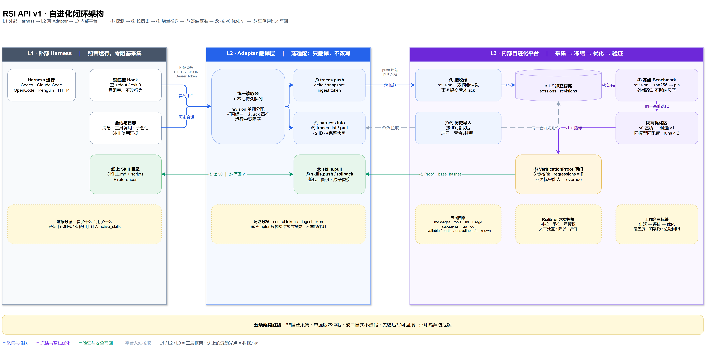
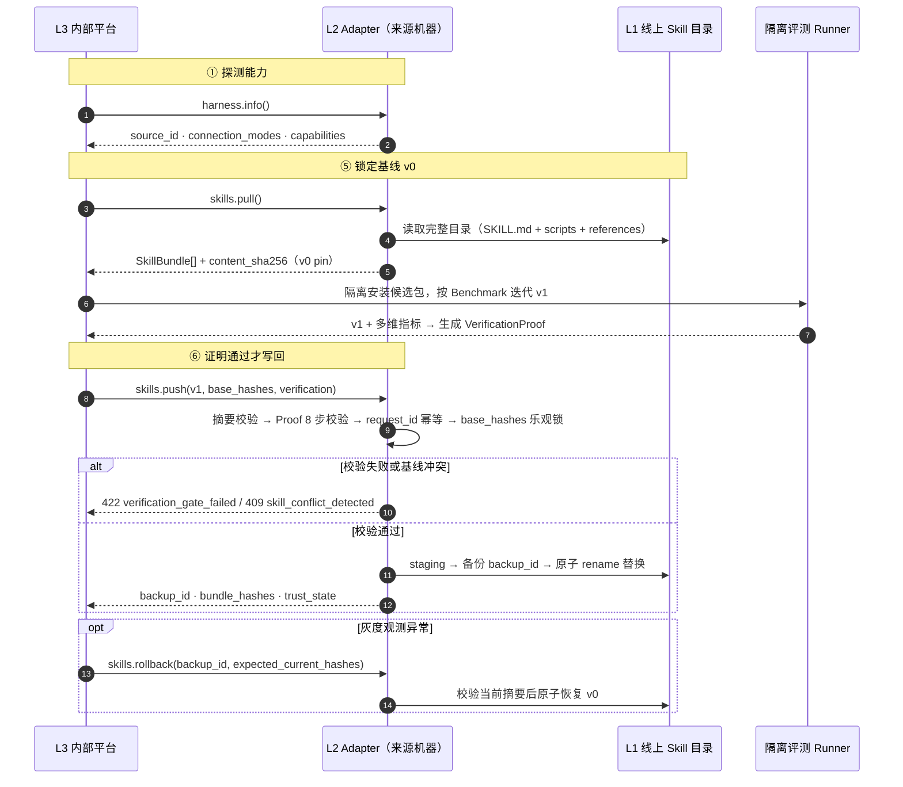
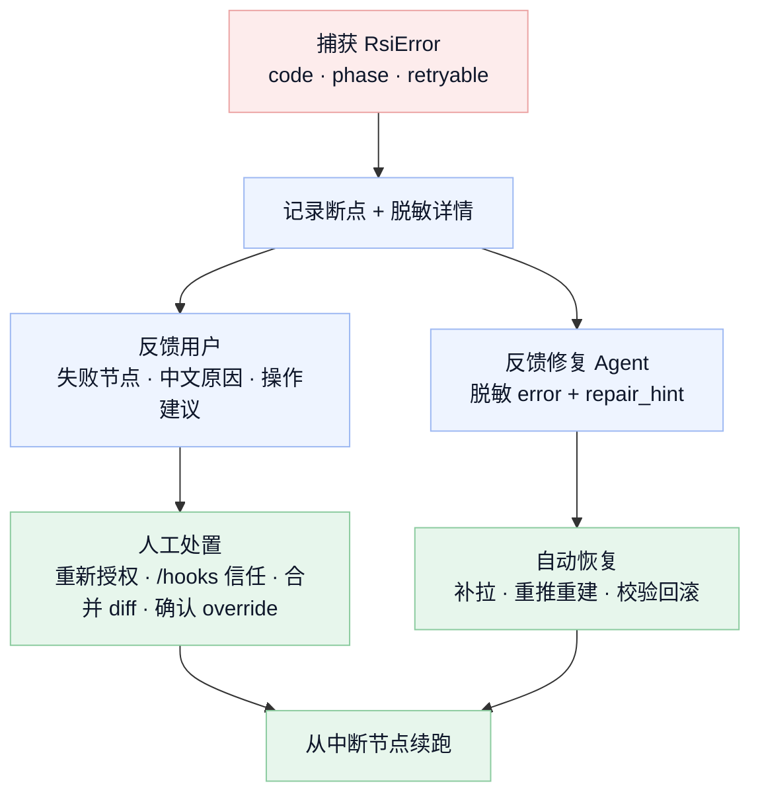

# RSI API 架构设计与统一协议规范

> **核心结论**：让 AI 修改自己的 Skill 并不难，难的是**证明改完之后确实更好、且没在其他场景退化**。RSI API（Recursive Self-Improvement API）将「日志沉淀 → 基准构建 → **离线优化** → 量化验证 → 安全回写」定义为跨 Agent Harness 的统一协议：通过**双路径版本化快照采集（`traces.pull` + `traces.push`）、五域四态显式缺口模型、薄 Adapter 翻译、以及 `VerificationProof` 强制准入闸门**，确保只有经同一 Benchmark 客观证明候选版本 `v1` 优于基线 `v0` 后，才允许备份并原子写回外部系统。
>
> **协议版本**：`v1`（`/api/rsi/v1`） · **日期**：2026-11-27

## 目录

- [执行摘要（SCQA）](#执行摘要scqa)
- [一、自进化全流程设计：从「黑盒盲改」到「可验证进化」](#一自进化全流程设计从黑盒盲改到可验证进化)
- [二、RSI API 统一协议规范（v1）](#二rsi-api-统一协议规范v1)
- [三、自进化工作台迭代计划：三步完成进化，效果可见、异常可修](#三自进化工作台迭代计划三步完成进化效果可见异常可修)
- [四、落地路线、首轮验证与范围边界](#四落地路线首轮验证与范围边界)

---

## 执行摘要（SCQA）

- **背景（Situation）**：现代 Agent 的表现高度依赖 Harness 层配置（Skill、Hook、工具与指令）。让模型直接修改 Skill 在技术上已无门槛。
- **冲突（Complication）**：直接让 Agent 自改存在两个工程痛点——**（1）改完好不好缺客观尺子**：单看个别样例容易过拟合，可能修好一个问题却在高频场景引入回归；**（2）外部信息天然不完整**：日志可能被截断、部分域无权限或不支持重读历史，若把「没看到」当成「没有」，优化和评测结论都会失真。
- **核心问题（Question）**：如何设计一套统一的跨 Harness 协议与工作台架构，让不同外部 Agent 都能低成本接入同一套**可验证、可回滚、且能诚实表达信息缺口**的自进化体系？
- **整体方案（Answer）**：围绕四根支柱构建 RSI API v1：
  1. **物理隔离的四阶段闭环**：先沉淀真实交互并冻结 Benchmark，再拉取基线 `v0` 在隔离区迭代出 `v1`，通过量化门禁后再灰度写回线上。
  2. **统一协议与版本化快照模型**：确立 11 个 `<domain>.<action>` 方法、以 `(source_id, session_id)` + 单调 `revision` + 双摘要统一采集，并用 `VerificationProof` 作为写回强制凭证。
  3. **跨 Harness 信息分级与诚实表达**：通过「白/灰/黑盒分级 + 五域四态可见性 + `SyncState`/`DeliveryStatus` 拆分 + Skill 三层证据」把数据边界变成一等公民。
  4. **三步式工作台与双端异常恢复**：把复杂链路收敛为可观测的三步操作，基于 `RsiError` 打通用户与修复 Agent 的断点续跑闭环。

---

## 一、自进化全流程设计：从「黑盒盲改」到「可验证进化」

**本节结论**：系统按「外部 Harness → Adapter 翻译层 → 内部自进化平台」三层解耦；全流程通过双路径采集把真实会话沉淀为独立 `rsi_*` 表空间（`rsi_sources` / `rsi_sessions` / `rsi_revisions`，与宿主聊天表物理隔离）与冻结 Benchmark，拉取线上基线 `v0` 后在隔离区迭代出候选 `v1`，签发 `VerificationProof` 后方可经由 `skills.push` 备份替换外部 Skill。

### 1.1 整体架构全景（三层职责与 6 步闭环）

整套架构按 **「左：外部运行（不受阻塞） → 中：Adapter 标准边界 → 右：内部离线加工与验证」** 划分，顺时针 **① → ⑥** 构成完整闭环：



> 可编辑版：用 draw.io 打开 [`rsi-api-architecture.drawio`](./rsi-api-architecture.drawio)，连线带流动动画。

- **双路径采集如何统一**：`traces.pull`（平台按 ID 纯读历史）与 `traces.push`（Adapter 运行中主动推送）共用同一套读取器、内部标准轨迹格式（AMSP，即平台统一事件信封格式，其中单条 `AmspRecord` `{timestamp, type, payload, origin?}` 按行追加且无全局事件主键）与 `revision` 分配规则；平台调用 `traces.pull` 取回完整快照后，在进程内直接走与 `traces.push` 共用的合并入库逻辑（不重复发起 HTTP push），保留来源 `revision`，避免两套历史互相覆盖。
- **单条 Trace 与 Benchmark 的边界**：单条 Trace 只用于解释任务上下文、Skill 加载/调用证据与单次观测结果；**优化效果提升必须靠同一 Benchmark 上的 `v0`/`v1` 对照证明**。

### 1.2 四阶段闭环职责与视角映射

| 闭环阶段 | 协议步骤（①–⑥） | 解决的核心工程问题 | 关键产出 | 对应工作台位置 |
|---|---|---|---|---|
| **1. 本地数据沉淀** | ① `harness.info` 探测能力<br>② `traces.list` + `traces.pull` 读历史<br>③ `hooks.*` + `traces.push` 增量推送 | 无侵入沉淀真实交互；运行时零阻塞、断网本地缓冲不丢数据；显式记录可见性与缺口 | 归一化会话表空间 `rsi_*` + `visibility`/`gaps` | 平台前置（接入与采集） |
| **2. 生成量化基准集** | ④ 清洗、聚类样本生成 Benchmark，并按 `(source_id, session_id, revision, content_sha256)` 冻结并 **pin**（锁定该历史快照不被清理，直至引用它的 Benchmark 删除） | 解决「拿什么评判 Skill 好不好」；外部清理或继续对话不影响已冻结评测尺子 | Benchmark 包 + 冻结快照 pin | 工作台「出题」+「评估」 |
| **3. Skill 离线优化** | ⑤ `skills.pull` 完整拉取目录包锁定基线 `v0`，在隔离环境基于 Benchmark 迭代 `v1` | 物理隔离实验区与生产区，防止边改边测污染外部线上环境 | 候选包 `v1` + 多维实验指标 | 工作台「优化」 |
| **4. 灰度上线校验** | ⑥ 同配置对比 `v0`/`v1` 生成 `VerificationProof`；`skills.push` 校验基线与凭证后备份写入；异常调 `skills.rollback` | 落地硬性准入闸门：证明更好再上线、外部并发修改自动拦截、异常一键原子回滚 | `VerificationProof` + `backup_id` | 工作台「优化」（上线收尾） |

---

## 二、RSI API 统一协议规范（v1）

**本节结论**：协议围绕 **「版本化快照、显式缺口、验证驱动写回」** 三条主线设计，由 11 个标准方法、6 个核心数据模型与跨 Harness 信息分级模型组成。

### 2.1 协议设计取舍与五条架构红线

#### 关键设计取舍（为什么这样设计）

| 关键设计选择 | 核心理由 | 边界与代价控制 |
|---|---|---|
| **版本化 `SessionSnapshot` 而非裸记录流** | 单条 `AmspRecord` 仅含时间戳、类型与载荷，按行追加、无全局事件主键，逐条去重不可靠；快照 + 单调 `revision` 可复现且能仲裁网络乱序 | 长会话重算摘要控制在单会话 `≤ 50,000 条 / 64 MB`、单次 push `≤ 16 MB` 内 |
| **非对称双路径（`pull` + `push`）** | 补历史只能平台按 ID 拉取，运行中增量只能来源感知后推送；共享 reader 避免双份数据 | Adapter 持久化 `revision` 与本地缓冲队列；仅出站部署自然降级为 push-only |
| **Adapter 单一写者分配 `revision`** | 来源机器最清楚会话真实演进顺序；RSI 仅按 `revision` 仲裁，摆脱跨机时钟偏差 | 同一 `(source_id, session_id)` 仅允许一个 Adapter 实例写入；`source_id` 跨重启固定 |
| **整包 `SkillBundle` + 强制 `VerificationProof`** | Skill 是多文件目录资产，补丁易残留旧文件；整包替换 + 基线乐观锁 + Proof 门禁最安全 | v1 每次 push 限 1 个包、仅支持集合级 `merge`（只增改本次提交的 Skill，不动宿主机其他 Skill；单个 Skill 目录内部仍是整包原子替换）；Adapter 只校验结构与摘要，不重跑评测 |

#### 五条架构红线（任何实现与演进都不得打破）

| 架构红线 | 核心规范要求 | 防范的工程风险 |
|---|---|---|
| **1. 非阻塞采集** | 观察型 Hook 必须空 `stdout`、`exit 0`，严禁阻塞外部 Harness 主流程或改变 Agent 行为。 | 防止观测工具拖慢或弄挂宿主正常对话。 |
| **2. 单源版本仲裁** | 一个外部会话对应一条 `(source_id, session_id)` 轨迹；双路径（`pull` 经内部导入与 `push`）共用同一读取器与合并规则；由来源侧单实例跨重启单调分配 `revision`，接收端事务提交后才确认 ack，旧版永不覆盖新版。 | 防止拉推两套历史打架、网络乱序覆写新快照、或断网丢 ack 造成重复与丢失。 |
| **3. 缺口显式不造假** | 五域状态严格区分 `available` / `partial` / `unavailable` / `unknown`；**`unknown` 严禁派生为 `0` 或 `[]`**；Hook 必须显式区分四态（不得用布尔值掩盖 `pending_trust`）。 | 防止把「没读到/没权限/未信任」误当成「确实没有/已生效」，污染 Benchmark 与归因。 |
| **4. 先验后写可回滚** | `skills.push` 必须携带 `VerificationProof`（`approved` 或 `override_by_user`）与 `base_hashes`；人工放行只绕过评分指标，不绕过摘要与冲突校验，写前必须备份。 | 防止未经验证的改动直接上线，或静默覆盖他人并发修改的线上 Skill。 |
| **5. 评测隔离防泄题** | Benchmark 私有评分细则严禁经由 `RsiError`、`repair_hint` 或 `details` 回流给优化或修复 Agent。 | 防止优化 Agent 通过报错信息「偷看答案」导致刷分过拟合。 |

### 2.2 信息不完全与离线设计：白/灰/黑盒、五域可见性与离线保证

外部系统能开放的信息天然参差不齐，协议通过**接入分级、五域四态、交付拆分、Skill 证据分层、离线五档保证**把信息边界精确表达出来。

#### （1）白盒 / 灰盒 / 黑盒接入分级与 API 表现

| 接入层级 | 可读资产 | 可写资产 | 协议可用性特征（实际能力以 `connection_modes × capabilities` 为准） | 工作台与评测边界 |
|---|---|---|---|---|
| **白盒** `white_box` | 完整会话、工具调用、Skill 证据、子会话、原始日志 | Skill、Hook、回滚 | 全方法可用（含可选 `eval.run`）；关键域通常为 `available` | 展示完整会话树、工具链与 Skill 证据徽标；支持自动化闭环 |
| **灰盒** `gray_box` | 部分会话/工具/Skill 证据，子会话可能不全 | 部分 Skill 或需人工确认 | `harness.info` + `traces.*` 必备；`hooks.*` / `skills.*` 按能力位开放 | 按缺口展示；`partial` 标覆盖度；写回仍强制要求 `VerificationProof` |
| **黑盒** `black_box` | 仅有输入/输出或外部执行结果 | 通常不可写 | 仅 `harness.info` + `traces.*`（或外部跑分直接录入 scoreboard）；Hook/Skill 写回返回 `501` | 隐藏 Hook 与写回按钮；仅做输入/输出评分，**严禁声称 Skill 归因** |

#### （2）三大正交状态模型（避免把「没同步」或「已安装」混为一谈）

| 模型维度 | 划分方式 | 核心规则与工程意义 |
|---|---|---|
| **五域四态可见性**<br>（`visibility` + `gaps`） | **五域**：`messages`、`tool_calls`、`skill_usage`、`subagents`、`raw_log`<br>**四态**：`available` / `partial` / `unavailable` / `unknown` | • `available`：已确认持有全部可读内容，**只有此时 `[]` 才代表「确实没有」**。<br>• `partial`：仅读到一部分，**必须附带至少一个内容 `Gap`**（记录 `{returned, total_known?}` 或丢失区间 `{lost_from, lost_to}`）。<br>• `unavailable`/`unknown`：确定不提供/无权限，或 Adapter 无法判断；**必须省略对应业务字段并附 `Gap`**（缺整个 `visibility` 报 `400`，仅缺某域键按 `unknown` 处理）。 |
| **交付状态拆分**<br>（`SyncState` vs `DeliveryStatus`） | • `SyncState`（仅 RSI 端填写）：`synced` / `pending` / `stale`<br>• `DeliveryStatus`（仅 Adapter 填写）：`source_revision`、`pending_count`、`buffer_bytes` | `visibility` 描述**数据本身全不全**，`SyncState`/`DeliveryStatus` 描述**数据送到没送到**——前者回答内容边界，后者回答传输进度，二者正交互不覆盖。交付延迟记为 `sync.state="pending"/"stale"`，**绝不降级 `available` 或伪造内容 `Gap`**。`local_buffer` 建议上限 2 GB / 14 天，满额后停采并记 `not_captured` gap，禁止静默丢弃旧数据。 |
| **Skill 三层证据**<br>（`skill_evidence`） | **1. 已安装**（资产扫描）<br>**2. 已加载**：确定性声明/观察（`source_metadata` 来源元数据、`prompt_roster` 系统提示词技能清单、`use_skills_marker` 用户消息 `[use_skills]` 标记、`tool_read` 工具读 `SKILL.md`）与启发式推测（`shell_read` 从 shell 命令推测读取）<br>**3. 有使用证据**：确定性调用（`explicit_invocation` 显式调用） | **「装了什么」≠「这次用了什么」**。仅层 2/3 可进入 `active_skills`，且要求 `set(active_skills) == set(skill_evidence.name)`。单独依赖 `shell_read` 等启发式证据时 `skill_usage` 最多标 `partial`（此时若无证据必须省略 `active_skills`，严禁写 `[]`）。 |

#### （3）离线五档保证矩阵

| 数据状态 | 持久化与一致性保证 | 恢复方式 | 协议表达 |
|---|---|---|---|
| **1. RSI 已入库** | 事务提交后返回 ack；`(source_id, session_id, revision)` 唯一 | 无需恢复；ack 丢失重发按 `(revision, content_sha256, metadata_sha256)` 幂等去重 | `accepted: "stored" \| "duplicate"`；`sync.state = "synced"` |
| **2. 外围已采集未送达** | 本地持久队列重启不丢；采集零阻塞；未 ack 始终保留 | 重连后从 `last_acked_revision` 起 at-least-once 重推，或由平台按 ID `pull` | `hooks.status.delivery`；`sync.state = "pending"`；全空时 `409 not_synced_yet` |
| **3. 来源从未开放** | 永久记录缺口，严禁自动重试伪装成功 | 标 `unsupported`/`policy`/`denied` 并停止自动重试 | `visibility = "unavailable"` + `Gap`；省略对应字段 |
| **4. 一次性事件** | 仅已落盘部分可重发；未落盘区间诚实丢失 | `source_replay=false` 强制 `local_buffer` 模式；恢复后上报丢失区间 | `gaps: [{domain, reason: "not_captured", detail: {lost_from, lost_to}}]` |
| **5. 旧快照晚到** | 新旧完全由 `revision` 仲裁，不受网络顺序与机器时钟影响 | 响应返回最新 `stored_revision`，发送方重读后推进新版本 | `accepted: "stale_ignored"`（`strict: true` 返回 `409 snapshot_stale`） |

> 若来源侧清理了本地历史，补拉返回 `404 session_not_found`，但 RSI 平台保留已入库的快照并标注「截至 `revision N`」。

### 2.3 标准方法名与 HTTP 路由总表

协议包含 **9 个核心方法 + 2 个可选扩展**；除 `traces.push` 由 **RSI 接收端**暴露外，其余 10 个方法均由 **Adapter** 提供：

| 类别 | 标准方法 | 提供方 | HTTP 路由（`/api/rsi/v1`） | 幂等性 | 凭据要求 | 核心职责 |
|---|---|---|---|---|---|---|
| **能力发现** | `harness.info` | Adapter | `GET /info` | 幂等 | control 读 | 返回来源类型、`source_id`、连接方向、`access_level`、能力位与默认可见性 |
| **Hook 管理** | `hooks.install` | Adapter | `POST /hooks` | 按 `hook_id` | control + `hooks:manage` | 备份后增量挂载运行中观察型 Hook（仅需实时推送时调用） |
| | `hooks.status` | Adapter | `GET /hooks/status` | 幂等 | control + `hooks:read` | 返回 Hook 四态、信任状态、`DeliveryStatus` 与 `action_required` |
| | `hooks.uninstall` | Adapter | `DELETE /hooks/:hook_id` | 幂等 | control + `hooks:manage` | 按 `hook_id` 精准摘除；默认保留未送达缓冲 |
| **轨迹同步** | `traces.list` | Adapter | `POST /traces/list` | 幂等 | control 读 | 按来源活跃时间与页码发现会话摘要（默认含子会话，无公开 cursor） |
| | `traces.pull` | Adapter | `POST /traces/pull` | 幂等 | control 读 | 按 `{session_id}` 纯读完整 `SessionSnapshot`（不直接写库；平台导入历史时取回快照后在进程内走与 `traces.push` 共用的合并入库逻辑） |
| | `traces.push` | **RSI 接收端** | `POST /traces/push` | 按 `revision` + 双摘要 | ingest token（绑定 `source_id`） | 推送 `delta` 或完整 `snapshot`，数据库事务提交后返回 ack |
| **Skill 管理** | `skills.pull` | Adapter | `POST /skills/pull` | 幂等 | control 读 | 拉取完整目录包 `SkillBundle[]` 锁定基线 `v0` |
| | `skills.push` | Adapter | `POST /skills/push` | 按 `request_id` | control + `skills:write` | 校验 `VerificationProof` 与 `base_hashes` 后备份并原子替换目录 |
| **可选扩展** | `skills.rollback` | Adapter | `POST /skills/rollback` | 按 `backup_id` | control + `skills:write` | 校验当前目录摘要后按 `backup_id` 原子恢复旧版 |
| | `eval.run` | Adapter | `POST /eval/run` | 非幂等 | control + `eval:run` | 隔离真机运行单个用例，返回 `session_id` 与指标（trace 走 `traces.pull`） |

> **通用格式与鉴权约定**：方法名采用 `<domain>.<action>`、字段与错误码统一 `snake_case`、时间统一 UTC ISO 8601、v1 内仅做向后兼容增量。通信仅使用 `Bearer Token + JSON`（无 Cookie / 通配 CORS）；缺少 scope 返回 `403 permission_denied`，调用未声明能力返回 `501 unsupported_capability`，协议版本非 `"v1"` 返回 `400 protocol_version_unsupported`。目标态按 `ingest token` 与 `control token` 分权隔离；工作台查询「已入库会话」直读 RSI 内部存储，不走 `traces.list`。*（平台实现备注：当前代码为 admin token + Agent key，分权签发与轮换在阶段 1 落地。）*

### 2.4 核心数据模型与契约定义

#### 1. 能力发现：`HarnessInfo`（`harness.info` 响应）

| 字段名 | 类型 | 必填 | 规范说明 |
|---|---|---|---|
| `protocol_version` | `"v1"` | 是 | 必须与路由 `/api/rsi/v1` 一致 |
| `source_id` | `string` | 是 | Adapter 实例稳定标识（机器 + Harness home + profile），跨重启不变，严禁使用 `cwd` |
| `harness_type` | `"codex" \| "claude_code" \| "opencode" \| "penguin" \| "custom"` | 是 | 闭合来源枚举 |
| `harness_version` | `string` | 否 | 外部 Harness 自身版本（与 Adapter 版本分离） |
| `connection_modes` | `Array<"push" \| "pull">` | 是 | 支持的连接方向；仅出站部署为 `["push"]` |
| `access_level` | `"white_box" \| "gray_box" \| "black_box"` | 是 | 接入层级摘要；实际可调方法由 `connection_modes × capabilities` 决定 |
| `capabilities` | `object` | 是 | 逐项能力：`traces.{list,pull,push,source_replay（能否按历史重读）}`、`skills.{pull,push,rollback,needs_manual_approval（写后是否需外部人工确认）,scopes,writable}`、`hooks.{install,events}`、`eval.run` |
| `default_visibility` | `object` | 是 | 五域默认可见性基线；单次快照只可比默认值更弱，不可更强 |

> 连接在平台侧直接绑定 Project（及可选 Workspace/Agent），协议不设 `supported_scopes`。仅出站模式下，首次 push 需携带 `connection` 能力摘要。

#### 2. Hook 管理：`hooks.install` / `hooks.status` / `hooks.uninstall`

| 接口 | 关键字段 | 规范说明 |
|---|---|---|
| `hooks.install` | 请求：`hook_id?`、`agent_id?`、`events`、`delivery`、`dry_run?`<br>响应：`HookStatus` + 备份路径 + `delivery_limits` | `events` 支持 `session_start`/`user_prompt`/`pre_tool_use`/`post_tool_use`/`stop`/`interrupt`/`pre_compact`/`post_compact`/`session_end`/`subagent_*`。`delivery.mode` 取 `native_log` 或 `local_buffer`（来源不支持重读历史即 `source_replay=false` 时禁用 `native_log`）。修改前必须备份原配置，按 `hook_id` 增量追加。 |
| `hooks.status` | 响应：`hook_id`、`status`、`trust_status`、`current_hash`、`trusted_hash?`、`is_managed`、`installed_paths`、`config_backup_paths`、`delivery`、`action_required?` | `status` 为 RSI 协议层运行态（`not_installed \| pending_trust \| active \| broken`）；`trust_status` 为 Adapter 如实上报的外部来源原生信任态（`managed` 平台/系统托管免确认、`trusted` 用户已放行、`untrusted` 未确认、`modified` 定义已变更、`unknown` 未知）。当来源处于 `untrusted`/`modified` 或定义 hash 变化时，协议态 `status` 进入或自动退回 `pending_trust`，二者不可互相替代。省略 `hook_id` 返回 `{hooks: HookStatus[]}`。 |
| `hooks.uninstall` | 请求：`hook_id`（路径）+ `purge_buffer?`（默认 `false`）<br>响应：`{hook_id, uninstalled, restored_paths}` | 精准摘除目标 Hook；清理未送达缓冲需显式 `purge_buffer: true` 与二次确认。 |

#### 3. 轨迹发现、拉取与推送合并：`traces.list` / `traces.pull` / `traces.push`

| 方法 | 核心请求参数 | 核心响应与使用规则 |
|---|---|---|
| `traces.list` | `{from?, to?, workspace?, page=1, page_size=50(1..200), include_subagents=true, source_kinds?, status?}` | 固定按 `(source_updated_at DESC, source_id ASC, session_id ASC)` 排序并按页码翻页（无公开 cursor），返回 `TraceListItem[]`。 |
| `traces.pull` | `{session_id, include_raw_path?}` | 纯读接口（不带分页/时间参数），返回完整 `SessionSnapshot`。平台导入已有会话走接收端内部导入路径复用入库规则。 |
| `traces.push` | `{mode: "delta" \| "snapshot", base_revision?, strict?, snapshot, added_records?, delivery?, connection?}` | 返回 `{accepted: "stored" \| "duplicate" \| "stale_ignored", stored_revision, content_sha256}`。仅已存记录是严格前缀且 turn 可稳定映射时用 `delta`；**turn 变化、revert、compact 或可见性改变一律发更高 `revision` 的完整 `snapshot`**。 |

**`SessionSnapshot` 核心字段表**（`SnapshotHeader` 即去掉 `records` 的头部结构）：

| 字段名 | 类型 | 必填 | 规范说明 |
|---|---|---|---|
| `session_id` / `source_id` | `string` / `string` | 是 | 来源原生 opaque ID + Adapter 稳定标识；平台主键为 `(source_id, session_id)` |
| `harness_type` / `normalization` | 枚举 / `"native" \| "normalized" \| "unknown"` | 是 / 否 | 外部来源默认 `"normalized"`；`native` 仅用于 Penguin 原生会话（全量必填），`normalized` 用于外部系统转换后的会话（未知省略并记 gap，严禁补 `""`） |
| `parent_session_id` / `child_sessions` | `string \| null` / `ChildRef[]` | 否 | `ChildRef` 仅列直接子会话引用（含 `readable` 与 `reason`），子会话内容不内联，平台按需递归拉取（默认深度上限 8）。Benchmark 默认以单会话为取样单位；若父子同时入选，统计 token 须去重并显式声明 |
| `started_at` / `updated_at` / `ended_at` | UTC ISO 8601 | 是 / 是 / 否 | `ended_at` 仅在来源可明确证明会话结束时填写 |
| `status` | `"running" \| "idle" \| "completed" \| "interrupted" \| "unknown"` | 是 | 会话级状态（不设 `"failed"`，未闭合请求不判失败） |
| `revision` | `integer >= 1` | 是 | Adapter 单调持久化版本号。`snapshot` 模式允许 `revision` 跳号（接收端忽略 `base_revision`）；仅 `delta` 模式强制校验 `base_revision == stored_revision`，不等时才报 `409 revision_gap` |
| `content_sha256` / `metadata_sha256` | `string` | 是 | `content_sha256` 覆盖五域过滤后的有效 `records`；`metadata_sha256` 覆盖固定元数据（身份、时间边界、状态、父子关系与 `visibility`/`gaps`，不含时钟与派生统计）；两者与 `revision` 组成幂等键 |
| `records` | `AmspRecord[]` | `snapshot` 必填 | 按分片索引 + 行序拼接，严禁按时间戳重排；未完成流式片段与内部索引字段不入快照 |
| `contexts` / `tasks` / `summary` | 派生数组 / 对象 | 否 | 模型切换或上下文压缩分段索引（`contexts`）、任务分段与汇总统计；对应依赖域不可见时必须省略该统计子项 |
| `active_skills` / `skill_evidence` | `string[]` / `SkillEvidence[]` | 否 | Skill 证据链及其去重名称投影（见 2.2 节） |
| `visibility` / `gaps` | 五域对象 / `Gap[]` | 是 / 否 | 缺整个 `visibility` 返回 `400`；缺某域键按 `unknown`；`gaps` 不得写入脱敏原文 |
| `sync` / `integrity` / `raw_path` | 对象 / 对象 / `string[]` | 否 | `sync` 仅由接收端填写；`integrity` 记录读取完整性计数（如损坏跳过行 `dropped_lines`、如进程异常退出导致的半行截断尾部 `torn_tail`）；`raw_path` 仅在 `raw_log` 可见且请求开启时返回，平台永不直接打开 |

> **接收端存储与合并规则**：
> - **独立表空间与内部导入**：落库于独立 `rsi_sources` / `rsi_sessions` / `rsi_revisions` 表（与宿主聊天表物理隔离）；`traces.pull` 内部导入复用下列合并规则，保留来源 `revision`。
> - **Pin 与保留策略**：最新 `revision` 长期保留；非 pin 历史 `revision` 默认保留 30 天（可配置），定时清理自动跳过已 pin 版本，pin 持续到对应引用对象（如 Benchmark）删除（提供内部历史 revision 只读端点）；显式清理命中已 pin 版本返回 `409 revision_pinned`。
> - **合并仲裁三分支**：
>   - `revision < stored`：默认返回 `stale_ignored`（`strict: true` 返回 `409 snapshot_stale`）；
>   - `revision == stored`：双摘要（`content_sha256` 与 `metadata_sha256`）全同则返回 `duplicate`，任一不同则返回 `409 revision_conflict`；
>   - `revision > stored`：`snapshot` 直接整包替换（**可见性升降级必走此路径**）；`delta` 须先满足 `base_revision == stored_revision`（否则 `409 revision_gap`）且拼接后重算摘要一致（否则 `409 revision_conflict`）才原子提交。

#### 4. Skill 传输包：`SkillBundle`（`skills.pull` / `skills.push` / `skills.rollback`）

**`SkillBundle` 核心字段**：

| 字段名 | 类型 | 必填 | 规范说明 |
|---|---|---|---|
| `name` / `kind` | `string` / `"skill"` | 是 | 目录名与唯一身份（`^[A-Za-z0-9_-]+$`）；v1 仅支持 `"skill"`（`InstructionBundle` 留后续版本） |
| `description` / `version` | `string` | 否 | 人类可读描述与自报版本（不作为内容身份） |
| `content_sha256` | `string` | 是 | 按 `rel_path`（统一 `/` 分隔符与 Unicode 字符规范化 NFC）UTF-8 排序计算的整包摘要，接收端必须重算校验 |
| `files` | `Array<{rel_path, encoding: "utf8" \| "base64", content}>` | 是 | 完整普通文件清单（必含根 `SKILL.md`，拒绝对路径/`..`/符号链接，按字节原样落盘 `0644`）；单包解码 `≤ 14 MB`、`≤ 200` 文件、JSON `≤ 20 MB` |

**`skills.*` 方法契约**：

| 方法 | 核心请求字段 | 核心响应与规范说明 |
|---|---|---|
| `skills.pull` | `{agent_id?, names?}` | 返回 `{pulled_at, skills: SkillBundle[]}`，强制返回完整目录包锁定 `v0`。可读作用域由 Adapter 声明（如 Codex 读 `user`/`repo`），`system`/`admin`/`plugin` 只读。 |
| `skills.push` | `{agent_id?, mode="merge", skills: [SkillBundle], base_hashes, request_id, verification, rollout_stage, backup_before_write=true, dry_run?}` | 返回 `{backup_id?, applied, skipped, conflicts, diffs, bundle_hashes, trust_state, already_applied?}`。v1 每次限推 1 个包、仅支持 `backup_before_write=true` 与集合级 `mode="merge"`（只新增或更新本次推送的 1 个 Skill，不动宿主机其他 Skill；单个 Skill 目录内部仍是整包原子替换，新增填 `"absent"`，不支持删除/改名）。`trust_state`（`active`/`pending_trust`/`rejected`）表示新会话真实生效态。 |
| `skills.rollback` | `{backup_id, names?, expected_current_hashes}` | 返回 `{backup_id, restored, restored_at, already_restored?}`。校验 `expected_current_hashes` 防覆盖后续改动；已等于备份则幂等返回 `already_restored: true`；新建 Skill 的回滚为删除该目录。 |

> **`skills.push` 五步写回保护链**：① 包格式与摘要自洽校验 → ② `VerificationProof` 放行校验 → ③ `request_id` 幂等重放 → ④ `base_hashes` 乐观锁匹配 → ⑤ 加锁、staging 备份原目录并原子 `rename` 替换。

#### 5. 验证证明块：`VerificationProof`（强契约 + 薄 Adapter 校验）

Adapter 不重跑评测，但必须按如下 **8 步确定性校验**核对结构、重算 `proof_sha256`（RFC 8785 / JCS 键排序规范化 JSON 摘要）、两侧 `evaluation_id`、`candidate_hashes` 以及自动放行条件：

| 字段名 | 类型 | 必填 | 规范说明 |
|---|---|---|---|
| `proof_version` / `proof_sha256` | `"1"` / `string` | 是 | 结构版本与整块完整性摘要（去掉 `proof_sha256` 自身后计算） |
| `target` | `{agent_id, source_id, harness_type}` | 是 | 必须与当前连接完全匹配 |
| `benchmark_id` / `benchmark_content_sha256` / `benchmark_status` | `string` / `string` / `"published"` | 是 | 只接受已发布 Benchmark；`baseline` 与 `candidate` 必须对齐同一尺子摘要 |
| `comparison_basis` / `runtime` | `"same_model_same_runs"` / `{provider, model_id, thinking}` | 是 | 锁定同模型同配置可比口径 |
| `eval_environment` / `evaluator` | `"target_harness" \| "platform_mirror"` / `{kind, version, isolation}` | 是 | 首轮锁定 `"target_harness"`（真机隔离环境） |
| `baseline` / `candidate` | `ProofSide` | 是 | 各含 `evaluation_id`（评测结果哈希指纹，防篡改）、`time`、`agent_state_version`（被测环境状态版本）、`benchmark_content_sha256`、`bundle_sha256`、`metrics`、`runs_per_case`（统一且对称的 `>= 2` 整数）、`data_coverage`（五域四态计数） |
| `delta` / `pareto_improved` / `regressions` | 差值 / `boolean` / `RegressionEntry[]` | 是 | `pareto_improved` 仅在所有非 `null` 可比维度不退化且至少一维严格更好时为 `true`；`regressions` 为逐题回归列表 |
| `gate_policy` / `gate_decision` / `override` | `"score_strict" \| "pareto"` / `"approved" \| "override_by_user"` / `object \| null` | 是 / 是 / 条件 | **自动放行（`approved`）强制条件**：`regressions == []`、两侧 `excluded_sessions == 0`、`messages`/`tool_calls` 全量 `available`、尺子与 `runs_per_case` 对称且 `gate_policy` 达标。人工放行需填 `override`（含审批人、时间、原因与已确认回归）。 |
| `candidate_hashes` | `Record<string, string>` | 是 | 必须与请求 `skills[].name` 及重算摘要一一对应 |

**Adapter 8 步确定性校验清单**（任一不符返回 `422 verification_gate_failed`）：
1. **版本兼容**：校验 `proof_version` 与结构受支持；
2. **整块防篡改**：去掉 `proof_sha256` 后按 RFC 8785 规范化重算并核对 `proof_sha256`；
3. **尺子锁定**：`benchmark_status == "published"`，且两侧 `benchmark_content_sha256` 与顶层一致；
4. **门禁达标**：`score_strict` 要求 `delta.score > 0`、`pareto` 要求 `pareto_improved == true`，且两者均要求 `regressions == []`；若走人工放行则 `override` 字段齐全；
5. **覆盖与对称**：数据覆盖度自动放行条件（`excluded_sessions == 0`、`messages`/`tool_calls` 全量 `available`）与对称的 `runs_per_case >= 2` 达标；
6. **目标匹配**：`target` 与当前连接的 `agent_id`/`source_id`/`harness_type` 完全一致；
7. **资产对齐**：`candidate_hashes` 与请求 `skills[]` 名称及重算摘要一一匹配，每个 `name` 均在 `base_hashes` 中且与两侧 `bundle_sha256` 配对；
8. **结果自洽**：重算并核对基线与候选两侧的 `evaluation_id` 哈希指纹。

**`VerificationProof` 结构示意**（精简展示核心放行字段，省略了 `runtime`、`evaluator`、`evaluation_id`、`time`、`agent_state_version`、`data_coverage` 等必填字段）：

```json
{
  "proof_version": "1",
  "target": { "agent_id": "default_agent", "source_id": "codex-dev-laptop", "harness_type": "codex" },
  "benchmark_id": "code-review-basic",
  "benchmark_content_sha256": "69b2080f...",
  "benchmark_status": "published",
  "comparison_basis": "same_model_same_runs",
  "eval_environment": "target_harness",
  "baseline":  { "bundle_sha256": "dc13b8f4...", "runs_per_case": 2, "metrics": { "score": 62.5, "cost_usd": 0.012 } },
  "candidate": { "bundle_sha256": "9bc35cd5...", "runs_per_case": 2, "metrics": { "score": 81.0, "cost_usd": 0.010 } },
  "delta": { "score": 18.5, "cost_usd": -0.002 },
  "gate_policy": "score_strict",
  "pareto_improved": true,
  "regressions": [],
  "gate_decision": "approved",
  "override": null,
  "candidate_hashes": { "review-helper": "9bc35cd5..." },
  "proof_sha256": "85a28ed4..."
}
```

#### 6. 统一错误信封与闭合错误码：`RsiError`

所有错误统一返回 `{error: {code, message, phase, retryable, repair_hint, details}}`（`details` 严禁含私有评分细则）：

| 阶段（`phase`） | 错误码（`code`） | HTTP | `retryable` | 触发条件与默认恢复类别 |
|---|---|---|---|---|
| 通用 | `invalid_request` / `protocol_version_unsupported` | `400` | `false` | 缺字段、路径非法、delta 缺摘要或协议非 `v1` |
| 通用 | `unauthorized` / `permission_denied` | `401` / `403` | `false` | 无效 Bearer Token 或缺少对应操作 scope（**重新授权**） |
| 通用 | `unsupported_capability` | `501` | `false` | 调用未声明能力（含 `eval.run`），写入前拒绝（**接受降级**） |
| 通用 | `payload_too_large` / `skill_too_large` | `413` | `false` | 超出单会话（50k 条 / 64 MB）、push（16 MB）或 Skill（14 MB / 200 文件）上限 |
| 通用 / 资源 | `session_not_found` / `revision_not_found` / `hook_not_found` / `backup_not_found` | `404` | `false` | 不存在、未授权（默认不泄露存在性；仅显式配置返回 `403 session_unreadable`）或备份过期 |
| `hook` | `hook_trust_pending` / `hook_write_denied` / `hook_config_corrupted` | `409`/`403`/`500` | `true`/`false`/`true` | 待外部信任确认（**人工处置**）/ 企业策略禁止 / 配置语法损坏 |
| `pull_traces` | `source_unavailable` / `normalization_failed` / `not_synced_yet` | `503`/`422`/`409` | `true` | 来源不可读或被占用 / 格式变更映射失败 / 尚未送达（**补拉**） |
| `push_traces` | `revision_gap` / `revision_conflict` / `snapshot_stale` / `revision_pinned` | `409` | `true`/`false` | `delta` 模式下 `base_revision != stored_revision` / 同版本异内容（**重推/重建**或**人工合并**）/ `strict` 拒收旧版 / 显式清理（purge）历史版本命中已 pin 版本 |
| `push` / `skills` | `verification_gate_failed` / `skill_invalid_format` / `unsupported_data` | `422` | `false` | 缺合法 Proof 或门禁未放行（**人工处置**）/ Skill 格式或摘要非法 |
| `push` | `skill_conflict_detected` / `request_id_conflict` / `target_write_denied` | `409`/`409`/`403` | `true`/`false`/`false` | 外部基线并发修改（**人工合并**）/ 同 `request_id` 异 payload / 目标目录只读 |
| `rollback` | `rollback_failed` | `500` | `true` | 恢复备份发生 I/O 异常（**人工处置**或**接受降级**） |

#### 可选扩展接口：`eval.run`（真机隔离复核）

当 `capabilities.eval.run = true` 时，可在推送前触发：`{case_id, prompt, workspace_files?, candidate_skills?, timeout_s?}` → `{status: "completed" | "failed" | "timeout", session_id, duration_ms, cost_usd?}`。该接口不直接回传 trace，平台按返回 `session_id` 通过 `traces.pull` 读取完整快照。

### 2.5 多系统 Adapter 中间件与跨 Harness 适配

#### （1）多系统 Hook 与读取适配总表

| 外部 Harness | Hook 流派与事件 | 会话读取路径 | 核心适配约束 |
|---|---|---|---|
| **Codex CLI** 0.172.0 | Command 进程派（`hooks.json`；支持会话/turn/工具/压缩/子会话事件） | 优先通过 Codex 内置服务端读取接口（`App Server`）拉取完整 turn 列表与会话；本地 transcript 回退 | 新/改 Hook 进 `pending_trust`（需 `/hooks` 确认）；观察型 Hook 空 stdout/`exit 0`；线程未加载或中断不判失败 |
| **Claude Code** | Command 进程派（`settings.json`；`Stop` / `SessionEnd` / `PostToolUse`） | 读取来源 transcript 与会话存储 | 严禁返回 `exit 2`（在 Claude Code 中表示阻断工具/对话执行）；遇企业 `allowManagedHooksOnly` 返回 `403 hook_write_denied` |
| **OpenCode** | 进程内 JS/TS Plugin 派 | 进程内事件流写入本地持久缓冲 | 无子进程开销，与 Command 派共用读取格式与缓冲规范 |
| **通用 HTTP Adapter** | 可选（由能力位声明） | 标准 `/api/rsi/v1` 实现 | 必须保证稳定 `source_id`、五域可见性与幂等语义 |
| **Penguin（原生）** | 原生 AMSP | 直读原生 AMSP 记录 | `normalization: "native"`、`harness_type: "penguin"`，不伪造 `pending_trust` |

#### （2）连接方向与部署拓扑

默认部署为「RSI 运行在本机/容器（仅发布 `127.0.0.1:7364`），Adapter 运行于外部 Harness 来源机器」；跨机必须走 TLS 反代或 SSH 隧道，严禁把接收端裸露公网：

- **双向可达（`push` + `pull`）**：日常增量走 `traces.push`，补拉历史、拉取/写回 Skill 与 `eval.run` 走平台入站调用（同机 `localhost` / `host.docker.internal` / 隧道）。
- **仅出站（collection-only，`["push"]`）**：可穿透 NAT 持续上报会话（首次 push 带 `connection` 摘要），但所有平台主动方法不可用，工作台隐藏自动拉取与自动写回按钮（仅支持人工导入导出）。

#### （3）Skill 跨系统传输与安全回写流转

下图聚焦 **Skill 跨系统回写链路**（对应闭环 `① → ⑤ → ⑥`；前置 `②–④` 的轨迹采集与 Benchmark 冻结见第 1 节）：



---

## 三、自进化工作台迭代计划：三步完成进化，效果可见、异常可修

**本节结论**：工作台（`@penguinharness/rsi-workbench`）把「接入与采集」放在平台前置，自身以「**出题 / 评估 / 优化**」三标签承接闭环，严格按五域覆盖度呈现证据并打通双端异常恢复。

### 3.1 递进式三步交互与工作台映射

**流程映射关系**：闭环 `阶段 1` → **平台前置（第一步）**；`阶段 2` → **「出题 + 评估」标签（第二步）**；`阶段 3–4` → **「优化」标签（第三步）**。

| 用户旅程步骤 | 工作台位置 | 用户核心操作 | 背后协议与平台动作 | 界面必须显式展示的要素 |
|---|---|---|---|---|
| **第一步：接入与沉淀数据** | **平台前置**（不占标签） | 选择来源与连接形态，按时间段导入历史会话；仅需实时同步时安装 Hook | `harness.info` → `traces.list` / `traces.pull` + 内部导入；可选 `hooks.install` / `status` 与 `traces.push` | `access_level`、五域可见性、`sync.state` 与 `gaps`（不把未同步当没有）、Hook 四态与 `pending_count` |
| **第二步：生成量化基准集** | **「出题」+「评估」** 标签 | 筛选轨迹生成或导入 Benchmark，运行基线取得 `v0` 分数 | 按 `(source_id, session_id, revision, content_sha256)` 冻结并 pin；平台侧落盘于 `<agentDir>/app/data/benchmark/` | 冻结 `revision` 与摘要、参与会话五域可见性、被排除会话原因、各域数据覆盖度 |
| **第三步：离线优化与校验上线** | **「优化」** 标签 | 选择优化算法运行迭代，审阅榜单、帕累托图与逐题 Diff 后推送或回滚 | `skills.pull` → 隔离迭代 `v1` → 生成 `VerificationProof` → `skills.push`（异常时 `skills.rollback`） | 候选包 hash、`base_hashes` 冲突态、proof 覆盖度、`gate_policy`、逐题回归、`backup_id` 与 `trust_state` |

### 3.2 结果可视化与证据约束

1. **可见性与原因徽标**：按五域展示徽标——`partial` 显示缺口数、`unknown` 显示「未检查」、`unavailable` 按 `reason` 精确区分「无权限 / 策略禁止 / 来源未提供」。
2. **缺口与队列分离**：内容缺口面板按 `domain + reason` 分组标注 `recovery`（可补拉 / 需重授权 / 永久缺失）；发送积压统一在 `sync` 面板展示。
3. **不可比警告与禁连趋势线**：当两侧关键域覆盖不一致或非全 `available` 时显式警告不可直接对比；不同覆盖度的数据点严禁连成同一条趋势线。
4. **多维榜单、帕累托与逐题回归**：同时展示综合榜单、得分 vs 成本/耗时帕累托图（`null` 维度标不可比较）与逐题回归列表；黑盒来源严禁展示 Skill 归因。

### 3.3 全流程双向异常反馈与恢复闭环

所有 `RsiError` 按 `phase`、`retryable` 与 `repair_hint` 收敛为 **六类确定性恢复动作**：**补拉**（`source_unavailable` / `not_synced_yet`）、**重推/重建**（`revision_gap`）、**重新授权**（`unauthorized` / `permission_denied`）、**人工处置**（`hook_trust_pending` / `verification_gate_failed` / `revision_pinned`）、**接受降级**（`unsupported_capability` / `hook_write_denied` / `target_write_denied`）及 **人工合并**（`revision_conflict` / `skill_conflict_detected` / `request_id_conflict`）。



---

## 四、落地路线、首轮验证与范围边界

**本节结论**：按「规范定稿 → 接收端与底座 → Codex Adapter 与真机闭环 → 工作台集成」四阶段推进，首轮在开源 Codex CLI `0.172.0` 上完成单任务端到端对比验证。

### 4.1 分阶段落地路线

| 阶段 | 核心交付内容 | 退出与验收标准 |
|---|---|---|
| **阶段 0 · 协议评审定稿（当前）** | 评审冻结本协议设计；补齐哈希测试向量与各待决事项责任人 | 协议字段、状态模型与首轮实验契约确认冻结 |
| **阶段 1 · 接收端与底座** | 落地 `rsi_*` 独立表空间、`traces.push` 合并与内部导入、pin 保留策略、连接级 Token Scope 签发与轮换（ingest 与 control 分权） | 通过双摘要幂等、乱序仲裁与 pin 防误删一致性测试 |
| **阶段 2 · Adapter 与真机闭环** | 完成 Codex CLI 适配（App Server 读取 + 归一化 golden 测试 + 实时触发/Hook 信任），并跑通协议 6 大场景与真机对比闭环 | Codex CLI `0.172.0` 全链路跑通并留存完整审计工件 |
| **阶段 3 · 工作台集成** | 集成 `@penguinharness/rsi-workbench`、三标签视觉规范与六类异常恢复交互 | 端到端 UI 联调与可视性降级展示验收 |

### 4.2 首轮 Codex CLI 0.172.0 闭环验证方案

- **实验契约**：在隔离工作区修复预置失败的 TypeScript 测试；目标 Skill 为合成 `review-helper`（`v1` 补充「先复现失败、只改任务文件、报告测试结果、不改无关代码」）。Benchmark 含 **6–8 个 case（`3 个开发集 + 3 个盲测集 + 2 个反例防误改用例`）**，`v0` 与 `v1` 在临时 `CODEX_HOME` 中采用完全相同的 `provider` / `model_id` / `thinking` 与对称 `runs_per_case >= 2` 评测，启动优化前冻结盲测集与通过阈值，全程留存输入、runner 日志、`rsi_*` 行、`scoreboard.yaml`（计分板结果文件）、`VerificationProof` 与 `backup_id`。
- **六大必测验证场景**：

| 验证场景 | 必测核心断言 |
|---|---|
| **1. 按 ID 发现与拉取** | `harness.info`、`traces.list` 分页、`traces.pull(session_id)`；核对 `revision`、双摘要、五域可见性与 `records` 顺序 |
| **2. 运行中增量与信任** | App Server 通知流（自启会话）与 command Hook + `/hooks` 信任（外部 CLI 会话）双路径；`pending_trust → active` 流转；重复安装 Hook 幂等 |
| **3. 幂等、乱序与恢复** | 同版重发 `duplicate`、异内容 `409 revision_conflict`、旧版 `stale_ignored`、断档 `409 revision_gap`、丢 ack 不重入库、pin 旧版可读 |
| **4. 部分可见与父子会话** | 验证五域四态与 `gaps`、`unknown` 不写 `0`、不可读子会话保留 `ChildRef`、父子同选时 token 去重 |
| **5. Skill 往返与回滚** | `skills.pull` 锁 `v0`、`skills.push` 校 Proof 与基线冲突、幂等重试、`skills.rollback` 原子恢复与 `trust_state` 核对 |
| **6. 端到端对照与门禁** | 同一 Benchmark 上 `v0`/`v1` 同配置跑分，scoreboard/覆盖度/Proof 三者一致；存在任何逐题回归仅允许 `override_by_user` |

### 4.3 v1 范围边界与待决事项

- **明确非目标（留待后续版本）**：token 级流式采集、单请求多 session 批量推送、全局 Skill 作用域、`InstructionBundle`（如 `AGENTS.md` 等指令文件）、Skill `replace`/prune（删除宿主机未提及的旧 Skill）与改名、`eval.run` 直接回传 trace、流量切分 canary（v1 中的灰度为审计观察窗口而非流量切分）、push-only 反向命令通道、通过协议接口直接回传黑盒评分、跨 Project 生产级数据治理细则。
- **待跟进事项**：补全完整测试用例与哈希标准测试向量、明确非 pin 历史 `revision` 清理策略与黑盒录入/push-only 回退细则的责任人，并在工作台包合入前核实导出路径。
